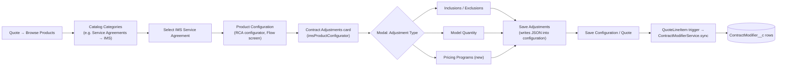
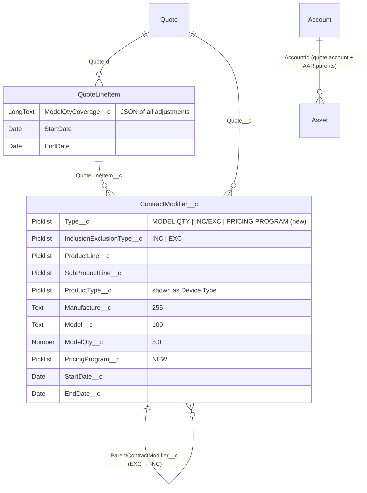
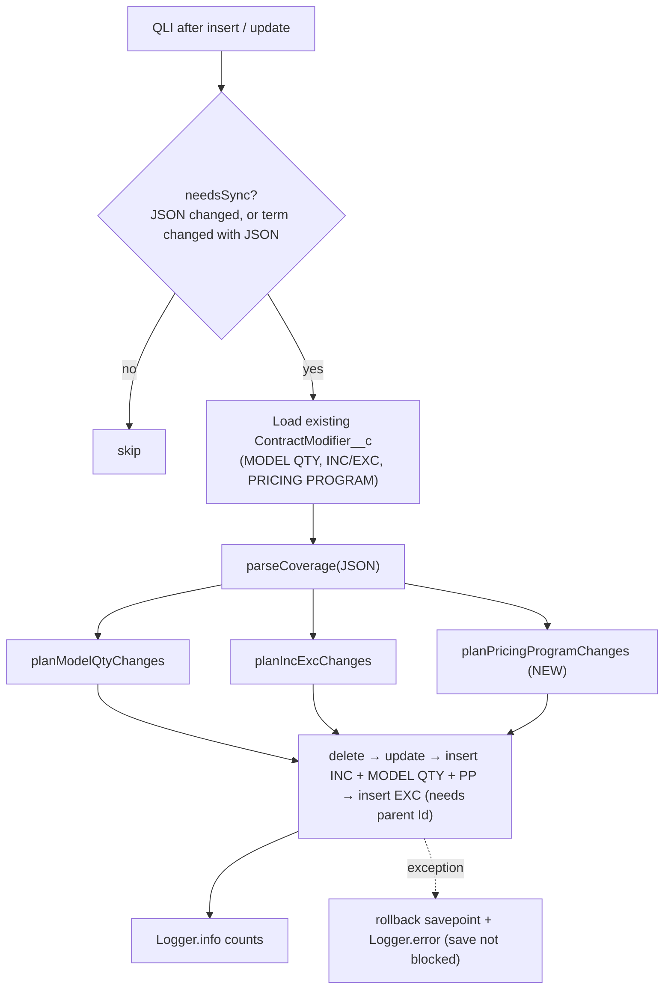
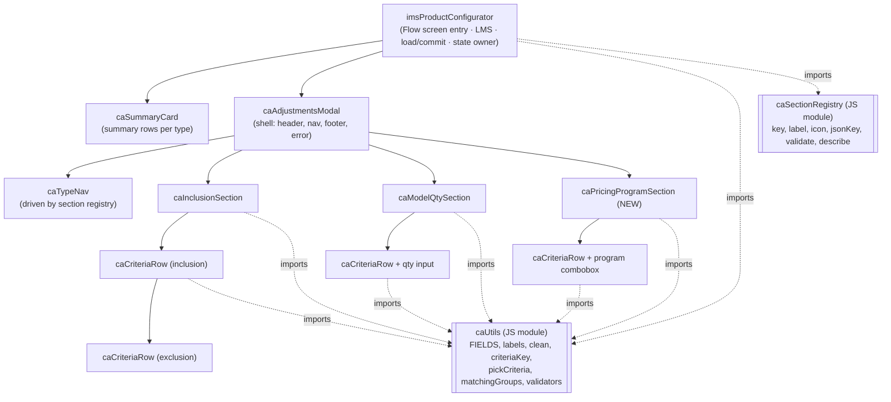

# Contract Adjustments: Pricing Programs Design & LWC Structure

> **Feature path (RCA Product Configurator):** Browse Products → Categories → Product Configuration → **Contract Adjustments**
> **Tickets in code:** GW-4777 / GW-5676 (Inclusions / Exclusions and Model Qty, already built). **New:** Pricing Programs.
> **Status:** design proposal, written 2026-11-02 from the current code in `force-app/main/default`.

---

## 1. Summary

The **Contract Adjustments** card sits inside the Revenue Cloud (RCA) product configurator for the **IMS Service Agreement** product. Today it supports two adjustment types:

| # | Adjustment type | What it does | Stored as |
|---|---|---|---|
| 1 | **Inclusions / Exclusions** | Defines which equipment the agreement covers (Include rules, each with optional Exclude rules) | `ContractModifier__c`, Type `INC/EXC`, record type `Inclusion_Exclusion`. Exclusions point to their inclusion through `ParentContractModifier__c` |
| 2 | **Model Quantity** | Sets the maximum number of covered devices for an equipment group | `ContractModifier__c`, Type `MODEL QTY`, record type `Model_Qty`, field `ModelQty__c` |
| 3 | **Pricing Programs** *(new)* | Applies a pricing program to an equipment group on the line | `ContractModifier__c`, Type `PRICING PROGRAM`, record type `Pricing_Program`, new field `PricingProgram__c` *(proposed)* |

**Groundwork already in the code for Pricing Programs:**
- `ContractModifierService.ContractAdjustments` already has a `String pricingProgram` property. It is read and written in the JSON but nothing is done with it.
- The LWC carries `pricingProgram` through `fromJson` / `workingValue` / `toValue`.
- The LWC meta description says *"Pricing Programs to follow"*.
- An older prototype (`lwc/modelQtyConfigurator` + `classes/ModelRepairContractController`) had a **single-select "Pricing Program" tile** that wrote `QuoteLineItem.PricingProgram__c`. Its save call is commented out.

**Recommendation:** add Pricing Programs as a **third section in the same modal**. Its rows use the same 5 equipment criteria (Product Line, Sub Product Line, Device Type, Manufacturer, Model) plus a **Program** picklist, and are saved as `ContractModifier__c` records the same way as Model Qty. At the same time, **split the 757-line LWC into small child components** so each adjustment type has its own section component.

---

## 2. User journey



> The catalog and category setup (Product Catalog, Product Category, Product Classification, Context Definition) is configuration in the org and is not in this repo. Only the configurator Flow-screen component and its Apex are in source control.

---

## 3. Current architecture (as built)

### 3.1 Files

| Layer | File | Role |
|---|---|---|
| LWC (Flow screen) | `lwc/imsProductConfigurator/` (JS 757, HTML 277, CSS 396 lines) | Summary card + modal with both sections; publishes JSON to the configurator |
| LWC (duplicate) | `lwc/modelQtyCoverage/` | Same JS and HTML as above, but calls `ModelQtyCoverageController` |
| LWC (old prototype) | `lwc/modelQtyConfigurator/` | 3-tile modal (Model Qty / Inc-Exc / Pricing Program); save call commented out |
| Apex controller | `classes/ImsProductConfiguratorController.cls` | Read-only `@AuraEnabled` methods: `getCoverage`, `getSubProductLines`, `getManufacturers`, `getAssetCatalog` |
| Apex controller (duplicate) | `classes/ModelQtyCoverageController.cls` | Same methods |
| Apex controller (old) | `classes/ModelRepairContractController.cls` | Prototype using `QuoteLineItem.IncludeExclude__c` / `PricingProgram__c` |
| Service | `classes/ContractModifierService.cls` (727 lines) | JSON model, parse, **sync to ContractModifier__c**, asset catalogue, picklist validation |
| Selector | `classes/ContractModifierSelector.cls` | Type and record-type constants; `selectAdjustmentsByQuoteLineItemIds` |
| Trigger | `QuoteLineItemTriggerHandler` (after insert and after update) | Calls `ContractModifierService.syncAdjustmentsFromQuoteLines` |
| Tests | `ContractModifierServiceTest`, `ImsProductConfiguratorControllerTest`, `ImsProductConfiguratorTestDataFactory`, `ModelQtyCoverage*Test*`, `ServiceBomLayerCoverageTest` | — |

### 3.2 Runtime sequence

```mermaid
sequenceDiagram
    actor U as User
    participant CFG as RCA Configurator
    participant LWC as imsProductConfigurator
    participant C as ImsProductConfiguratorController
    participant S as ContractModifierService
    participant DB as Database

    CFG->>LWC: @api transactionId (Quote), rootTransactionLineId, currentTransactionLineId
    LWC->>C: getAttributeIds(['ModelQtyCoverage__c'])  (EsServiceProductConfigController)
    LWC->>C: getAssetCatalog(quoteId)  (wire)
    C->>S: assets of quote account + AAR parents, grouped by 5 fields
    LWC->>C: getCoverage(lineId)  (saved lines "0QL…" only)
    C->>S: QLI.ModelQtyCoverage__c JSON, or rebuilt from ContractModifier__c
    U->>LWC: Manage → edit sections → Save Adjustments
    LWC->>LWC: validate()
    LWC-->>CFG: LMS publish valueChanged {ContextFields, attributeId, ModelQtyCoverage__c, JSON}
    U->>CFG: Save configuration
    CFG->>DB: upsert QuoteLineItem (ModelQtyCoverage__c)
    DB->>S: QuoteLineItemTrigger → syncAdjustmentsFromQuoteLines
    S->>DB: delete / update / insert ContractModifier__c (savepoint; errors logged, save not blocked)
```

### 3.3 JSON contract (`QuoteLineItem.ModelQtyCoverage__c`): current

```json
{
  "inclusions": [
    { "productLine": "Flexible Endoscopy", "subProductLine": null, "productType": null,
      "manufacturer": "Olympus", "model": null,
      "exclusions": [ { "productLine": null, "subProductLine": null, "productType": null,
                        "manufacturer": null, "model": "GIF-H190" } ] }
  ],
  "models": [
    { "productLine": "Flexible Endoscopy", "subProductLine": null, "productType": null,
      "manufacturer": "Olympus", "model": "CF-HQ190L", "qty": 12 }
  ],
  "pricingProgram": null
}
```

A blank criteria field means **"Any"**. Each row needs at least one field set.

### 3.4 Data model



---

## 4. Pricing Programs: functional design

### 4.1 Behaviour

| Item | Rule |
|---|---|
| Section name | **Pricing Programs** (3rd item in the "Adjustment Type" nav, with a count badge) |
| Row | 5 equipment criteria (same cascading pickers as Model Qty, driven by the account's asset catalogue) + **Program** (required picklist) |
| Add / remove | "+ Add Pricing Program" button; a delete icon on each row (same pattern as Model Qty) |
| Validation | At least one criteria field **or** an explicit "All equipment" choice; Program required; no two rows with the same criteria |
| Matching assets | Show the matching asset count per row (reuse `matchingGroups`) |
| Summary card | 3rd summary row: `Pricing Programs · n` with a preview such as `Olympus / CF-HQ190L → Program X` |
| Term | Each record gets the line's `StartDate` / `EndDate`, like the other types |
| Save | Goes into the same JSON → same trigger sync → `ContractModifier__c` Type `PRICING PROGRAM` |

### 4.2 Open questions (please confirm before build)

1. **Program values:** where do they come from? A restricted picklist on `ContractModifier__c.PricingProgram__c`, custom metadata, or an Oracle price-list or program object?
2. **Scope:** one program per **line**, as the old prototype did, or per **equipment group**, as proposed here? The proposal supports both: a row with all criteria set to "Any" is the line-level program.
3. **Extra values:** does a program carry anything else, such as a discount %, a tier or an effective date override?
4. **Pricing impact:** should the RCA pricing procedure use the program? If so, a `RevSignaling` pre-hook (like `EsServiceOtCoveragePreHook`) would read the program and set a context field.
5. **Overlap with Inclusions:** must a pricing-program row fall inside an included equipment group, or can it be any group?

---

## 5. Technical design

### 5.1 Metadata changes (in the org, not in the repo yet)

| Metadata | Change |
|---|---|
| `ContractModifier__c.Type__c` | Add picklist value `PRICING PROGRAM` |
| `ContractModifier__c` record type | New `Pricing_Program` (with Type__c = PRICING PROGRAM allowed) |
| `ContractModifier__c.PricingProgram__c` | New picklist (restricted) *or* lookup, depending on open question 1 |
| Page layout / FLS | Layout for the new record type; FLS for the permission sets used by IMS sales users (the LWC reads picklists through UI API, which needs FLS) |
| Context Definition | No change: everything still goes through `ModelQtyCoverage__c` |

### 5.2 JSON contract v2 (backward compatible)

```json
{
  "inclusions": [ ... ],
  "models": [ ... ],
  "pricingPrograms": [
    { "productLine": "Flexible Endoscopy", "subProductLine": null, "productType": null,
      "manufacturer": "Olympus", "model": null, "program": "PROGRAM_A" }
  ],
  "pricingProgram": null
}
```

- **New array:** `pricingPrograms`.
- **Legacy field:** `pricingProgram` (string) is still **read**. If it is set and `pricingPrograms` is empty, it becomes one all-"Any" row, then is written back as `null`.
- **Older JSON:** stays readable, because missing arrays default to `[]` (same as `parseCoverage` does today).

### 5.3 Apex changes

**`ContractModifierSelector`**
```apex
public static final String TYPE_PRICING_PROGRAM = 'PRICING PROGRAM';
public static final Id PRICING_PROGRAM_RECORD_TYPE_ID = Schema.SObjectType.ContractModifier__c
    .getRecordTypeInfosByDeveloperName().get('Pricing_Program')?.getRecordTypeId();
// selectAdjustmentsByQuoteLineItemIds: add 'PricingProgram__c' to fields
// and TYPE_PRICING_PROGRAM to typeValues
```

**`ContractModifierService`**
```apex
public class PricingProgramEntry extends Criteria {
    public String program;
}
public class ContractAdjustments {
    public List<InclusionRule> inclusions = new List<InclusionRule>();
    public List<ModelQtyEntry> models = new List<ModelQtyEntry>();
    public List<PricingProgramEntry> pricingPrograms = new List<PricingProgramEntry>();
    public String pricingProgram; // legacy, read-only
}
```

| Method | Change |
|---|---|
| `parseCoverage` | Default `pricingPrograms` to `[]`; turn a legacy `pricingProgram` string into one row |
| `syncAdjustmentsFromQuoteLines` | Bucket existing records into **three** maps by `Type__c` (today it is a two-way ternary: INC/EXC vs everything else, so it must change or PRICING PROGRAM rows would be treated as Model Qty and deleted) |
| `planPricingProgramChanges` *(new)* | Same matching approach as `planModelQtyChanges`: match by criteria key, update when program or term changes, insert new rows, delete removed rows |
| `getContractAdjustments` | Rebuild `pricingPrograms` from records when the JSON is blank (add a branch: today the `else` branch treats any non-MODEL-QTY, non-EXC record as an inclusion) |
| `isValidProgram` *(new)* | Check against active `PricingProgram__c` picklist values (reuse `PICKLIST_FIELD_MAP` + `picklistValues`) |

> **Refactor option:** `planModelQtyChanges` and the new method differ only in the value field (`ModelQty__c` vs `PricingProgram__c`). Pull out a generic `planKeyedChanges(line, entries, existing, type, recordTypeId, IValueMapper)` so a 4th type later costs one small class.

**`ImsProductConfiguratorController`**
- No new method is needed if program values come from a picklist (the LWC uses `getPicklistValues`).
- Add `@AuraEnabled(cacheable=true) getPricingPrograms(Id quoteId)` only if the list depends on the account, Oracle or custom metadata.

### 5.4 Sync logic with the new type



---

## 6. LWC structure

### 6.1 Problem today
- `imsProductConfigurator` is **one 757-line component** holding the card, modal, nav, both sections, validation and LMS publishing. Adding a third section into the same file pushes it past 1,000 lines.
- `modelQtyCoverage` is a **byte-for-byte copy** apart from the controller name, so every change has to be made twice.
- `modelQtyConfigurator` is an abandoned prototype.

### 6.2 Target component tree



### 6.3 Folder layout

```
force-app/main/default/lwc/
├── imsProductConfigurator/          # EXISTING – becomes a thin container
│   ├── imsProductConfigurator.html  # <c-ca-summary-card> + <c-ca-adjustments-modal>
│   ├── imsProductConfigurator.js    # @api inputs, LMS subscribe/publish, wires, load/commit
│   ├── imsProductConfigurator.css
│   └── imsProductConfigurator.js-meta.xml   # unchanged Flow-screen properties
├── caUtils/                         # NEW – service module (no template)
│   ├── caUtils.js                   # FIELDS, FIELD_LABELS, clean, lower, criteriaKey,
│   │                                # pickCriteria, hasAnyValue, matchingGroups, optionsFor
│   └── caUtils.js-meta.xml          # isExposed=false
├── caSectionRegistry/               # NEW – one entry per adjustment type
│   ├── caSectionRegistry.js
│   └── caSectionRegistry.js-meta.xml
├── caSummaryCard/                   # NEW – the collapsed card on the configurator
├── caAdjustmentsModal/              # NEW – modal shell, nav, footer
├── caTypeNav/                       # NEW – left nav with count badges
├── caCriteriaRow/                   # NEW – 5 criteria cells (picklist / cascading / free text)
├── caInclusionSection/              # NEW – extracted from today's Inc/Exc block
├── caModelQtySection/               # NEW – extracted from today's Model Qty block
├── caPricingProgramSection/         # NEW – Pricing Programs
└── __tests__/                       # Jest for each component (jest.config.js already present)

# REMOVE after cut-over: lwc/modelQtyCoverage, lwc/modelQtyConfigurator,
#   classes/ModelQtyCoverageController(+Test, +TestDataFactory), classes/ModelRepairContractController
```

### 6.4 Section registry (adding a type = one entry + one component)

```javascript
// caSectionRegistry.js
export const SECTIONS = [
    { key: 'incExc',   jsonKey: 'inclusions',      label: 'Inclusions / Exclusions', icon: 'utility:filterList',
      count: (v) => v.inclusions.reduce((n, r) => n + 1 + r.exclusions.length, 0) },
    { key: 'modelQty', jsonKey: 'models',          label: 'Model Quantity',          icon: 'utility:number_input',
      count: (v) => v.models.length },
    { key: 'pricing',  jsonKey: 'pricingPrograms', label: 'Pricing Programs',        icon: 'utility:moneybag',
      count: (v) => v.pricingPrograms.length }
];
```

`caTypeNav`, `caSummaryCard` and the footer ("n adjustments across 3 types") all loop over `SECTIONS`, so none of them need a code change for a new type.

### 6.5 Component contracts

| Component | `@api` inputs | Events out | Notes |
|---|---|---|---|
| `imsProductConfigurator` | `transactionId`, `rootTransactionLineId`, `currentTransactionLineId`, `currentProductId` (unchanged) | LMS `valueChanged` | Owns `committed`, `sessionByLine`, `assetGroups`, picklist values, `attributeId` |
| `caSummaryCard` | `adjustments`, `loading`, `disabled`, `pendingSave` | `manage`, `opentype` `{section}` | Read-only view |
| `caAdjustmentsModal` | `adjustments` (initial), `activeSection`, `catalog` (assets + picklists + manufacturers) | `commit` `{value}`, `cancel` | Keeps a working copy; runs every section's `validate()` and shows the first error |
| `caTypeNav` | `sections`, `activeSection`, `counts` | `select` `{section}` | |
| `caInclusionSection` | `rules`, `catalog` | `change` `{rules}`, `needsmanufacturers` `{row}` | Expand/collapse exclusions |
| `caModelQtySection` | `rows`, `catalog` | `change` `{rows}` | Cascading pickers from `assetGroups`; qty 1–99,999 |
| `caPricingProgramSection` | `rows`, `catalog`, `programOptions` | `change` `{rows}` | Cascading pickers + Program combobox + matching-asset count |
| `caCriteriaRow` | `row`, `mode` (`picklist` / `cascading`), `catalog`, `labelPrefix` | `fieldchange` `{field, value}`, `remove` | Shared by all three sections |

**Data flow rule:** state lives in the parent. Children are controlled: they receive data through `@api` and send `CustomEvent` with the new value. Nothing writes to `@api` properties.

### 6.6 `caPricingProgramSection` sketch

```html
<template>
    <div class="ca-section-head">
        <div>
            <h3 class="ca-section-title">Pricing Programs</h3>
            <p class="ca-section-sub">Apply a pricing program to equipment on this agreement. Leave every field as Any for the whole line.</p>
        </div>
        <button class="slds-button slds-button_neutral" onclick={handleAdd}>+ Add Pricing Program</button>
    </div>
    <template for:each={viewRows} for:item="row">
        <div key={row.key} class="ca-pp-row">
            <c-ca-criteria-row row={row} mode="cascading" catalog={catalog}
                data-key={row.key} onfieldchange={handleFieldChange}></c-ca-criteria-row>
            <lightning-combobox variant="label-hidden" label={row.programLabel} required
                options={programOptions} value={row.program} data-key={row.key}
                onchange={handleProgramChange}></lightning-combobox>
            <span class="ca-match">{row.matchingCount} assets</span>
            <lightning-button-icon icon-name="utility:delete" alternative-text={row.deleteLabel}
                data-key={row.key} onclick={handleRemove}></lightning-button-icon>
        </div>
    </template>
</template>
```

```javascript
// caPricingProgramSection.js (outline)
import { LightningElement, api } from 'lwc';
import { FIELDS, newRow, matchingCount, cascadeReset } from 'c/caUtils';

export default class CaPricingProgramSection extends LightningElement {
    @api rows = [];
    @api catalog;            // { assetGroups, picklists }
    @api programOptions = [];

    get viewRows() { /* add labels + matchingCount(row, this.catalog.assetGroups) */ }
    emit(rows) { this.dispatchEvent(new CustomEvent('change', { detail: { rows } })); }
    handleAdd() { this.emit([...this.rows, { ...newRow('pp'), program: null }]); }
    handleFieldChange(e) { /* cascadeReset(row, field, value, catalog) → emit */ }
    handleProgramChange(e) { /* set program → emit */ }
    handleRemove(e) { this.emit(this.rows.filter((r) => r.key !== e.currentTarget.dataset.key)); }

    @api validate() {
        // returns null or { message } – program required, no duplicate criteria
    }
}
```

### 6.7 Validation rules (client and server)

| Type | Client (`validate`) | Server (`ContractModifierService`) |
|---|---|---|
| Inclusion | ≥1 field; no duplicate inclusion; no duplicate exclusion within a rule | `normalize` + `validInclusions` (skip and log) |
| Model Qty | ≥1 field; qty integer 1–99,999; no duplicate criteria | `normalize` + `isValidQty` + duplicate key check |
| **Pricing Program** | Program required and active; no duplicate criteria; all-Any allowed once (line level) | `normalize` (allow all-blank for PP only) + `isValidProgram` + duplicate key check |

---

## 7. Implementation plan

| # | Task | Area | Estimate |
|---|---|---|---|
| 1 | Confirm the open questions in §4.2 | BA / Product | — |
| 2 | Metadata: Type__c value, `Pricing_Program` record type, `PricingProgram__c` field, FLS, layout; retrieve into the repo (`objects/ContractModifier__c`) | Admin | 0.5 d |
| 3 | Selector constants and fields | Apex | 0.25 d |
| 4 | Service: `PricingProgramEntry`, parse (with legacy string), 3-way bucketing, `planPricingProgramChanges`, rebuild in `getContractAdjustments` | Apex | 1.5 d |
| 5 | Apex tests: insert, update program, update term, delete, legacy JSON, invalid program, duplicate, mixed types in one line, bulk of 200 lines | Apex | 1 d |
| 6 | LWC refactor: extract `caUtils`, `caSectionRegistry`, `caCriteriaRow`, the Inc/Exc and Model Qty sections, the modal and the card, **with no behaviour change** | LWC | 2 d |
| 7 | `caPricingProgramSection` + registry entry + summary preview | LWC | 1 d |
| 8 | Jest tests for each component (validation, cascade reset, events) | LWC | 1 d |
| 9 | Remove duplicates: `modelQtyCoverage`, `ModelQtyCoverageController*`, `modelQtyConfigurator`, `ModelRepairContractController` (check the configurator Flow screen references first) | Cleanup | 0.5 d |
| 10 | *(Optional)* RevSignaling pricing pre-hook that reads Pricing Programs | Apex | TBD |
| 11 | UAT in the configurator: new line (`ref_` Id), saved line (`0QL…`), child line navigation, term change | QA | 1 d |

**Order:** do the refactor (step 6) **before** adding the new section (step 7). That way the refactor can be regression-tested on its own against the current behaviour.

---

## 8. Test scenarios

| # | Scenario | Expected |
|---|---|---|
| 1 | Add 2 pricing-program rows on a new line, save the configuration | 2 `PRICING PROGRAM` records with the line's term, linked to the Quote and QLI |
| 2 | Change only the program on an existing row | 1 update, no delete or insert |
| 3 | Remove a row | Its record is deleted; the MODEL QTY and INC/EXC records are untouched |
| 4 | Change the line's Start/End Date | Term updated on all three types |
| 5 | Old JSON with `"pricingProgram":"X"` | Shown as one all-Any row; saved as a record |
| 6 | Program value deactivated in the picklist | Client keeps showing the current value (`withCurrent`); server skips the row and logs it |
| 7 | Duplicate criteria rows | Client blocks save with a message; server skips the duplicate |
| 8 | Sync throws an exception | Rolled back; the quote save still succeeds; error logged with tag `ContractAdjustments` |
| 9 | Navigate between parent and child lines in the configurator | Each line shows its own adjustments (`sessionByLine` / `savedByLine`) |
| 10 | 200 QLIs updated in one transaction | Within governor limits (one selector query, 4 DML statements) |

---

## 9. Risks & notes

- **Type bucketing bug risk:** today `syncAdjustmentsFromQuoteLines` and `getContractAdjustments` use two-way branching. Adding a new `Type__c` without updating **both** places will delete pricing-program rows or rebuild them as inclusions.
- **Sync never blocks the save:** a failed sync leaves the records out of step with the JSON, and only the log shows it. Consider adding a "sync status" field or a banner.
- **UI API FLS:** the LWC reads picklists through `getPicklistValues`. Users without FLS on `PricingProgram__c` get *"The requested resource does not exist"*.
- **Context attribute:** everything goes through the single context attribute `ModelQtyCoverage__c`, so no Context Definition change is needed. Its long-text length still limits JSON size: watch large inclusion lists.
- **Duplicates:** change `imsProductConfigurator` only. Remove the `modelQtyCoverage` copy, or the two will drift apart.
