# STERIS Healthcare (CBM Org): Field Service, Revenue Cloud & Multi-Cloud Architecture

> **What this document is:** a business and architecture analysis of why this org uses **Salesforce Field Service (FSL)**, how FSL is built here, and how it connects to **Revenue Cloud Advanced (RCA)**, Sales Cloud, Service Cloud, Experience Cloud and Oracle ERP.
>
> **Sources and confidence**
> | Mark | Meaning |
> |---|---|
> | **[Code]** | Read directly from Apex / LWC / triggers / VF in `force-app/main/default` (Jira keys such as `GW-6099` come from code comments) |
> | **[Inferred]** | Reasoned from code (object usage, flow names called from Apex, field names). Flows, objects, permission sets and FSL settings are **not in the repo** (`objects/`, `flows/` are empty or absent), so check these in the org |
> | **[Domain]** | General knowledge of STERIS's business and of Salesforce products, not read from this org |
>
> Companion docs: `OBJECT_RELATIONSHIPS_AND_BUSINESS_ANALYSIS.md` (full data model), `CONTRACT_ADJUSTMENTS_PRICING_PROGRAMS_DESIGN.md` and `ModelQtyCoverageCodeExplain.md` (RCA configurator detail).
>
> **Generated:** 2026-11-04 · Repo size at time of writing: ~1,086 Apex classes, 54 triggers, 178 LWCs, 13 Aura, 33 VF pages.

---

## Table of Contents
1. [The Business in One Page](#1-the-business-in-one-page)
2. [Why STERIS Uses Field Service](#2-why-steris-uses-field-service)
3. [Service Lines Supported in FSL](#3-service-lines-supported-in-fsl)
4. [Overall Multi-Cloud Architecture](#4-overall-multi-cloud-architecture)
5. [FSL Architecture in Detail](#5-fsl-architecture-in-detail)
6. [FSL Data Model](#6-fsl-data-model)
7. [Key FSL Processes (with diagrams)](#7-key-fsl-processes)
8. [Revenue Cloud Advanced (RCA) + FSL: The Combination](#8-revenue-cloud-advanced-rca--fsl)
9. [Pricing Architecture (Oracle + RCA)](#9-pricing-architecture-oracle--rca)
10. [Integration Architecture](#10-integration-architecture)
11. [Mobile / Offline Architecture](#11-mobile--offline-architecture)
12. [Code Inventory for FSL & RCA](#12-code-inventory-for-fsl--rca)
13. [Analysis: Strengths, Gaps, Risks](#13-analysis-strengths-gaps-risks)
14. [Recommendations & Roadmap](#14-recommendations--roadmap)
15. [Glossary](#15-glossary)

---

## 1. The Business in One Page

**[Domain]** STERIS is a global provider of infection-prevention and procedural products and services for hospitals and surgery centres: sterilizers, washer-disinfectors, surgical tables and lights, endoscopes and surgical instruments, plus consumables. A large part of its revenue is **recurring service**:

| Service business | What the customer buys | Where the work happens |
|---|---|---|
| **Equipment Service (ES)** | Preventive maintenance (PM), repair and calibration of installed capital equipment (sterilizers, washers, tables, lights) | At the hospital, by a field engineer |
| **Instrument Management Services (IMS)** | Repair, sharpening and refurbishment of surgical instruments and scopes | **On Location** in a mobile repair van parked at the hospital, or shipped to a **Repair Center** (depot) |
| **Repair Center (depot repair)** | Sending a device to a STERIS repair facility | STERIS repair centre, with return logistics |
| **Installation** | Installing new capital equipment sold through Sales Cloud | At the hospital, as a project |

**[Code]** The org name `CBM` and the code show this org covers the whole **Lead → Quote → Order → Install → Service → Renewal** loop for the Healthcare (`HC`) and Life Sciences (`SC`/`LS`) customer classes, with Oracle ERP as the system of record for orders, pricing and customers.

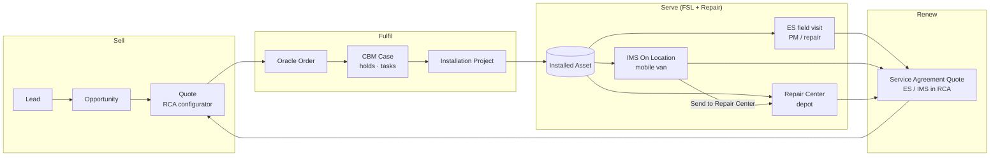

---

## 2. Why STERIS Uses Field Service

These are the business requirements the FSL build answers. Each one is traced to code.

| # | Business requirement | Why it matters to STERIS | How FSL + custom code meets it | Evidence |
|---|---|---|---|---|
| R1 | **Send the right technician to the right hospital** | Hospitals expect named/known engineers; equipment needs certified skills | Service Territories (district → zone), Service Territory Members, `AddressResourcePreference__c` (preferred tech per ship-to), Skills & Skill Requirements on Work Types | **[Code]** `DistrictZoneAlignmentService` (GW-2706), `TechAccountAlignmentService` (GW-2710), `ServiceAppointmentRealignmentService` (GW-6099) |
| R2 | **Keep the schedule clean when territories change** | Re-territorying is frequent; misaligned appointments cause no-shows and wrong billing | Realignment Analysis batch flags each future appointment: Territory Misalignment / Preferred Resource Misalignment, with action Auto-reassign or Manual Review | **[Code]** `ServiceAppointmentRealignmentBatch`, fields `RealignmentConflict__c`, `RealignmentConflictCategory__c`, `RealignmentConflictAction__c` |
| R3 | **Technician skills come from HR** | Certifications live in the HR system (Summit), not Salesforce | `SummitSkill__c` staging → Batch/Schedulable sync to WorkType, Skill, SkillRequirement, ServiceResourceSkill | **[Code]** `SummitSkillProcessor`, `SummitSkillsUtil` |
| R4 | **Bill accurately from the field** | Service revenue leaks when labour, parts and expenses are not captured, or are billed when covered by contract | Custom mobile debrief LWCs (ES, IMS) with Allowed Unit check, billing type, skill check, rate list, expenses, part exceptions | **[Code]** `woDebriefES`, `woDebriefIMS`, `WoDebriefAllowedUnitController`, `WoDebriefSkillCheckController`, `PartExceptionService` (GW-3329) |
| R5 | **Manage trunk stock (parts in the van/car)** | Engineers carry inventory; first-time-fix depends on having the part | ProductItem per technician Location, barcode scan in debrief, "Find Nearby Trunk Stock" map to borrow from a colleague | **[Code]** `WoDebriefProductItemController`, `findNearbyTrunkStock`, `mobileMap`, `ProductItemsService` |
| R6 | **Order replacement parts from Oracle** | Parts ordering and fulfilment happen in Oracle | ProductRequest → Boomi → Oracle Create Sales Order; or → Digital Parts Catalog | **[Code]** `ProductRequestsService` (GW-514), `ProductRequestsDpcService` (GW-580/GW-5262), flows `ProductRequest_SCR_SubmitToERP`, `ProductRequest_SCR_OpenDPC` |
| R7 | **Run On Location IMS with a mobile van** | IMS technicians work out of a repair truck; truck and tech must be scheduled together | Truck is a `ServiceResource`; the IMS debrief creates a truck ServiceAppointment linked to the tech's appointment with an FSL **Same Start** dependency | **[Code]** `WoDebriefIMSController.assignSelectedTruck`, `FSL__Dependency__c = 'Same Start'`, `ServiceAppointment.Truck__c`, `TruckAppointment__c` |
| R8 | **Route on-site failures to depot repair** | Some instruments cannot be fixed in the van | Child WO lines flagged `SendToRepairCenter__c` feed a site-visit Return Order; site-visit review is blocked until resolved | **[Code]** `WoDebriefIMSController` (GW-1353), Repair Center classes |
| R9 | **Customer-facing proof of service** | Hospitals need a signed service report (compliance, Joint Commission audits) and an end-of-day summary | Field Service Document Builder report LWC (offline), On Location End of Day Report email | **[Code]** `fsrFieldServiceReport` (GW-1900), `OnLocationEndOfDayReportAction` (GW-6191/GW-6257) |
| R10 | **Photos and evidence** | Damage evidence for warranty and quality (NCR) | Mobile photo capture via `MobileDevicePictureLink__e`, microscope capture on WOLIs | **[Code]** `MobileDevicePictureLinkTrigger`, `woliMicroscopeCaptureMobile`, `cameraCapture2` |
| R11 | **Protect contract and asset integrity** | An asset with open work or an active contract must not be retired | Asset inactivation blocked if open WOs or active `ContractLineItem`s exist | **[Code]** `AssetPendingInactivationTrigger`, `AssetPendingInactivationSelector` |
| R12 | **Sell service agreements on the installed base** | Service contracts are the recurring revenue engine; they are priced per asset, PFCL and PM visits | RCA product configurator for ES / IMS Service Agreements with asset picker, PM visits, contract adjustments (Inclusion/Exclusion, Model Qty, Pricing Programs) | **[Code]** `esServiceProductConfigLauncher`, `esServiceVisitsCard`, `EsServiceLineExpansion`, `ContractModifierService` (GW-4777/GW-5676) |
| R13 | **Dispatch help from the Gantt** | Large jobs need a second engineer | VF page on the Dispatcher Console Gantt runs `ServiceAppointment_SCR_DispatchAdditionalResource` | **[Code]** `pages/DisptachAdditionalResourceFromGantt.page` |
| R14 | **One price engine for every workstream** | Repair Center, Field Service and Service Sales used separate pricing calls | Common Oracle pricing framework + RCA headless pricing | **[Code]** `PricingFrameworkService` (GW-4585), `OraclePricingService`, `workOrderOraclePricingHeadless` |

**Summary of the "why":** STERIS uses FSL because its service business is **asset-centric, skill-constrained, territory-based, parts-heavy and contract-billed**. Standard Service Cloud (Cases) cannot schedule people, trucks and parts; FSL provides the scheduling engine, mobile app (offline), inventory model and Gantt. Revenue Cloud then turns the same installed base into priced service agreements, and the agreement terms (`ContractModifier__c`) feed back into what is billable in the field.

---

## 3. Service Lines Supported in FSL

| Service line | Work Order shape | Appointments | Debrief UI | Notes |
|---|---|---|---|---|
| **ES – Equipment Service** | WO per visit, WOLIs for Time / Parts / Expense | Technician SA | `woDebriefES` | Allowed Unit (contract coverage), skill check for Time lines, trunk stock scan, rate list, regional expenses, asset inspection, part exception Case. **[Code]** |
| **IMS – On Location (mobile van)** | **Site Visit WO** (parent) with **child WOs** per instrument/tray | Technician SA **+ Truck SA** (Same Start dependency) | `woDebriefIMS`, `woDebriefIMSchildWO`, `woDebriefImsChildReview` | End of Day Report on completion; send-to-repair-center lines create a Return Order. **[Code]** |
| **CRSS site visits** | Site visit with inspected asset tables | Technician SA | IMS debrief variant | GW-6257 introduced a CRSS template, GW-6191 later removed the report for CRSS. **[Code]** (meaning of "CRSS" not defined in code; confirm with business) |
| **Repair Center (depot)** | WO from Return Order Line, child/vendor WOs | Not FSL-scheduled (rack/technician assignment in Repair Center UI) | `repairCenterEvalWorkspace`, `qualityInspection`, … | Uses FSL objects (WorkOrder, WOLI, Location, ProductItem) without the scheduler. **[Code]** |
| **Installation** | Installation Project (custom) from CBM Case | **[Inferred]** WO/SA from the project | `installationProjectMgmt/Editor/Viewer` | Links sales order → installed Asset. |

---

## 4. Overall Multi-Cloud Architecture

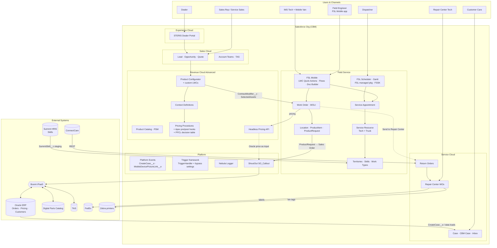

### 4.1 Which cloud owns what

| Cloud / product | Responsibility in this org | Key objects |
|---|---|---|
| **Sales Cloud** | Pipeline, forecast, quoting entry point, territory teams | Lead, Opportunity, Quote, AccountTeamMember |
| **Revenue Cloud Advanced (RCA)** | Product catalog, **configurator** for service agreements, **pricing procedures**, headless pricing for WOs | Product2, ProductSellingModel, AttributeDefinition, QuoteLineItem (+ context fields), `ContractModifier__c` |
| **Service Cloud** | Customer Care cases, CBM order cases, part-exception inbox, returns | Case, ReturnOrder, ReturnOrderLineItem |
| **Field Service** | Scheduling, dispatch, mobile execution, inventory, skills, territories | WorkOrder, WOLI, ServiceAppointment, ServiceResource, ServiceTerritory, WorkType, Skill, Location, ProductItem, ProductRequest |
| **Experience Cloud** | Dealer opportunity registration | Opportunity (dealer) |
| **Oracle ERP (via Boomi)** | System of record for orders, price lists, customers, parts fulfilment | — |

---

## 5. FSL Architecture in Detail

### 5.1 Layers

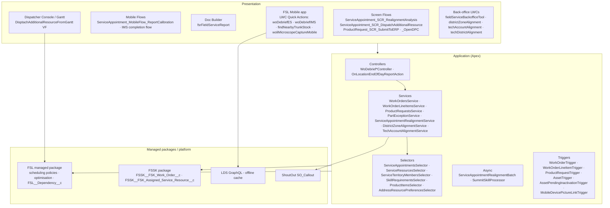

**Design patterns [Code]**
- fflib-style **Selector / Service / Domain** layering, `adb_*` test data builders.
- Kevin O'Hara **TriggerHandler** with `TriggerControl` and bypass via hierarchy setting `Automation_Setting_Trigger__c`.
- **Flows own orchestration**, Apex is called through `@InvocableMethod` (e.g. End of Day Report, Product Request submit, Realignment).
- **`without sharing` where FSL Mobile cannot write** — `WoDebriefIMSController` documents that the mobile offline store fails writes on Appointment Dependency / Service Appointment / Assigned Resource (`LightningDataService.SQLiteResult error 5`), so these go through Apex.

### 5.2 Territory & resource model

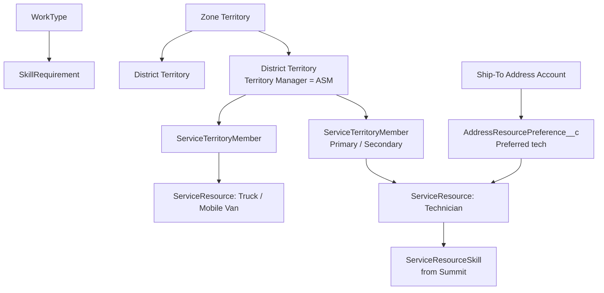

- **District → Zone** territories are created/updated from an uploaded file (`DistrictZoneAlignmentService`, GW-2706); errors are emailed back as a file.
- **Tech ↔ Account** preferences come from another file (`TechAccountAlignmentService`, GW-2710) into the custom `AddressResourcePreference__c` (preferred resource per ship-to account). **[Inferred]** It is custom rather than standard `ResourcePreference` because the preference hangs off the ship-to address account, not the WO.

---

## 6. FSL Data Model

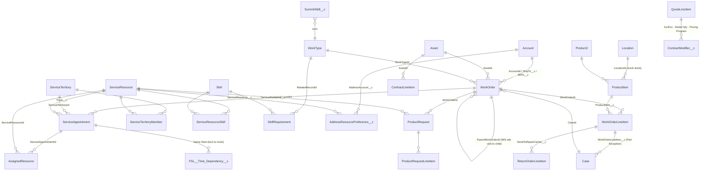

> The exact dependency object name (`FSL__Time_Dependency__c`) is the FSL package standard; the code sets `FSL__Dependency__c = 'Same Start'` on it. **[Inferred]**

**Custom fields that carry the business logic [Code]**

| Object | Field | Purpose |
|---|---|---|
| ServiceAppointment | `Truck__c`, `TruckAppointment__c` | Tech SA points to the van; the van's own SA is flagged |
| ServiceAppointment | `RealignmentConflict__c`, `…Category__c`, `…Action__c` | Output of Realignment Analysis |
| WorkOrderLineItem | `SendToRepairCenter__c`, `ProductItem__c`, `AssignedResource__c` | Depot hand-off, trunk stock consumption, who did the line |
| ProductRequest | `PONumber__c`, `DPCOrderNumber__c`, integration status/message fields | Oracle / DPC submission tracking |
| ServiceResource | `OracleAccountId__c` | Ship-to / sold-to for parts orders to the tech |
| QuoteLineItem | `ModelQtyCoverage__c`, `SelectedAssets__c`, `Asset_Visits__c`, `Requested_Number_of_PM_Visits__c`, `OT_Coverage__c` | RCA configurator state that becomes contract terms |

---

## 7. Key FSL Processes

### 7.1 ES field visit: from booking to billing

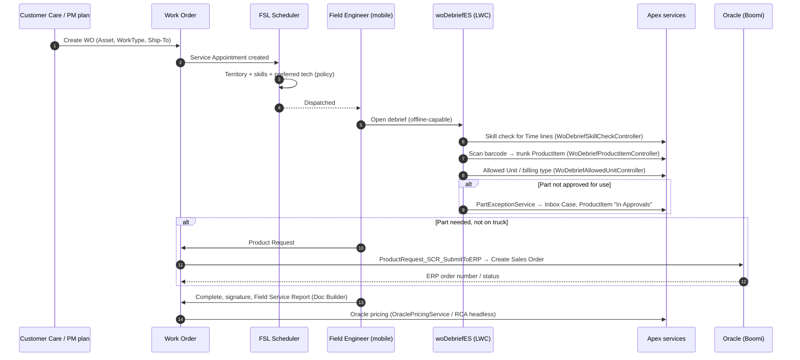

### 7.2 IMS On Location (mobile van) site visit

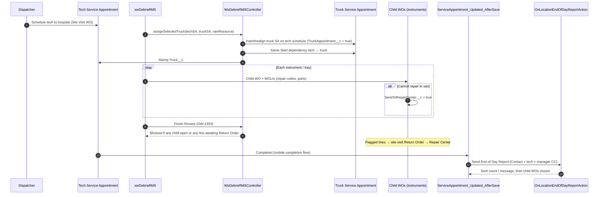

**Why the truck is a Service Resource:** the van is a scarce, capital asset shared by several technicians. Modelling it as a resource lets FSL check its availability and show it on the Gantt; the Same Start dependency keeps tech and van together when the dispatcher drags the job. **[Inferred from code]**

### 7.3 Parts & trunk stock

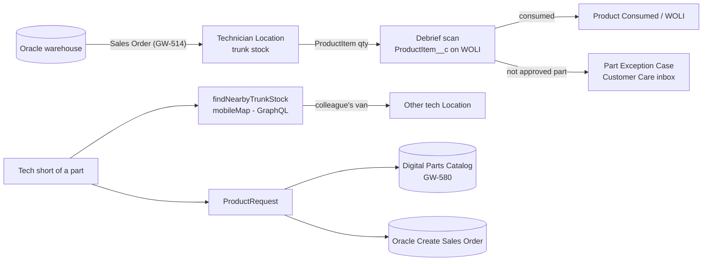

### 7.4 Scheduling hygiene: Realignment Analysis (GW-6099)

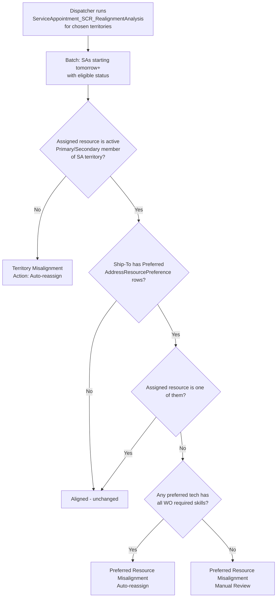

### 7.5 Skills sync from Summit

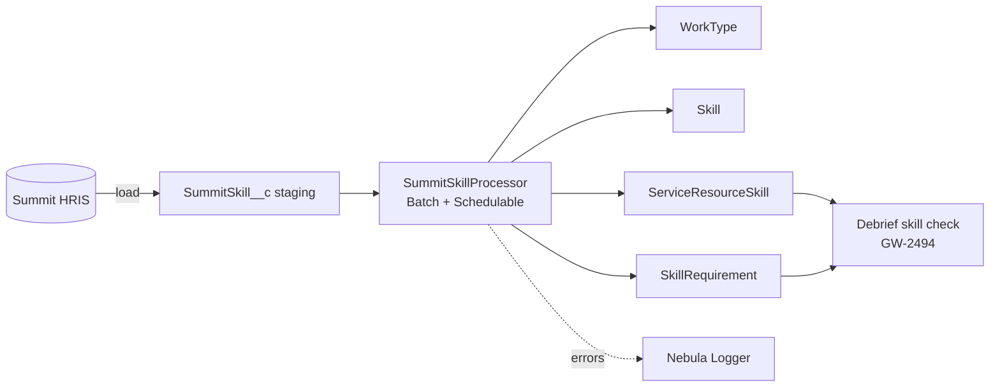

---

## 8. Revenue Cloud Advanced (RCA) + FSL

### 8.1 Why combine them

| Without the combination | With RCA + FSL in one org |
|---|---|
| Service agreements quoted in spreadsheets, coverage terms typed into notes | Agreement is configured **on the actual installed assets** (`SelectedAssets__c`), with PM visits per asset |
| Field tech cannot tell if a part/labour is covered | Contract terms are records (`ContractModifier__c`, contract lines) the debrief can evaluate (**Allowed Unit**) |
| Prices differ between quote, field and depot | One pricing framework: Oracle price as input → RCA pricing procedure / headless pricing |
| Renewal starts from zero | Field history (WOs, repairs, PM counts) on the same Asset informs the next quote |

### 8.2 How the configurator is extended [Code]

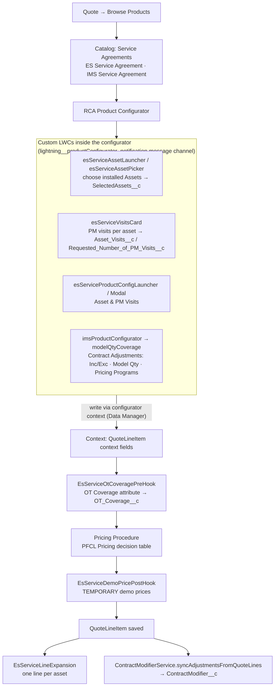

**Rules worth knowing**
- Configurator LWCs **never write records directly**; they write into the configuration context and RCA saves it (`EsServiceProductConfigController`, `EsServiceAssetSelectionController` are read-only).
- `ContractModifier__c` types: **MODEL QTY** (max covered devices per equipment group), **INC/EXC** (inclusion with child exclusions via `ParentContractModifier__c`), **PRICING PROGRAM** (in design). Blank criteria = "any value". Each carries the line's Start/End date.
- `EsServiceDemoPricePostHook` and `configPocModal` are **POC/demo** code and must be removed before go-live.

### 8.3 Asset-centric lifecycle loop

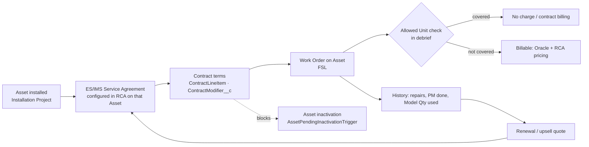

> **[Inferred]** The exact link between `ContractModifier__c` / contract lines and the debrief Allowed Unit evaluation (`WorkOrderLineItemsService.evaluateAllowedUnits`) should be confirmed in the org; the code path exists but the contract objects that feed it are created by RCA/flows outside this repo. `ModelRepairContractController` (older prototype) shows the intent: *Covered Quantity* vs *Quantity Repaired* per model.

---

## 9. Pricing Architecture (Oracle + RCA)

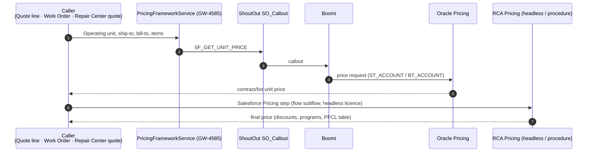

- Field Service WOs use the headless action `workOrderOraclePricingHeadless` → `OraclePricingService.fetchAndApplyOraclePricing`.
- Repair Center uses `RepairCenterQuotePricingQueueable`.
- **Oracle remains the price master**; RCA adds Salesforce-side adjustments. This avoids duplicating Oracle price lists in Salesforce but makes every price depend on Boomi availability.

---

## 10. Integration Architecture

| # | Flow | Direction | Mechanism | FSL/RCA object |
|---|---|---|---|---|
| 1 | Parts order to Oracle | Out | Flow → `ProductRequestsService` → SO_Callout `ORACLE_CREATESALESORDER_*` → Boomi | ProductRequest(+Lines) |
| 2 | Parts order to DPC | Out | `ProductRequestsDpcService` → `DPC_GETPRODUCTINSTANCE_*` | ProductRequest |
| 3 | Unit pricing | Out | `PricingFrameworkService` / `OraclePricingGateway` | QLI, WO, WOLI |
| 4 | Skills | In | `SummitSkill__c` staging + batch | WorkType, Skill, SkillRequirement |
| 5 | Territories / tech alignment | In (file) | LWC upload → Apex services | ServiceTerritory, AddressResourcePreference__c |
| 6 | Photos | In (mobile) | Platform Event `MobileDevicePictureLink__e` | WOLI / WO files |
| 7 | WOLI thumbnails | In REST | `GET /woli/v1/file-thumbnail/*` | WOLI files |
| 8 | Depot hand-off | Internal | WOLI `SendToRepairCenter__c` → Return Order | ReturnOrder, WO |
| 9 | Shipping / labels | Out | `FEDEX_LABEL`, Zebra print | ReturnOrder, WO |
| 10 | ConnectCare returns/assets | In REST | `/connectcare/v1/*` | Asset, ReturnOrder |

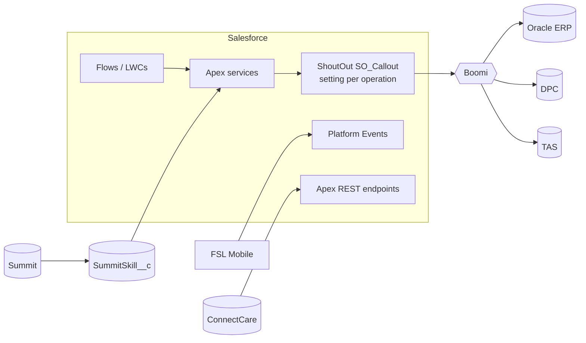

---

## 11. Mobile / Offline Architecture

| Concern | Approach in this org | Evidence |
|---|---|---|
| Offline data | LWCs use **LDS GraphQL** (`lightning/uiGraphQLApi`) so data is primed into the offline cache | `woDebriefES`, `fsrFieldServiceReport`, `findNearbyTrunkStock` **[Code]** |
| Writes that fail offline | Routed to Apex (`without sharing`) when the mobile SQLite store rejects them | `WoDebriefIMSController` header **[Code]** |
| Device features | `lightning/mobileCapabilities` barcode scanner; camera / microscope capture | `woDebriefES`, `woliMicroscopeCaptureMobile` **[Code]** |
| Service report | Field Service **Document Builder** (`lightning__ServiceDocument` target), no Apex so it renders offline | `fsrFieldServiceReport` (GW-1900) **[Code]** |
| Guided steps | Mobile flows (calibration report, IMS completion) | flow names in code **[Code]** |

**Caution:** Apex calls from the mobile app need connectivity. Debrief actions that call Apex (skill check, allowed unit, IMS truck assignment) will **not work offline**; confirm the field team's expectations for low-signal hospitals (basements, OR suites).

---

## 12. Code Inventory for FSL & RCA

| Area | Apex | LWC / VF | Ticket(s) |
|---|---|---|---|
| ES debrief | `WoDebriefAllowedUnitController`, `WoDebriefProductItemController`, `WoDebriefSkillCheckController`, `PartExceptionService`, `WorkOrderLineItemsService` | `woDebriefES`, `woDebrief`, `woDebriefBackup` | GW-2494, GW-3329 |
| IMS / On Location | `WoDebriefIMSController`, `WoDebriefIMSchildWOController`, `OnLocationEndOfDayReportAction` | `woDebriefIMS`, `woDebriefIMSchildWO`, `woDebriefImsChildReview` | GW-1353, GW-6191, GW-6257 |
| Scheduling & territory | `ServiceAppointmentRealignment*`, `DistrictZoneAlignmentService`, `TechAccountAlignmentService`, selectors | `districtZoneAlignment`, `techAccountAlignment`, `techDistrictAlignment`, `DisptachAdditionalResourceFromGantt.page` | GW-6099, GW-2706, GW-2710 |
| Skills | `SummitSkillProcessor`, `SummitSkillsUtil` | — | — |
| Inventory & parts | `ProductItemsService`, `ProductRequestsService`, `ProductRequestsDpcService` | `findNearbyTrunkStock`, `mobileMap` | GW-514, GW-580, GW-5262 |
| Reports & evidence | — | `fsrFieldServiceReport`, `woliMicroscopeCapture*`, `cameraCapture2` | GW-1900 |
| RCA configurator | `EsServiceProductConfigController`, `EsServiceAssetSelectionController`, `EsServiceLineExpansion`, `ImsProductConfiguratorController`, `ModelQtyCoverageController`, `ContractModifierService` | `esService*`, `imsProductConfigurator`, `modelQtyCoverage`, `modelQtyConfigurator` | GW-4777, GW-5676 |
| RCA pricing hooks | `EsServiceOtCoveragePreHook`, `EsServiceDemoPricePostHook` (demo) | — | — |
| Pricing framework | `PricingFrameworkService`, `OraclePricingService`, `RepairCenterQuotePricingQueueable` | `workOrderOraclePricingHeadless` | GW-4585 |
| Asset guard | `AssetPendingInactivationSelector` | — | — |

**Not in the repo but required to run** (deploy/scan the org for these): FSL & FSSK managed packages, scheduling policies, Flows (`ServiceAppointment_*`, `WorkOrder_Updated_AfterSave`, `ProductRequest_SCR_*`), RCA context definitions, pricing procedures and decision tables, ShoutOut, Nebula Logger, object/field metadata, permission sets, mobile app configuration (offline priming / briefcase).

---

## 13. Analysis: Strengths, Gaps, Risks

### 13.1 Strengths
1. **Asset-centric end to end**: the same Asset drives the service agreement (RCA), the field WO, depot repair and inactivation guards. This is the right backbone for a med-device service business.
2. **Good scheduling hygiene tooling** for frequent territory changes (file-driven alignment + realignment analysis) instead of manual dispatcher clean-up.
3. **Real mobile engineering**: GraphQL offline reads, documented workarounds for offline write limits, Doc Builder report with no Apex.
4. **On Location van modelled correctly** as a schedulable resource with a time dependency.
5. **Integration consistency**: all outbound calls through one ShoutOut/Boomi pattern with status stamping.

### 13.2 Gaps
| Gap | Impact | Evidence |
|---|---|---|
| No `MaintenancePlan` / `MaintenanceAsset` usage in code | PM visits sold in RCA (`Requested_Number_of_PM_Visits__c`) may not auto-generate PM WOs; risk of missed PMs | 0 references **[Code]**; may exist as config/flows **[Inferred]** |
| No `ResourceAbsence`, `TimeSheet`, `ProductTransfer` usage | Time-off, timesheets and van-to-van transfers may be handled outside SF or manually | 0 references **[Code]** |
| PM visits default is a placeholder | `esServiceVisitsCard` uses a TEMPORARY default (2) until PM Plan lookup supplies standard visits | **[Code]** |
| Demo pricing in procedure | `EsServiceDemoPricePostHook` hard-codes prices for 1–4 visits | **[Code]** |
| Allowed Unit ↔ contract link not visible in repo | Hard to prove field billing respects RCA contract terms | **[Inferred]** |
| Several debrief variants (`woDebrief`, `woDebriefBackup`, `woDebriefES`) | Maintenance cost, unclear which is live | **[Code]** |
| `AssetAction*Selector` only used by tests | RCA asset lifecycle (asset actions / state periods) not yet wired into service | **[Code]** |

### 13.3 Risks
| Risk | Why | Mitigation |
|---|---|---|
| Pricing depends on Boomi + Oracle availability | Every price call is synchronous through Boomi | Cache last price, async retry, show "price pending" state |
| Offline gaps | Apex-backed debrief steps fail without signal | Move checks to GraphQL-primed data where possible; queue Apex calls |
| `without sharing` controllers | Needed for mobile, but bypass record access | Keep them narrow; validate the WO belongs to the running user's assignment |
| Missing trigger bypass on some triggers & duplicate OrderLineContact trigger | Data loads / double execution | See `OBJECT_RELATIONSHIPS_AND_BUSINESS_ANALYSIS.md` §14 |
| Metadata not in source control | Flows, objects, RCA procedures can drift between orgs | Retrieve them into the repo (`manifest/package.xml`) |

---

## 14. Recommendations & Roadmap

| Priority | Recommendation | Clouds |
|---|---|---|
| **P1** | Generate PM work orders from sold agreements: RCA line (asset + visits) → **Maintenance Plan / Maintenance Asset** → auto WOs. Replace the hard-coded visit default with the PM Plan lookup. | RCA → FSL |
| **P1** | Remove `EsServiceDemoPricePostHook` and finish the **PFCL Pricing decision table**. | RCA |
| **P1** | Document and test the **Allowed Unit** rule against `ContractModifier__c` / contract lines (coverage by Model Qty, Inc/Exc, Pricing Program). | RCA ↔ FSL |
| P2 | Pull Flows, objects, permission sets, RCA context definitions and pricing procedures into the repo. | Platform |
| P2 | Consolidate debrief LWCs (retire `woDebriefBackup`, decide on `woDebrief` vs `woDebriefES`). | FSL |
| P2 | Use standard **ProductTransfer** for van-to-van borrowing found via `findNearbyTrunkStock`. | FSL |
| P3 | Wire RCA **Asset Lifecycle** (AssetAction / AssetStatePeriod) so renewals and amendments act on the same assets the field services. | RCA |
| P3 | KPI dashboards: first-time fix, PM compliance vs sold visits, contract leakage (billable lines on covered assets), van utilisation. | FSL + RCA + CRM Analytics |

**Suggested KPIs**

| KPI | Source |
|---|---|
| PM compliance % (done vs sold) | WO (PM) count per Asset vs `Requested_Number_of_PM_Visits__c` |
| First-time fix % | WOs closed without follow-up WO / ProductRequest |
| Contract leakage | WOLIs billed as covered vs Allowed Unit result |
| Model Qty utilisation | Repairs per model vs `ContractModifier__c.ModelQty__c` |
| Realignment backlog | SAs with `RealignmentConflict__c = true` by action |
| Van utilisation | Truck SA hours / available hours |
| Parts order cycle time | ProductRequest submit → ERP order number |

---

## 15. Glossary

| Term | Meaning |
|---|---|
| **FSL** | Salesforce Field Service (managed package namespace `FSL__`) |
| **FSSK** | Field Service Starter Kit package (`FSSK__` fields) |
| **RCA** | Revenue Cloud Advanced (Revenue Lifecycle Management): product catalog, configurator, pricing procedures |
| **ES** | Equipment Service: field maintenance and repair of capital equipment |
| **IMS** | Instrument Management Services; **On Location** = repair from a mobile van at the hospital |
| **CRSS** | Site-visit type with inspected-asset tables (expand with business) |
| **PM** | Preventive Maintenance |
| **PFCL** | Product Family Classification (pricing and service BOM key) |
| **Trunk stock** | Parts carried in a technician's vehicle (ProductItem at the tech's Location) |
| **Allowed Unit** | Debrief evaluation of whether a part/labour unit is covered/allowed for the WO |
| **DPC** | Digital Parts Catalog |
| **Summit** | HR system that holds technician skills |
| **ShoutOut (`SO_Callout`)** | Callout framework that sends requests to Boomi by operation name |
| **Same Start** | FSL time dependency that makes two appointments start together |
