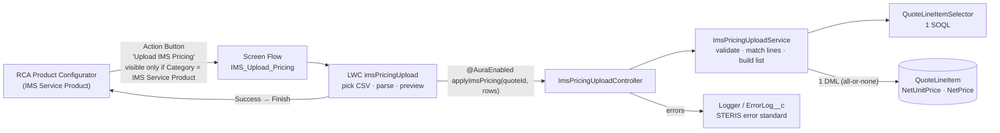

# GW-4864 — 1.3.2 Quote Pricing: IMS Service Contract (Upload IMS Pricing)

| | |
|---|---|
| **Story** | GW-4864 (parent GW-1809, 1.3.2 Quote Pricing) |
| **Sub-tasks** | GW-5653 Create Custom Flow Action Button and … (Reopened, Vinay Soni) · GW-5654 Create Current State Macro/Process (Cancelled) |
| **Solution Architect** | Chad Huffman |
| **Fix version / Sprint** | Service Go-live / Sprint 11 |
| **Ticket estimate** | 1 week |
| **This document** | Technical solution + estimate. **No org changes were made.** |

> **Status note:** On 25 Sep 2026 Justin Gavette commented that a manual way to price the IMS Service Contract product already exists, that this story should tie to the CSC integration after Day 1, and that it was being moved to the backlog. Confirm with the PO that the story is back in scope before starting the build.

---

## 1. Business summary

A Pricing User receives IMS contract pricing from an external pricing process, with one approved price per IMS revenue (product-line) category. They need to load those prices onto the matching quote lines of the **IMS Service Product** inside the RCA Product Configurator, with no reallocation. After that they save the configuration.

**Desc 1:** Capture the externally calculated IMS contract pricing by category so it can be used on the customer agreement.
**Desc 2:** Category pricing, discounts, allocations and forecast cost must reconcile to the contract total so the pricing can be reviewed.

### Acceptance criteria → coverage in this design

| AC | Requirement | Covered by |
|---|---|---|
| AC1.1 | Business-calculated IMS pricing can be loaded onto the contract | CSV upload → quote line update (§3) |
| AC1.2 | One price per IMS product-line category | One CSV row per category, validated against the 11 allowed values (§4.2) |
| AC1.3 | Category prices remain as supplied, not derived from a parent total | Amount written as-is to the child line. No allocation logic. Pricing procedure must not overwrite it (§6, R2) |
| AC2.1 | Sum of category prices = contract-line total | Bundle roll-up to the root IMS line. Total shown on the success screen (§4.5) |
| AC3.1–3.7 | Multi-category discount, ConnectCare/premium allocation, on-location categories, unit price/qty/forecast cost, OEM $ coverage, % vs fixed-$ legacy | **Not in the Solution Design.** Partly covered elsewhere (On-Location → GW-6468 Mobile Van tab). Needs a separate story or confirmation (§6, Q5) |

---

## 2. Solution overview



### Component list

| # | Type | API name | New / Change | Purpose |
|---|---|---|---|---|
| 1 | Configurator Flow (RCA default) | *RCA Advanced Configurator default flow* (clone used by IMS) | Change | Add an **Action Button** (Label `Upload IMS Pricing`, Flow = `IMS_Upload_Pricing`, visibility `Category = 'IMS Service Product'`) below *Product Configurator Messages* |
| 2 | Screen Flow | `IMS_Upload_Pricing` | New | Input vars: `quoteId`, `accountId`, `rootTransactionLineId`. Hosts the LWC on one screen |
| 3 | LWC | `imsPricingUpload` | New | File picker, CSV parse, client-side validation, preview table, Apply, success/error panel, Finish (`FlowNavigationFinishEvent`) |
| 4 | Apex | `ImsPricingUploadController` | New | `@AuraEnabled applyImsPricing(Id quoteId, String rowsJson)`. Wraps errors with `Logger` + `AuraHandledException` (same `toAuraException` pattern as `ImsProductConfiguratorController`) |
| 5 | Apex | `ImsPricingUploadService` | New | Server-side validation, line matching, update list, single DML, result DTO |
| 6 | Apex | `QuoteLineItemSelector` | Change | Add `selectByQuoteAndProductNames(Id quoteId, Set<String> names)` (WITH USER_MODE) |
| 7 | Apex | `ImsPricingUploadException` | New | Business-rule failures |
| 8 | Custom Metadata | `IMS_Revenue_Category__mdt` | New | The 11 allowed categories: `Code__c`, `Category_Name__c` (CSV value), `Product_Name__c` (exact Product2.Name), `Active__c`. Avoids hard-coding and absorbs naming/typo differences |
| 9 | Apex tests | `ImsPricingUploadControllerTest`, `ImsPricingUploadServiceTest` (+ selector test method) | New | ≥ 90 % coverage, positive/negative/bulk |
| 10 | Jest | `imsPricingUpload.test.js` | New | Parser and validation tests |
| 11 | Permission set | IMS / Pricing user perm set | Change | Apex class access for the controller, flow access, CMDT read |
| 12 | Manifest | `manifest/package.xml` | Change | Add all of the above |

---

## 3. End-to-end flow

```mermaid
sequenceDiagram
    actor U as Pricing User
    participant CFG as RCA Configurator
    participant FL as Flow IMS_Upload_Pricing
    participant L as LWC imsPricingUpload
    participant C as ImsPricingUploadController
    participant S as ImsPricingUploadService
    participant DB as QuoteLineItem

    U->>CFG: Open IMS Service Product configuration
    CFG-->>U: Show "Upload IMS Pricing" (Category = IMS Service Product)
    U->>FL: Click button (QuoteId, AccountId passed)
    FL->>L: Render
    U->>L: Select .csv
    L->>L: Read (FileReader) + parse + validate format
    alt File/format errors
        L-->>U: Error list, Apply disabled
    else Valid
        L-->>U: Preview table (category, amount, currency, total)
        U->>L: Apply
        L->>C: applyImsPricing(quoteId, rows)
        C->>S: apply(...)
        S->>DB: SELECT lines WHERE QuoteId AND Product2.Name IN (...)
        S->>S: Match each row; collect ALL errors
        alt Any row unmatched / invalid
            S-->>C: throw ImsPricingUploadException (all errors)
            C-->>L: AuraHandledException (user message) + log
        else All matched
            S->>DB: update lineList (ONE DML, allOrNone)
            S-->>L: Result (rows updated, total)
            L-->>U: "Success! - IMS Pricing successfully applied…" + Finish
            U->>CFG: Finish → back to configurator → Save configuration
        end
    end
```

---

## 4. Detailed design

### 4.1 Configurator Action Button (GW-5653)

- Open the RCA Advanced Configurator flow used by the IMS Service Product. Drag the **Action Button** component under *Product Configurator Messages* (`S01_Messages`), as in the ticket screenshot.
- **API Name:** `S01_UploadImsPricing` · **Label:** `Upload IMS Pricing` · **Flow:** `IMS_Upload_Pricing`
- **Set Component Visibility:** `Category = 'IMS Service Product'`. Use the same context resource the existing `imsProductConfigurator` card uses for the product on screen (`S01_DataManager.header`). Confirm the exact category resource name in Flow Builder.
- Map the inputs `quoteId ← configuratorContext.transactionId`, `rootTransactionLineId ← configuratorContext.transactionLineId`, `accountId ← Quote.AccountId` (or a Get Records in the flow if the configurator does not expose it).
- The configurator flow is not in the repo today. Retrieve it first (`sf project retrieve start -m Flow:<name>`) so the change is source-controlled.

### 4.2 Input file rules

| Rule | Behaviour |
|---|---|
| File type | Extension `.csv` (case-insensitive) and `accept=".csv"` on the input. Anything else → *"Please select a CSV file."* |
| Size | Reject files > 1 MB (11 rows expected) |
| Header | First non-empty row is **always skipped**, whatever its values |
| Columns | Exactly **3** per row: `IMS Revenue Category`, `Amount`, `Currency Code` (see Q1 on the sample-file conflict) |
| Category | Trimmed, compared case-insensitively with `IMS_Revenue_Category__mdt.Category_Name__c` (11 active values below) |
| Amount | Numeric, ≥ 0, up to 2 decimals. Strip `$` and thousand separators. Blank → error |
| Currency | 3-letter ISO code, must be an active org currency **and equal the Quote's `CurrencyIsoCode`** (see §6 R1) |
| Duplicates | Same category twice → error (no silent overwrite) |
| Blank lines / BOM | Ignored / stripped |
| Quoted values | Supported (`"1,250.00"`). Parser handles RFC-4180 quotes |

**Allowed categories (CMDT seed):**
1. Large Flex Scope Repair Service
2. Small Flex Scope Repair Service
3. Ultrasound Flex Scope Repair Service
4. Rigid Scope Repa**i**r Service *(ticket has the typo "Repar". Map to the exact Product2.Name)*
5. Power Repair Service
6. Video Repair Service
7. Endocam Repair Service
8. Ultrasound Repair Service
9. Op**h**thalmic Repair Service *(ticket: "Opthalmic". Confirm the product name)*
10. Instrument Repair Service
11. Mobile Van Service

All validation errors are collected and shown together as *"Row 4: Category 'X' is not a valid IMS Revenue Category"*. The LWC does not stop at the first error.

### 4.3 LWC `imsPricingUpload`

- **Inputs (`@api`):** `quoteId`, `accountId`, `rootTransactionLineId`. Target: `lightning__FlowScreen`.
- **States:** `select` → `preview` → `applying` (spinner) → `success` | `error`.
- **Parsing:** client-side with `FileReader.readAsText`, a small RFC-4180 parser in a `csvUtils.js` module, and the same validation as §4.2 (format checks only; Apex re-validates everything).
- **Preview:** `lightning-datatable` with Category, Amount, Currency and a **Total** footer (supports AC2 reconciliation).
- **Apply:** calls `applyImsPricing`. Sends `JSON.stringify(rows)` to keep the payload simple.
- **Success text (exact):**
  > **Success! - IMS Pricing successfully applied to Revenue Categories, Save the configuration to see the amounts applied on the individual quote lines.**
- **Finish:** button fires `FlowNavigationFinishEvent`, which returns the user to the configurator.
- **Errors:** inline `slds-notify` error list, plus `reduceErrors` for Apex errors. Same styling as `imsProductConfigurator`.

### 4.4 Apex

```apex
public with sharing class ImsPricingUploadController {
    @AuraEnabled
    public static ImsPricingUploadService.Result applyImsPricing(Id quoteId, String rowsJson) {
        try {
            List<ImsPricingUploadService.PriceRow> rows =
                (List<ImsPricingUploadService.PriceRow>) JSON.deserialize(rowsJson, List<ImsPricingUploadService.PriceRow>.class);
            return ImsPricingUploadService.apply(quoteId, rows);
        } catch (ImsPricingUploadService.ImsPricingUploadException e) {
            throw toAuraException('applyImsPricing: validation failed', quoteId, e, e.getMessage());
        } catch (Exception e) {
            throw toAuraException('applyImsPricing: unexpected error', quoteId, e,
                                  'Unable to apply IMS pricing. Please contact your administrator.');
        } finally {
            Logger.saveLog();
        }
    }
}
```

**`ImsPricingUploadService.apply(quoteId, rows)`:**
1. Guard: `quoteId` not null, rows not empty, rows ≤ 11.
2. Load the `IMS_Revenue_Category__mdt` map (CSV name, lower-cased → Product2.Name).
3. Re-validate every row (category, amount, currency = `Quote.CurrencyIsoCode`, duplicates). Collect errors.
4. **One SOQL:** `QuoteLineItemSelector.selectByQuoteAndProductNames(quoteId, productNames)` →
   `SELECT Id, Product2.Name, NetUnitPrice, Quantity, CurrencyIsoCode FROM QuoteLineItem WHERE QuoteId = :quoteId AND Product2.Name IN :names WITH USER_MODE`
5. Build `Map<String, List<QuoteLineItem>>` by product name. Missing → error *"Row n: No quote line found for 'X'"*. More than one line → error (see Q3).
6. If any errors: log them (`Logger.warn` with tag `ImsPricingUpload`) and throw `ImsPricingUploadException` with all messages joined.
7. Build `List<QuoteLineItem> toUpdate`, setting `NetUnitPrice = amount` and `NetPrice/NetTotalPrice` per Q2. **No DML inside the loop.**
8. `Savepoint` → `Database.update(toUpdate, AccessLevel.USER_MODE)` → on failure roll back, log, rethrow.
9. Return `Result { Integer linesUpdated; Decimal total; String currencyIsoCode; }`.

**Error handling (STERIS standard, same as the existing IMS classes):** `Logger.setScenario('IMS Pricing Upload')`, `Logger.error(..., recordId, ex).addTag('ImsPricingUpload')`, `Logger.saveLog()` in `finally`, and an `AuraHandledException` with a user-friendly message. No raw stack traces reach the UI.

### 4.5 Reconciliation (AC2)

The service returns the uploaded total. The success panel shows *"Total applied: USD 125,000.00 across 11 categories"*. The contract-line total is the bundle roll-up on the root IMS line after the configuration is saved. A hard check of uploaded total vs root line total is **not possible before save**, because the root total is recalculated by the pricing procedure on save. See Q4.

---

## 5. Test plan

### Apex (`ImsPricingUploadServiceTest` / `ControllerTest`)
| # | Scenario | Expected |
|---|---|---|
| 1 | 11 valid rows, all lines present | 11 lines updated, 1 DML, total correct |
| 2 | Category not in the allowed list | Exception listing the row. No update |
| 3 | Valid category, no quote line | "No quote line found". No update (all-or-none) |
| 4 | Duplicate category in the file | Error |
| 5 | Non-numeric / negative amount | Error |
| 6 | Currency ≠ quote currency | Error |
| 7 | Mixed valid and invalid rows | Nothing updated. All errors returned |
| 8 | Case/whitespace differences in the category | Matches |
| 9 | DML failure (e.g. validation rule) | Rollback, logged, user message |
| 10 | User without access (USER_MODE) | Handled error |
| 11 | DML/SOQL count assertion | `Limits.getDmlStatements() == 1`, `Limits.getQueries()` ≤ 2 |

### Jest (`imsPricingUpload`)
Header skipped, quoted values, BOM, blank lines, wrong extension, wrong column count, `$1,250.00`, preview total, Apex error rendering, Finish event fired.

### UAT
1. Quote → IMS Service Product → Configure. Button visible. Not visible on non-IMS products.
2. Upload a valid file → success message → Finish → Save configuration → each category line shows the uploaded price. The root total equals the sum.
3. Upload invalid files (wrong type, bad category, missing line) → clear errors. Lines unchanged.
4. Re-upload with different amounts → prices overwritten.
5. Save configuration again → **prices are not recalculated or overwritten by the pricing procedure** (key risk R2).

---

## 6. Risks, gaps & open questions

### Risks
| # | Risk | Impact | Mitigation |
|---|---|---|---|
| **R1** | Salesforce requires a QuoteLineItem's `CurrencyIsoCode` to match its parent Quote. **Updating currency per line as the ticket says will fail.** | Story step 5.2.3 cannot be built as written | Validate that the CSV currency equals the quote currency and reject mismatches. Confirm with Chad |
| **R2** | RCA pricing procedure recalculates `NetUnitPrice` when the configuration is saved, which can overwrite the uploaded price. Also, the configurator keeps the configuration in memory, so a direct DML on lines while it is open may be overwritten by the configurator's own save | AC1.3 broken: price not retained | **Spike first (0.5–1 d).** Option A (ticket as written): DML + mark the line as manual price / price override so the pricing procedure keeps it. Option B (fallback): publish the prices into the configuration via `lightning__productConfigurator_notification` `valueChanged`, the pattern `imsProductConfigurator` already uses for `ModelQtyCoverage__c`, plus a pricing procedure element that reads the value. The ticket's success text ("Save the configuration to see the amounts") fits Option B well |
| R3 | Unsaved configurator lines (`ref_…` Ids) are not in the database, so the SOQL cannot find them | "No line found" on a brand-new configuration | Require the IMS bundle to be saved once before upload (show a message), or use Option B |
| R4 | Category names in the ticket have typos versus Product2.Name | Lines not matched | CMDT mapping (§2 #8) |

### Open questions (for Chad Huffman / Jason Gage)
| # | Question |
|---|---|
| Q1 | The validation section lists **Category, Amount, Currency Code**, but the sample file lists **Revenue Category Code, Revenue Category Name, Price**. Which layout is final? Should matching be by code or by name? |
| Q2 | Exact target fields: `NetUnitPrice` plus which "NetPrice" field (`NetTotalPrice`? `UnitPrice`?). Is the Amount a **unit** price or a **line total**? (It matters when Quantity ≠ 1.) |
| Q3 | Can a quote have more than one line for the same category (e.g. multiple IMS bundles)? If so, scope the match to the root line's children (`rootTransactionLineId`) |
| Q4 | Must the upload enforce that the uploaded total equals an expected contract total (AC2), or is showing the total enough? |
| Q5 | AC3 (discounts, ConnectCare/premium allocation, OEM $, forecast cost, % vs $) is not in the Solution Design. Split it into a separate story? |
| Q6 | Is `AccountId` actually needed? Nothing in the logic uses it today |
| Q7 | Do 0 amounts count as valid (category included at no charge)? |
| Q8 | Story in backlog (Justin Gavette's comment): confirm it is back in scope for Service Go-live / Sprint 11 |

---

## 7. Estimation

Assumes Option A works after the spike (direct update). If the spike shows Option B is needed, add the delta at the bottom.

| # | Task | Owner | Estimate |
|---|---|---|---|
| 1 | Clarify Q1–Q8 with SA/PO | Dev + SA | 0.25 d |
| 2 | **Spike:** RCA pricing procedure and configurator save behaviour vs a direct QLI update (R2, R3); currency rule (R1) | Dev | 0.75 d |
| 3 | Retrieve the configurator flow. Add the Action Button + visibility + input mapping (GW-5653) | Dev/Admin | 0.5 d |
| 4 | Screen Flow `IMS_Upload_Pricing` | Dev/Admin | 0.25 d |
| 5 | CMDT `IMS_Revenue_Category__mdt` + 11 records | Admin | 0.25 d |
| 6 | Apex: selector method, service, controller, exception, logging | Dev | 1.0 d |
| 7 | Apex tests (positive, negative, bulk, limits) | Dev | 0.75 d |
| 8 | LWC `imsPricingUpload` (file read, CSV parser, validation, preview, success/error, Finish) | Dev | 1.25 d |
| 9 | Jest tests | Dev | 0.5 d |
| 10 | Permission set, package.xml, deploy to dev/QA, PR review fixes | Dev | 0.5 d |
| 11 | Dev testing in the configurator + UAT support + defect fixes | Dev + QA | 1.0 d |
| | **Total (Option A)** | | **≈ 7.0 dev days (~1.5 weeks)** |
| | *Delta if Option B is needed (LMS context update + pricing procedure element / ContextAttribute setup)* | | *+2.0 d → ≈ 9 d* |
| | *AC3 scope (discounts, allocations, OEM, forecast cost), if kept in this story* | | *Separate estimate after design: 5–8 d* |

**Comparison with the ticket estimate:** the ticket says 1 week (5 d). That only holds if the spike is skipped and no tests or UAT are needed. The realistic figure with tests and UAT is **~7 days**.

---

## 8. Deployment checklist

- [ ] `IMS_Revenue_Category__mdt` object + records
- [ ] Apex: `ImsPricingUploadController`, `ImsPricingUploadService`, `QuoteLineItemSelector` (updated) + tests
- [ ] LWC: `imsPricingUpload`
- [ ] Flow: `IMS_Upload_Pricing` (Active)
- [ ] Configurator flow (with the Action Button)
- [ ] Permission set updates
- [ ] `manifest/package.xml` updated
- [ ] Run the specified tests: `ImsPricingUploadControllerTest`, `ImsPricingUploadServiceTest`, `QuoteLineItemSelectorTest`
