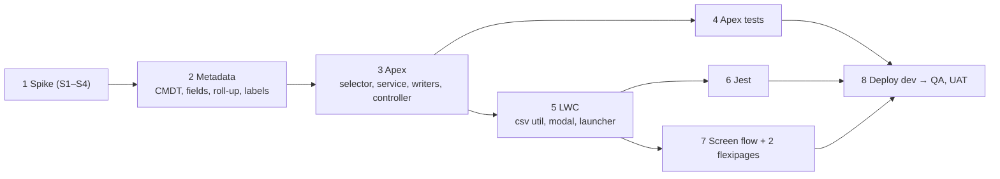

# GW-5653 — Upload IMS Pricing: Implementation Guide

| | |
|---|---|
| **Ticket** | GW-5653 *Create Custom Flow Action Button and Screen Flow Update Process* (Sub-task of GW-4864, 1.3.2 Quote Pricing: IMS Service Contract) |
| **Reporter / Assignee** | Chad Huffman / Vinay Soni |
| **Status / Sprint** | Reopened / Sprint 11 |
| **Related** | [GW-4864_IMS_PRICING_UPLOAD_DESIGN.md](GW-4864_IMS_PRICING_UPLOAD_DESIGN.md) (story-level design) · GW-5654 *Create Current State Macro/Process* (**Cancelled**) |
| **This document** | Build guide: metadata, code, tests and deployment steps. **Nothing has been deployed. No org changes were made.** |

> ⚠️ **GW-5653 changes the placement from the parent design.** GW-4864 put the button in the **RCA configurator flow**. GW-5653 puts it on the **Quote Lightning record page** (MSA Quote and Service Sales Quote), as a flow component that is the first item in the **Lines** tab, and opens a modal. This guide follows **GW-5653**. Because the user is on the record page and not inside a configuration, the quote lines are updated directly (no configurator context), and the Lines related list is refreshed afterwards.

---

## 0. Requirements recap and decisions

| # | Ticket says | Implementation decision |
|---|---|---|
| R1 | LWC on the Quote record page (MSA + Service Sales Quote), launched from a modal, first item in the LINES tab | Screen flow `IMS_Upload_Pricing` (Flow component at the top of the *Lines* tab) → LWC `imsPricingUploadLauncher` (button) → `LightningModal` `imsPricingUploadModal` |
| R2 | Label = **Upload IMS Pricing** | Button label (Custom Label `IMS_Upload_Pricing_Label`) |
| R3 | Visible only if the IMS Repair Contract Product is selected (**Roll-up Summary on ProductCode**) | `Quote.ImsRepairContractLineCount__c` = COUNT(QuoteLineItem) where `QuoteLineItem.ProductCode__c` = *IMS Repair Contract code*. Flexipage visibility rule `> 0` |
| R4 | CSV only, header row skipped, columns **IMS Revenue Category, Amount, Currency Code** (the ticket says "two fields" but lists three) | Three columns. Header always skipped |
| R5 | 11 allowed Revenue Categories | Custom Metadata `IMS_Revenue_Category__mdt` (absorbs the typos "Repar" and "Opthalmic") |
| R6 | LWC receives AccountId and QuoteId | `recordId` (Quote) from the page. AccountId is read in Apex (kept for logging; not needed by the logic) |
| R7 | Match `QuoteLineItem WHERE QuoteId = Quote.Id AND Product.Name = category` | One SOQL for all rows (`Product2.Name IN :names`) |
| R8 | Update **NetUnitPrice** and **NetPrice** with Amount | `NetUnitPrice = Amount`, `NetTotalPrice = Amount × Quantity`. Written through a pluggable writer (§4.4): direct DML **or** Place Sales Transaction, decided by the spike (§1) |
| R9 | Update **CurrencyIsoCode** from the file | **Not possible.** A QuoteLineItem's currency must equal its Quote's currency. Instead the file currency is **validated** against `Quote.CurrencyIsoCode`. Confirm with Chad |
| R10 | No DML inside the loop, one DML | Collect, then one update / one PST call |
| R11 | Errors per STERIS Apex Error Handling Standards | `Logger` (scenario `IMS Pricing Upload`, tag `ImsPricingUpload`), `Logger.saveLog()` in `finally`, `AuraHandledException` with a user message (same pattern as `ImsProductConfiguratorController.toAuraException`) |
| R12 | Success message + Finish | Exact ticket text. Finish closes the modal and refreshes the page (`RefreshEvent`) |
| R13 | Step 6: update the Current State Calculator to produce the file, and a process to **save/attach and import** into the quote | (a) The calculator (outside Salesforce) is **out of scope** here, because GW-5654 was cancelled. §8 gives the file spec to hand over. (b) **Save/attach + import is built**: every uploaded file is attached to the Quote (Files), and the modal can import a CSV already attached to the Quote |

---

## 1. Spike first (0.5–1 d): how to write the price in RCA

Before building §4.4, check these in the dev org with one IMS quote:

| Check | How | Decides |
|---|---|---|
| S1. Are `NetUnitPrice` / `NetTotalPrice` updatable on QuoteLineItem? | `Schema.sObjectType.QuoteLineItem.fields.NetUnitPrice.isUpdateable()` in Anonymous Apex, then a one-line update | If not updatable → PST writer |
| S2. Does a direct update survive **Reprice All** / *Instant Pricing* on the Lines tab? | Update one line → click Reprice All → re-query | If the price is overwritten → PST writer with a manual price (or a pricing procedure element that keeps it) |
| S3. Does `RevSalesTrxn.PlaceSalesTransactionExecutor` with `PricingPreferenceEnum.SKIP` keep a patched `NetUnitPrice` and roll up the totals? | Same call shape as `EsServiceLineExpansion` | Choose `SKIP` vs `SYSTEM` |
| S4. Do the 11 category lines have Quantity = 1? | Query | Unit price vs total price meaning of Amount |

Write down the result in the PR. The code below keeps both writers behind one interface, so the spike only flips a setting (`IMS_Pricing_Upload_Setting__mdt.Writer__c`).

---

## 2. Build order and estimate



| # | Task | Est. |
|---|---|---|
| 1 | Spike S1–S4, confirm the open questions (§9) | 0.75 d |
| 2 | Metadata: CMDT type + 11 records + setting record, `QuoteLineItem.ProductCode__c`, roll-up on Quote, custom labels | 0.75 d |
| 3 | Apex: product-code stamping, selector method, service, both writers, controller (incl. attach + import from Files) | 1.5 d |
| 4 | Apex tests | 1.0 d |
| 5 | LWC: `imsPricingCsv` util, `imsPricingUploadModal`, `imsPricingUploadLauncher` | 1.5 d |
| 6 | Jest | 0.5 d |
| 7 | Screen flow + retrieve/edit the MSA and Service Sales Quote flexipages + permission set | 0.5 d |
| 8 | Deploy to dev/QA, UAT support, fixes | 1.0 d |
| | **Total** | **≈ 7.5 dev days** |

---

## 3. Metadata

### 3.1 Custom Metadata `IMS_Revenue_Category__mdt`

| Field | Type | Purpose |
|---|---|---|
| `MasterLabel` | — | Category as it appears in the CSV |
| `Category_Code__c` | Text(20) | Revenue Category Code (for the "sample file" layout, see Q1) |
| `Product_Name__c` | Text(255) | **Exact** `Product2.Name` of the quote line |
| `Active__c` | Checkbox | Only active rows are accepted |
| `Sort_Order__c` | Number(3,0) | Order in the preview and error messages |

Records (`customMetadata/IMS_Revenue_Category.<DeveloperName>.md-meta.xml`):

| DeveloperName | Label (CSV) | Product_Name__c |
|---|---|---|
| `Large_Flex_Scope` | Large Flex Scope Repair Service | *confirm* |
| `Small_Flex_Scope` | Small Flex Scope Repair Service | *confirm* |
| `Ultrasound_Flex_Scope` | Ultrasound Flex Scope Repair Service | *confirm* |
| `Rigid_Scope` | Rigid Scope Repair Service | *confirm* (ticket: "Repar") |
| `Power` | Power Repair Service | *confirm* |
| `Video` | Video Repair Service | *confirm* |
| `Endocam` | Endocam Repair Service | *confirm* |
| `Ultrasound` | Ultrasound Repair Service | *confirm* |
| `Ophthalmic` | Ophthalmic Repair Service | *confirm* (ticket: "Opthalmic") |
| `Instrument` | Instrument Repair Service | *confirm* |
| `Mobile_Van` | Mobile Van Service | *confirm* |

Matching ignores case and extra spaces, and accepts **either the label or the product name**, so both spellings of the typos work.

```xml
<!-- customMetadata/IMS_Revenue_Category.Rigid_Scope.md-meta.xml -->
<CustomMetadata xmlns="http://soap.sforce.com/2006/04/metadata"
                xmlns:xsi="http://www.w3.org/2001/XMLSchema-instance" xmlns:xsd="http://www.w3.org/2001/XMLSchema">
    <label>Rigid Scope Repair Service</label>
    <protected>false</protected>
    <values><field>Category_Code__c</field><value xsi:type="xsd:string">RSR</value></values>
    <values><field>Product_Name__c</field><value xsi:type="xsd:string">Rigid Scope Repair Service</value></values>
    <values><field>Active__c</field><value xsi:type="xsd:boolean">true</value></values>
    <values><field>Sort_Order__c</field><value xsi:type="xsd:double">4</value></values>
</CustomMetadata>
```

### 3.2 Custom Metadata `IMS_Pricing_Upload_Setting__mdt` (one record `Default`)

| Field | Type | Default | Purpose |
|---|---|---|---|
| `Writer__c` | Picklist `DML`, `PST` | `DML` | Result of the spike (§1) |
| `Pst_Pricing_Preference__c` | Picklist `SKIP`, `SYSTEM` | `SKIP` | Only for `PST` |
| `Ims_Repair_Contract_Product_Code__c` | Text(40) | *confirm* | Documentation only. The roll-up filter needs a literal value (§3.4) |
| `Max_File_Size_KB__c` | Number | `1024` | File guard |
| `Attach_File_To_Quote__c` | Checkbox | `true` | Save the uploaded CSV to the Quote's Files |

### 3.3 `QuoteLineItem.ProductCode__c` (new)

QuoteLineItem has no ProductCode field that a roll-up summary filter can use, and roll-up filters can't use cross-object formulas. So a text field is **stamped** from `Product2.ProductCode` in a before trigger.

```xml
<CustomField xmlns="http://soap.sforce.com/2006/04/metadata">
    <fullName>ProductCode__c</fullName>
    <label>Product Code</label>
    <description>GW-5653 - Copy of Product2.ProductCode (stamped before insert/update) so Quote roll-ups can filter on it.</description>
    <type>Text</type>
    <length>255</length>
</CustomField>
```

### 3.4 `Quote.ImsRepairContractLineCount__c` (roll-up summary)

```xml
<CustomField xmlns="http://soap.sforce.com/2006/04/metadata">
    <fullName>ImsRepairContractLineCount__c</fullName>
    <label>IMS Repair Contract Line Count</label>
    <description>GW-5653 - Number of IMS Repair Contract lines; drives the Upload IMS Pricing visibility.</description>
    <type>Summary</type>
    <summaryForeignKey>QuoteLineItem.QuoteId</summaryForeignKey>
    <summaryOperation>count</summaryOperation>
    <summaryFilterItems>
        <field>QuoteLineItem.ProductCode__c</field>
        <operation>equals</operation>
        <value><!-- IMS Repair Contract product code, e.g. IMS-RC --></value>
    </summaryFilterItems>
</CustomField>
```
> After deploying, run the backfill in §6.3 once so existing lines get `ProductCode__c`.

### 3.5 Custom labels

| Name | Value |
|---|---|
| `IMS_Upload_Pricing_Label` | Upload IMS Pricing |
| `IMS_Upload_Pricing_Success` | Success! - IMS Pricing successfully applied to Revenue Categories, Save the configuration to see the amounts applied on the individual quote lines. |
| `IMS_Upload_Pricing_Generic_Error` | Unable to apply IMS pricing. Please contact your administrator. |

> On the record page there is no configuration to save. The ticket text is kept as written; ask Chad whether to change it to *"…Review the amounts on the quote lines."* (Q6). Because it is a label, changing it later doesn't need code.

---

## 4. Apex

### 4.1 Product code stamping: `QuoteLineItemService.handleBeforeInsert` / `handleBeforeUpdate`

```apex
	/**
	 * @description GW-5653 - Copies Product2.ProductCode to ProductCode__c (used by Quote.ImsRepairContractLineCount__c).
	 */
	public static void stampProductCode(List<QuoteLineItem> newLines, Map<Id, QuoteLineItem> oldMap) {
		Set<Id> productIds = new Set<Id>();
		List<QuoteLineItem> toStamp = new List<QuoteLineItem>();
		for (QuoteLineItem line : newLines) {
			Boolean changed = oldMap == null || line.Product2Id != oldMap.get(line.Id).Product2Id
				|| String.isBlank(line.ProductCode__c);
			if (changed && line.Product2Id != null) {
				productIds.add(line.Product2Id);
				toStamp.add(line);
			}
		}
		if (toStamp.isEmpty()) {
			return;
		}
		Map<Id, Product2> products = new Map<Id, Product2>(
			[SELECT Id, ProductCode FROM Product2 WHERE Id IN :productIds WITH SYSTEM_MODE]
		);
		for (QuoteLineItem line : toStamp) {
			line.ProductCode__c = products.get(line.Product2Id)?.ProductCode;
		}
	}
```
Call it from `QuoteLineItemTriggerHandler.beforeInsert()` (`stampProductCode(Trigger.new, null)`) and add a `beforeUpdate()` override (`stampProductCode(Trigger.new, Trigger.oldMap)`). The trigger already has `before update`.

### 4.2 Selector: `QuoteLineItemSelector`

```apex
	/**
	 * @description GW-5653 - Quote lines whose product name is one of the given names.
	 */
	public static List<QuoteLineItem> selectByQuoteAndProductNames(Id quoteId, Set<String> productNames) {
		return [
			SELECT Id, QuoteId, Product2Id, Product2.Name, Quantity, NetUnitPrice, NetTotalPrice, CurrencyIsoCode
			FROM QuoteLineItem
			WHERE QuoteId = :quoteId AND Product2.Name IN :productNames
			WITH USER_MODE
			ORDER BY LineNumber
		];
	}
```

### 4.3 `ImsPricingUploadService`

```apex
/**
 * @author <dev>
 * @date 2026/11/xx
 * @group IMS Pricing Upload
 * @description GW-5653 - Applies externally calculated IMS pricing (CSV: IMS Revenue Category, Amount, Currency Code)
 *              to the matching quote lines. Re-validates every row on the server, collects all errors before writing,
 *              and writes all lines in one operation (all or nothing).
 */
public with sharing class ImsPricingUploadService {

	public class ImsPricingUploadException extends Exception {}

	/** @description One CSV data row as sent by the LWC (rowNumber = line in the file, header = 1). */
	public class PriceRow {
		@AuraEnabled public Integer rowNumber;
		@AuraEnabled public String category;
		@AuraEnabled public Decimal amount;
		@AuraEnabled public String currencyCode;
	}

	public class UploadContext {
		@AuraEnabled public Id quoteId;
		@AuraEnabled public Id accountId;
		@AuraEnabled public String quoteName;
		@AuraEnabled public String currencyIsoCode;
		@AuraEnabled public Integer maxFileSizeKb;
		@AuraEnabled public List<String> categories = new List<String>();
	}

	public class Result {
		@AuraEnabled public Integer linesUpdated = 0;
		@AuraEnabled public Decimal total = 0;
		@AuraEnabled public String currencyIsoCode;
		@AuraEnabled public Id contentDocumentId; // attached CSV, when enabled
	}

	/** @description A matched quote line and the new price. */
	public class LinePrice {
		public QuoteLineItem line;
		public Decimal unitPrice;
		public Decimal totalPrice;
	}

	@TestVisible private static final Integer MAX_ROWS = 50;

	public static UploadContext getContext(Id quoteId) {
		Quote q = loadQuote(quoteId);
		UploadContext ctx = new UploadContext();
		ctx.quoteId = q.Id;
		ctx.accountId = q.AccountId;
		ctx.quoteName = q.Name;
		ctx.currencyIsoCode = (String) q.get('CurrencyIsoCode');
		ctx.maxFileSizeKb = Integer.valueOf(ImsRevenueCategories.setting().Max_File_Size_KB__c);
		for (IMS_Revenue_Category__mdt c : ImsRevenueCategories.active()) {
			ctx.categories.add(c.MasterLabel);
		}
		return ctx;
	}

	public static Result apply(Id quoteId, List<PriceRow> rows) {
		if (quoteId == null) {
			throw new ImsPricingUploadException('The quote is not known. Refresh the page and try again.');
		}
		if (rows == null || rows.isEmpty()) {
			throw new ImsPricingUploadException('The file has no data rows.');
		}
		if (rows.size() > MAX_ROWS) {
			throw new ImsPricingUploadException('The file has ' + rows.size() + ' rows; the maximum is ' + MAX_ROWS + '.');
		}
		Quote q = loadQuote(quoteId);
		String quoteCurrency = (String) q.get('CurrencyIsoCode');
		List<String> errors = new List<String>();

		// 1. Row validation + category -> product name
		Map<String, PriceRow> rowByProduct = new Map<String, PriceRow>(); // lower-cased product name
		Map<String, String> productNameByKey = new Map<String, String>();
		Set<String> seenCategories = new Set<String>();
		for (PriceRow row : rows) {
			String at = 'Row ' + row.rowNumber + ': ';
			IMS_Revenue_Category__mdt cat = ImsRevenueCategories.find(row.category);
			if (cat == null) {
				errors.add(at + '"' + row.category + '" is not a valid IMS Revenue Category.');
				continue;
			}
			if (!seenCategories.add(cat.DeveloperName)) {
				errors.add(at + '"' + cat.MasterLabel + '" appears more than once.');
				continue;
			}
			if (row.amount == null || row.amount < 0 || row.amount.scale() > 2) {
				errors.add(at + 'Amount must be a number of 0 or more with up to 2 decimals.');
			}
			if (String.isBlank(row.currencyCode) || !row.currencyCode.trim().equalsIgnoreCase(quoteCurrency)) {
				errors.add(at + 'Currency "' + row.currencyCode + '" must match the quote currency (' + quoteCurrency + ').');
			}
			String key = cat.Product_Name__c.toLowerCase();
			rowByProduct.put(key, row);
			productNameByKey.put(key, cat.Product_Name__c);
		}

		// 2. One query for every line
		Map<String, List<QuoteLineItem>> linesByProduct = new Map<String, List<QuoteLineItem>>();
		if (!productNameByKey.isEmpty()) {
			for (QuoteLineItem line : QuoteLineItemSelector.selectByQuoteAndProductNames(
				quoteId, new Set<String>(productNameByKey.values()))) {
				String key = line.Product2.Name.toLowerCase();
				if (!linesByProduct.containsKey(key)) {
					linesByProduct.put(key, new List<QuoteLineItem>());
				}
				linesByProduct.get(key).add(line);
			}
		}

		// 3. Match rows to lines (no DML in the loop)
		List<LinePrice> prices = new List<LinePrice>();
		Result result = new Result();
		result.currencyIsoCode = quoteCurrency;
		for (String key : rowByProduct.keySet()) {
			PriceRow row = rowByProduct.get(key);
			List<QuoteLineItem> matches = linesByProduct.get(key);
			if (matches == null || matches.isEmpty()) {
				errors.add('Row ' + row.rowNumber + ': No quote line found for "' + productNameByKey.get(key) + '".');
				continue;
			}
			if (matches.size() > 1) { // see Q3
				errors.add('Row ' + row.rowNumber + ': ' + matches.size() + ' quote lines found for "'
					+ productNameByKey.get(key) + '"; expected one.');
				continue;
			}
			LinePrice lp = new LinePrice();
			lp.line = matches[0];
			lp.unitPrice = row.amount;
			Decimal qty = matches[0].Quantity == null ? 1 : matches[0].Quantity;
			lp.totalPrice = (row.amount * qty).setScale(2);
			prices.add(lp);
			result.total += row.amount == null ? 0 : row.amount;
		}

		// 4. All or nothing
		if (!errors.isEmpty()) {
			Logger.setScenario('IMS Pricing Upload');
			Logger.warn('ImsPricingUploadService.apply: ' + errors.size() + ' validation error(s) for quote ' + quoteId
				+ '\n' + String.join(errors, '\n')).addTag('ImsPricingUpload');
			throw new ImsPricingUploadException(String.join(errors, '\n'));
		}

		// 5. One write
		ImsPriceWriter.forSetting(ImsRevenueCategories.setting()).write(quoteId, prices);
		result.linesUpdated = prices.size();
		return result;
	}

	private static Quote loadQuote(Id quoteId) {
		Quote q = (Quote) new QuoteSelector()
			.selectFields(new List<String>{ 'Id', 'Name', 'AccountId', 'CurrencyIsoCode' })
			.whereEquals('Id', quoteId)
			.first();
		if (q == null) {
			throw new ImsPricingUploadException('Quote not found or not accessible.');
		}
		return q;
	}
}
```
> If the org has **no multi-currency** enabled, `CurrencyIsoCode` doesn't exist. Read it with `UserInfo.isMultiCurrencyOrganization() ? (String) q.get('CurrencyIsoCode') : UserInfo.getDefaultCurrency()` and leave it out of the field list.

### 4.4 Writers: `ImsPriceWriter`

```apex
/**
 * @description GW-5653 - Writes IMS prices to quote lines. DML or Place Sales Transaction, chosen by
 *              IMS_Pricing_Upload_Setting__mdt.Writer__c (result of the spike).
 */
public abstract with sharing class ImsPriceWriter {

	public abstract void write(Id quoteId, List<ImsPricingUploadService.LinePrice> prices);

	public static ImsPriceWriter forSetting(IMS_Pricing_Upload_Setting__mdt setting) {
		return setting?.Writer__c == 'PST' ? (ImsPriceWriter) new PstWriter(setting) : new DmlWriter();
	}

	/** @description Ticket as written: one update of NetUnitPrice / NetTotalPrice. */
	public with sharing class DmlWriter extends ImsPriceWriter {
		public override void write(Id quoteId, List<ImsPricingUploadService.LinePrice> prices) {
			List<QuoteLineItem> updates = new List<QuoteLineItem>();
			for (ImsPricingUploadService.LinePrice p : prices) {
				updates.add(new QuoteLineItem(Id = p.line.Id, NetUnitPrice = p.unitPrice, NetTotalPrice = p.totalPrice));
			}
			Savepoint sp = Database.setSavepoint();
			try {
				Database.update(updates, AccessLevel.USER_MODE); // allOrNone = true
			} catch (Exception e) {
				Database.rollback(sp);
				throw e;
			}
		}
	}

	/** @description RCA-safe path: one Place Sales Transaction call (same API as EsServiceLineExpansion). */
	public with sharing class PstWriter extends ImsPriceWriter {
		private final IMS_Pricing_Upload_Setting__mdt setting;
		public PstWriter(IMS_Pricing_Upload_Setting__mdt setting) { this.setting = setting; }

		public override void write(Id quoteId, List<ImsPricingUploadService.LinePrice> prices) {
			List<RevSalesTrxn.RecordWithReferenceRequest> records = new List<RevSalesTrxn.RecordWithReferenceRequest>{
				new RevSalesTrxn.RecordWithReferenceRequest('refQuote',
					new RevSalesTrxn.RecordResource(Quote.getSObjectType(), 'PATCH', String.valueOf(quoteId)))
			};
			Integer i = 0;
			for (ImsPricingUploadService.LinePrice p : prices) {
				RevSalesTrxn.RecordResource r = new RevSalesTrxn.RecordResource(
					QuoteLineItem.getSObjectType(), 'PATCH', String.valueOf(p.line.Id));
				r.fieldValues = new Map<String, Object>{
					'NetUnitPrice' => p.unitPrice,
					'NetTotalPrice' => p.totalPrice
				};
				records.add(new RevSalesTrxn.RecordWithReferenceRequest('refLine' + (i++), r));
			}
			RevSalesTrxn.PricingPreferenceEnum pref = setting?.Pst_Pricing_Preference__c == 'SYSTEM'
				? RevSalesTrxn.PricingPreferenceEnum.SYSTEM : RevSalesTrxn.PricingPreferenceEnum.SKIP;
			RevSalesTrxn.PlaceSalesTransactionResponse resp = RevSalesTrxn.PlaceSalesTransactionExecutor.execute(
				new RevSalesTrxn.GraphRequest('imsPricingUpload', records),
				pref,
				RevSalesTrxn.ConfigurationExecutionEnum.SKIP,
				new RevSalesTrxn.ConfigurationOptionsInput(),
				null
			);
			// The response carries errors instead of throwing: fail the upload when the call did not succeed.
			if (resp == null || resp.isSuccess != true) { // confirm the property name in the spike (S3)
				throw new ImsPricingUploadService.ImsPricingUploadException(
					'Pricing could not be applied: ' + (resp == null ? 'no response' : JSON.serialize(resp)));
			}
		}
	}
}
```
> The exact PST success/error properties must be confirmed during the spike. `EsServiceLineExpansion` only logs the response today.

### 4.5 `ImsRevenueCategories` (CMDT access)

```apex
public with sharing class ImsRevenueCategories {
	private static List<IMS_Revenue_Category__mdt> cache;
	private static IMS_Pricing_Upload_Setting__mdt settingCache;

	public static List<IMS_Revenue_Category__mdt> active() {
		if (cache == null) {
			cache = [SELECT DeveloperName, MasterLabel, Category_Code__c, Product_Name__c, Sort_Order__c
					 FROM IMS_Revenue_Category__mdt WHERE Active__c = true ORDER BY Sort_Order__c];
		}
		return cache;
	}

	/** @description Category by CSV label, product name or code (ignoring case and extra spaces). */
	public static IMS_Revenue_Category__mdt find(String value) {
		String key = normalize(value);
		if (String.isBlank(key)) return null;
		for (IMS_Revenue_Category__mdt c : active()) {
			if (key == normalize(c.MasterLabel) || key == normalize(c.Product_Name__c) || key == normalize(c.Category_Code__c)) {
				return c;
			}
		}
		return null;
	}

	public static IMS_Pricing_Upload_Setting__mdt setting() {
		if (settingCache == null) {
			settingCache = IMS_Pricing_Upload_Setting__mdt.getInstance('Default');
			if (settingCache == null) {
				settingCache = new IMS_Pricing_Upload_Setting__mdt(Writer__c = 'DML', Max_File_Size_KB__c = 1024,
																	Attach_File_To_Quote__c = true);
			}
		}
		return settingCache;
	}

	@TestVisible
	private static String normalize(String s) {
		return s == null ? null : s.trim().replaceAll('\\s+', ' ').toLowerCase();
	}
}
```

### 4.6 `ImsPricingUploadController`

```apex
/**
 * @description GW-5653 - Controller for imsPricingUploadModal (Upload IMS Pricing on the Quote record page).
 */
public with sharing class ImsPricingUploadController {

	private static final String CLASS_NAME = 'ImsPricingUploadController';
	private static final String SCENARIO = 'IMS Pricing Upload';
	private static final String LOGGER_TAG = 'ImsPricingUpload';

	@AuraEnabled
	public static ImsPricingUploadService.UploadContext getUploadContext(Id quoteId) {
		try {
			return ImsPricingUploadService.getContext(quoteId);
		} catch (Exception e) {
			throw toAuraException('getUploadContext', quoteId, e, 'Unable to load the quote.');
		} finally {
			Logger.saveLog();
		}
	}

	/** @description CSV files already attached to the quote (import an attached file, ticket step 6). */
	@AuraEnabled
	public static List<ContentVersion> getQuoteCsvFiles(Id quoteId) {
		try {
			Set<Id> docIds = new Set<Id>();
			for (ContentDocumentLink l : [SELECT ContentDocumentId FROM ContentDocumentLink
										  WHERE LinkedEntityId = :quoteId WITH USER_MODE]) {
				docIds.add(l.ContentDocumentId);
			}
			return [SELECT Id, ContentDocumentId, Title, FileExtension, ContentSize, CreatedDate, CreatedBy.Name
					FROM ContentVersion
					WHERE ContentDocumentId IN :docIds AND IsLatest = true AND FileExtension = 'csv'
					WITH USER_MODE ORDER BY CreatedDate DESC LIMIT 20];
		} catch (Exception e) {
			throw toAuraException('getQuoteCsvFiles', quoteId, e, 'Unable to load the quote files.');
		} finally {
			Logger.saveLog();
		}
	}

	/** @description Text of an attached CSV, parsed in the LWC exactly like a picked file. */
	@AuraEnabled
	public static String readQuoteCsvFile(Id quoteId, Id contentVersionId) {
		try {
			ContentVersion cv = [SELECT VersionData, ContentSize, FileExtension, ContentDocumentId
								 FROM ContentVersion WHERE Id = :contentVersionId WITH USER_MODE];
			Integer maxBytes = Integer.valueOf(ImsRevenueCategories.setting().Max_File_Size_KB__c) * 1024;
			if (cv.FileExtension != 'csv' || cv.ContentSize > maxBytes) {
				throw new ImsPricingUploadService.ImsPricingUploadException('Select a CSV file under the size limit.');
			}
			return cv.VersionData.toString();
		} catch (ImsPricingUploadService.ImsPricingUploadException e) {
			throw toAuraException('readQuoteCsvFile', quoteId, e, e.getMessage());
		} catch (Exception e) {
			throw toAuraException('readQuoteCsvFile', quoteId, e, 'Unable to read the file.');
		} finally {
			Logger.saveLog();
		}
	}

	/**
	 * @description Validates and applies the rows. When fileName/fileBody are given (a newly picked file) and the
	 *              setting allows it, the CSV is attached to the quote after a successful update.
	 */
	@AuraEnabled
	public static ImsPricingUploadService.Result applyImsPricing(Id quoteId, String rowsJson, String fileName, String fileBody) {
		Logger.setScenario(SCENARIO);
		try {
			List<ImsPricingUploadService.PriceRow> rows = (List<ImsPricingUploadService.PriceRow>)
				JSON.deserialize(rowsJson, List<ImsPricingUploadService.PriceRow>.class);
			ImsPricingUploadService.Result result = ImsPricingUploadService.apply(quoteId, rows);
			if (String.isNotBlank(fileBody) && ImsRevenueCategories.setting().Attach_File_To_Quote__c) {
				result.contentDocumentId = attach(quoteId, fileName, fileBody);
			}
			Logger.info(CLASS_NAME + '.applyImsPricing: ' + result.linesUpdated + ' line(s), total '
				+ result.total + ' ' + result.currencyIsoCode, quoteId).addTag(LOGGER_TAG);
			return result;
		} catch (ImsPricingUploadService.ImsPricingUploadException e) {
			throw toAuraException('applyImsPricing: validation', quoteId, e, e.getMessage());
		} catch (Exception e) {
			throw toAuraException('applyImsPricing: unexpected', quoteId, e, System.Label.IMS_Upload_Pricing_Generic_Error);
		} finally {
			Logger.saveLog();
		}
	}

	private static Id attach(Id quoteId, String fileName, String fileBody) {
		String title = String.isBlank(fileName) ? 'IMS Pricing ' + Datetime.now().format('yyyy-MM-dd HHmm') : fileName.removeEndIgnoreCase('.csv');
		ContentVersion cv = new ContentVersion(Title = title, PathOnClient = title + '.csv',
			VersionData = Blob.valueOf(fileBody), FirstPublishLocationId = quoteId);
		Database.insert(cv, AccessLevel.USER_MODE);
		return [SELECT ContentDocumentId FROM ContentVersion WHERE Id = :cv.Id WITH USER_MODE].ContentDocumentId;
	}

	@TestVisible
	private static AuraHandledException toAuraException(String context, Id recordId, Exception error, String userMessage) {
		Logger.setScenario(SCENARIO);
		Logger.error(CLASS_NAME + '.' + context, recordId, error).addTag(LOGGER_TAG);
		AuraHandledException ex = new AuraHandledException(userMessage);
		ex.setMessage(userMessage);
		return ex;
	}
}
```
> Attaching happens in the same transaction and **after** the price update. If the attach fails, the whole call fails and the price update is rolled back (Apex rolls back the transaction on an unhandled exception). That keeps the file and the prices consistent.

---

## 5. LWC

### 5.1 Files

```
lwc/
├── imsPricingCsv/                 # NEW – pure parse/validate functions (Jest-friendly)
├── imsPricingUploadLauncher/      # NEW – Flow screen: "Upload IMS Pricing" button, opens the modal, refreshes the page
└── imsPricingUploadModal/         # NEW – LightningModal: pick/import → preview → apply → success
```

### 5.2 `imsPricingCsv.js`

```js
// GW-5653 - CSV parsing and format checks for Upload IMS Pricing. Apex re-validates everything.
export const EXPECTED_COLUMNS = 3; // IMS Revenue Category, Amount, Currency Code

// RFC-4180: quoted values, "" escapes, commas/newlines inside quotes
export function parseCsv(text) {
    const rows = [];
    let row = [], value = '', inQuotes = false;
    const src = String(text || '').replace(/^/, ''); // strip BOM
    for (let i = 0; i < src.length; i++) {
        const ch = src[i];
        if (inQuotes) {
            if (ch === '"' && src[i + 1] === '"') { value += '"'; i++; }
            else if (ch === '"') { inQuotes = false; }
            else { value += ch; }
        } else if (ch === '"') { inQuotes = true; }
        else if (ch === ',') { row.push(value); value = ''; }
        else if (ch === '\n' || ch === '\r') {
            if (ch === '\r' && src[i + 1] === '\n') i++;
            row.push(value); rows.push(row); row = []; value = '';
        } else { value += ch; }
    }
    if (value !== '' || row.length) { row.push(value); rows.push(row); }
    return rows;
}

const normalize = (s) => String(s ?? '').trim().replace(/\s+/g, ' ').toLowerCase();

// "$1,250.00" -> 1250.00 ; returns NaN when not a number
export function toAmount(raw) {
    const cleaned = String(raw ?? '').trim().replace(/[$,\s]/g, '');
    if (!cleaned || !/^-?\d+(\.\d+)?$/.test(cleaned)) return NaN;
    return Number(cleaned);
}

/**
 * @param text file contents
 * @param ctx { categories: string[], currencyIsoCode: string }
 * @returns { rows: [{rowNumber, category, amount, currencyCode}], errors: string[], total: number }
 */
export function readPricingFile(text, ctx) {
    const errors = [];
    const rows = [];
    const lines = parseCsv(text);
    const allowed = new Map((ctx.categories || []).map((c) => [normalize(c), c]));
    const seen = new Set();
    // first non-empty line = header, skipped whatever its values
    let headerSkipped = false;
    lines.forEach((cols, index) => {
        const rowNumber = index + 1;
        if (cols.every((c) => !String(c).trim())) return; // blank line
        if (!headerSkipped) { headerSkipped = true; return; }
        const at = `Row ${rowNumber}: `;
        if (cols.length !== EXPECTED_COLUMNS) {
            errors.push(`${at}expected ${EXPECTED_COLUMNS} columns (IMS Revenue Category, Amount, Currency Code), found ${cols.length}.`);
            return;
        }
        const [categoryRaw, amountRaw, currencyRaw] = cols.map((c) => String(c).trim());
        const category = allowed.get(normalize(categoryRaw));
        if (!category) errors.push(`${at}"${categoryRaw}" is not a valid IMS Revenue Category.`);
        else if (seen.has(category)) errors.push(`${at}"${category}" appears more than once.`);
        else seen.add(category);
        const amount = toAmount(amountRaw);
        if (Number.isNaN(amount) || amount < 0 || !/^\d+(\.\d{1,2})?$/.test(String(amount))) {
            errors.push(`${at}Amount "${amountRaw}" must be a number of 0 or more with up to 2 decimals.`);
        }
        if (!/^[A-Za-z]{3}$/.test(currencyRaw) || currencyRaw.toUpperCase() !== String(ctx.currencyIsoCode).toUpperCase()) {
            errors.push(`${at}Currency "${currencyRaw}" must match the quote currency (${ctx.currencyIsoCode}).`);
        }
        rows.push({ rowNumber, category: category || categoryRaw, amount, currencyCode: currencyRaw.toUpperCase() });
    });
    if (!headerSkipped || !rows.length) errors.push('The file has no data rows (the first row is treated as the header).');
    const total = rows.reduce((s, r) => s + (Number.isNaN(r.amount) ? 0 : r.amount), 0);
    return { rows, errors, total };
}
```
> Server-side categories accept the label, product name and code, but the LWC preview only knows the labels (`ctx.categories`). If Q1 is resolved as "match by code", send the codes in `UploadContext` as well and add them to `allowed`.

### 5.3 `imsPricingUploadModal`

```js
import { api } from 'lwc';
import LightningModal from 'lightning/modal';
import getUploadContext from '@salesforce/apex/ImsPricingUploadController.getUploadContext';
import getQuoteCsvFiles from '@salesforce/apex/ImsPricingUploadController.getQuoteCsvFiles';
import readQuoteCsvFile from '@salesforce/apex/ImsPricingUploadController.readQuoteCsvFile';
import applyImsPricing from '@salesforce/apex/ImsPricingUploadController.applyImsPricing';
import SUCCESS_MESSAGE from '@salesforce/label/c.IMS_Upload_Pricing_Success';
import { readPricingFile } from 'c/imsPricingCsv';

const STEP = { SELECT: 'select', PREVIEW: 'preview', APPLYING: 'applying', SUCCESS: 'success' };
const COLUMNS = [
    { label: 'Row', fieldName: 'rowNumber', type: 'number', initialWidth: 70 },
    { label: 'IMS Revenue Category', fieldName: 'category' },
    { label: 'Amount', fieldName: 'amount', type: 'currency', typeAttributes: { currencyCode: { fieldName: 'currencyCode' } } },
    { label: 'Currency', fieldName: 'currencyCode', initialWidth: 100 }
];

export default class ImsPricingUploadModal extends LightningModal {
    @api quoteId;

    step = STEP.SELECT;
    ctx;
    files = [];             // CSVs already attached to the quote
    fileName;
    fileBody;               // only for a newly picked file (attached on success)
    parsed = { rows: [], errors: [], total: 0 };
    serverErrors = [];
    result;
    columns = COLUMNS;
    successMessage = SUCCESS_MESSAGE;

    async connectedCallback() {
        try {
            [this.ctx, this.files] = await Promise.all([
                getUploadContext({ quoteId: this.quoteId }),
                getQuoteCsvFiles({ quoteId: this.quoteId })
            ]);
        } catch (e) {
            this.serverErrors = [this.message(e)];
        }
    }

    get isSelect() { return this.step === STEP.SELECT; }
    get isPreview() { return this.step === STEP.PREVIEW || this.step === STEP.APPLYING; }
    get isApplying() { return this.step === STEP.APPLYING; }
    get isSuccess() { return this.step === STEP.SUCCESS; }
    get hasErrors() { return this.parsed.errors.length > 0 || this.serverErrors.length > 0; }
    get allErrors() { return [...this.parsed.errors, ...this.serverErrors]; }
    get applyDisabled() { return this.hasErrors || !this.parsed.rows.length || this.isApplying; }
    get hasFiles() { return this.files?.length > 0; }
    get fileOptions() {
        return (this.files || []).map((f) => ({ label: `${f.Title}.csv · ${f.CreatedBy?.Name} · ${new Date(f.CreatedDate).toLocaleString()}`, value: f.Id }));
    }
    get totalText() {
        const fmt = new Intl.NumberFormat(undefined, { style: 'currency', currency: this.ctx?.currencyIsoCode || 'USD' });
        return `Total: ${fmt.format(this.parsed.total)} across ${this.parsed.rows.length} categories`;
    }

    // New file from the computer
    handleFileChange(event) {
        const file = event.target.files?.[0];
        this.reset();
        if (!file) return;
        if (!/\.csv$/i.test(file.name)) { this.serverErrors = ['Please select a CSV file.']; return; }
        const maxBytes = (this.ctx?.maxFileSizeKb || 1024) * 1024;
        if (file.size > maxBytes) { this.serverErrors = [`The file is larger than ${this.ctx.maxFileSizeKb} KB.`]; return; }
        const reader = new FileReader();
        reader.onload = () => this.preview(file.name, String(reader.result), true);
        reader.onerror = () => { this.serverErrors = ['The file could not be read.']; };
        reader.readAsText(file);
    }

    // File already attached to the quote (step 6: save/attach and import)
    async handleAttachedFile(event) {
        this.reset();
        try {
            const text = await readQuoteCsvFile({ quoteId: this.quoteId, contentVersionId: event.detail.value });
            const f = this.files.find((x) => x.Id === event.detail.value);
            this.preview(`${f?.Title}.csv`, text, false);
        } catch (e) {
            this.serverErrors = [this.message(e)];
        }
    }

    preview(name, text, isNewFile) {
        this.fileName = name;
        this.fileBody = isNewFile ? text : null; // attached files are not attached again
        this.parsed = readPricingFile(text, this.ctx || {});
        this.step = STEP.PREVIEW;
    }

    async handleApply() {
        this.step = STEP.APPLYING;
        this.serverErrors = [];
        try {
            const rows = this.parsed.rows.map(({ rowNumber, category, amount, currencyCode }) => ({ rowNumber, category, amount, currencyCode }));
            this.result = await applyImsPricing({
                quoteId: this.quoteId,
                rowsJson: JSON.stringify(rows),
                fileName: this.fileName,
                fileBody: this.fileBody
            });
            this.step = STEP.SUCCESS;
        } catch (e) {
            this.serverErrors = this.message(e).split('\n'); // Apex joins all row errors with \n
            this.step = STEP.PREVIEW;
        }
    }

    handleBack() { this.reset(); this.step = STEP.SELECT; }
    handleCancel() { this.close({ applied: false }); }
    handleFinish() { this.close({ applied: true, result: this.result }); }

    reset() { this.parsed = { rows: [], errors: [], total: 0 }; this.serverErrors = []; this.fileName = null; this.fileBody = null; }
    message(e) { return e?.body?.message || e?.message || 'Something went wrong.'; }
}
```

**`imsPricingUploadModal.html`** (outline)
```html
<template>
  <lightning-modal-header label="Upload IMS Pricing">
    <p class="slds-text-body_small">Quote {ctx.quoteName} · currency {ctx.currencyIsoCode}</p>
  </lightning-modal-header>
  <lightning-modal-body>
    <template lwc:if={hasErrors}>
      <div class="slds-notify slds-notify_alert slds-alert_error" role="alert">
        <ul class="slds-list_dotted"><template for:each={allErrors} for:item="err"><li key={err}>{err}</li></template></ul>
      </div>
    </template>

    <template lwc:if={isSelect}>
      <lightning-input type="file" label="Select the IMS pricing file (.csv)" accept=".csv" onchange={handleFileChange}></lightning-input>
      <p class="slds-text-body_small slds-m-top_xx-small">Columns: IMS Revenue Category, Amount, Currency Code. The first row is a header.</p>
      <template lwc:if={hasFiles}>
        <lightning-combobox class="slds-m-top_medium" label="…or import a CSV already attached to this quote"
            options={fileOptions} onchange={handleAttachedFile}></lightning-combobox>
      </template>
    </template>

    <template lwc:if={isPreview}>
      <p class="slds-m-bottom_small"><strong>{fileName}</strong> · {totalText}</p>
      <lightning-datatable key-field="rowNumber" data={parsed.rows} columns={columns} hide-checkbox-column></lightning-datatable>
      <template lwc:if={isApplying}><lightning-spinner alternative-text="Applying pricing"></lightning-spinner></template>
    </template>

    <template lwc:if={isSuccess}>
      <div class="slds-notify slds-notify_alert slds-alert_success" role="status">{successMessage}</div>
      <p class="slds-m-top_small">{result.linesUpdated} quote lines updated.</p>
    </template>
  </lightning-modal-body>
  <lightning-modal-footer>
    <template lwc:if={isSuccess}><lightning-button variant="brand" label="Finish" onclick={handleFinish}></lightning-button></template>
    <template lwc:else>
      <lightning-button label="Cancel" onclick={handleCancel}></lightning-button>
      <template lwc:if={isPreview}>
        <lightning-button class="slds-m-left_x-small" label="Back" onclick={handleBack} disabled={isApplying}></lightning-button>
        <lightning-button class="slds-m-left_x-small" variant="brand" label="Apply Pricing" onclick={handleApply} disabled={applyDisabled}></lightning-button>
      </template>
    </template>
  </lightning-modal-footer>
</template>
```

### 5.4 `imsPricingUploadLauncher` (Flow screen)

```js
import { LightningElement, api } from 'lwc';
import { RefreshEvent } from 'lightning/refresh';
import { notifyRecordUpdateAvailable } from 'lightning/uiRecordApi';
import LABEL from '@salesforce/label/c.IMS_Upload_Pricing_Label';
import ImsPricingUploadModal from 'c/imsPricingUploadModal';

export default class ImsPricingUploadLauncher extends LightningElement {
    @api recordId; // Quote Id (flow input)
    label = LABEL;

    async handleClick() {
        const outcome = await ImsPricingUploadModal.open({ size: 'medium', quoteId: this.recordId });
        if (outcome?.applied) {
            // Refresh the Quote header totals and the Quote Line Items related list on the Lines tab
            await notifyRecordUpdateAvailable([{ recordId: this.recordId }]);
            this.dispatchEvent(new RefreshEvent());
        }
    }
}
```
```html
<template>
  <lightning-button icon-name="utility:upload" label={label} onclick={handleClick}></lightning-button>
</template>
```
```xml
<LightningComponentBundle xmlns="http://soap.sforce.com/2006/04/metadata">
    <apiVersion>66.0</apiVersion>
    <isExposed>true</isExposed>
    <masterLabel>IMS Pricing Upload Launcher</masterLabel>
    <description>GW-5653 - Upload IMS Pricing button for the Quote record page (opens the upload modal).</description>
    <targets><target>lightning__FlowScreen</target></targets>
    <targetConfigs>
        <targetConfig targets="lightning__FlowScreen">
            <property name="recordId" type="String" label="Quote Id" role="inputOnly"/>
        </targetConfig>
    </targetConfigs>
</LightningComponentBundle>
```
> If the RCA Lines grid doesn't respond to `RefreshEvent`, fall back to `window.location.reload()` after Finish. Check this in the spike.

---

## 6. Flow, page and access

### 6.1 Screen flow `IMS_Upload_Pricing`

| Setting | Value |
|---|---|
| Type | Screen Flow, API version 66 |
| Variable | `recordId` (Text, **Available for input**) |
| Screen `Upload_IMS_Pricing_File` | one component: `c:imsPricingUploadLauncher` with `recordId ← {!recordId}`. **Show Header off, Show Footer off** (no Next/Finish/Pause), so only the button shows |
| Status | Active |

`flows/IMS_Upload_Pricing.flow-meta.xml` (key parts)
```xml
<Flow xmlns="http://soap.sforce.com/2006/04/metadata">
    <apiVersion>66.0</apiVersion>
    <label>IMS Upload Pricing</label>
    <processType>Flow</processType>
    <status>Active</status>
    <variables>
        <name>recordId</name><dataType>String</dataType>
        <isInput>true</isInput><isOutput>false</isOutput><isCollection>false</isCollection>
    </variables>
    <screens>
        <name>Upload_IMS_Pricing_File</name>
        <label>Upload IMS Pricing File</label>
        <showFooter>false</showFooter>
        <showHeader>false</showHeader>
        <allowBack>false</allowBack><allowFinish>false</allowFinish><allowPause>false</allowPause>
        <fields>
            <name>imsPricingUploadLauncher</name>
            <extensionName>c:imsPricingUploadLauncher</extensionName>
            <fieldType>ComponentInstance</fieldType>
            <inputParameters><name>recordId</name><value><elementReference>recordId</elementReference></value></inputParameters>
            <isRequired>true</isRequired>
            <storeOutputAutomatically>true</storeOutputAutomatically>
        </fields>
        <locationX>0</locationX><locationY>0</locationY>
    </screens>
    <start><locationX>0</locationX><locationY>0</locationY><connector><targetReference>Upload_IMS_Pricing_File</targetReference></connector></start>
</Flow>
```

### 6.2 Quote record pages (MSA Quote + Service Sales Quote)

1. Find the two flexipages: Setup → Object Manager → Quote → Lightning Record Pages. Retrieve them: `sf project retrieve start -m "FlexiPage:<MSA_Quote_Page>,FlexiPage:<Service_Sales_Quote_Page>"`.
2. In App Builder, on the **Lines** tab, drop a **Flow** component as the **first** item (above *Quote Line Items*), as in the ticket screenshot.
   - Flow: `IMS_Upload_Pricing`. Variable `recordId` → *Pass record ID into this variable* ✔.
   - Layout: One Column.
3. **Set Component Visibility:** `Record > IMS Repair Contract Line Count` **Greater than** `0`.
4. Save. Activation is unchanged (existing assignments).

### 6.3 Backfill `ProductCode__c` on existing lines (once, after deploy)

```apex
// Anonymous Apex – run in batches if there are many quotes; the trigger stamps on update
List<QuoteLineItem> lines = [SELECT Id FROM QuoteLineItem WHERE ProductCode__c = null LIMIT 9000];
update lines; // before-update stamping fills ProductCode__c; the roll-up recalculates
```
> For large volumes, use a one-off Batch Apex job or Data Loader (export Id + Product2.ProductCode, then update).

### 6.4 Permission set (IMS pricing users, Service Sales)

- Apex class access: `ImsPricingUploadController`.
- Flow access: `IMS_Upload_Pricing` (or "Run Flows").
- Read `IMS_Revenue_Category__mdt`, `IMS_Pricing_Upload_Setting__mdt`.
- FLS: `QuoteLineItem.ProductCode__c` (Read), `Quote.ImsRepairContractLineCount__c` (Read), and Edit on `QuoteLineItem.NetUnitPrice` / `NetTotalPrice` if the DML writer is used (`USER_MODE`).
- Retrieve the existing permission set first and add to it. Don't overwrite it.

---

## 7. Tests

### 7.1 Apex: `ImsPricingUploadServiceTest`, `ImsPricingUploadControllerTest`, `ImsRevenueCategoriesTest`

Test data: reuse `ImsProductConfiguratorTestDataFactory.createQuoteWithLine()` and add one Product2 + PricebookEntry + QuoteLineItem per category (`createImsCategoryLines(quoteId, names)`). Set the writer with `ImsRevenueCategories.settingCache` (`@TestVisible`), and use DML in the tests. The PST writer is checked in UAT because `RevSalesTrxn` can't run in unit tests. Wrap that call behind a `@TestVisible` stub flag to cover the mapping code.

| # | Method | Expected |
|---|---|---|
| 1 | `apply_allValid_updatesEveryLine` | 11 lines updated, `NetUnitPrice` = amount, `NetTotalPrice` = amount × qty, total correct, `Limits.getDmlStatements()` == 1 |
| 2 | `apply_unknownCategory_noUpdate` | Exception names the row. Lines unchanged |
| 3 | `apply_missingLine_noUpdate` | "No quote line found". Nothing updated (all or nothing) |
| 4 | `apply_duplicateCategory_error` | Error |
| 5 | `apply_negativeOrThreeDecimals_error` | Error |
| 6 | `apply_currencyMismatch_error` | Error mentions the quote currency |
| 7 | `apply_mixedRows_reportsAllErrors` | Several errors in one message, nothing updated |
| 8 | `apply_typoAndCase_matches` | "rigid scope REPAR service" / product-name spelling both match |
| 9 | `apply_twoLinesSameProduct_error` | Q3 default behaviour |
| 10 | `apply_tooManyRows_error` | > `MAX_ROWS` |
| 11 | `controller_attachesFileOnSuccess` | ContentDocumentLink to the quote exists |
| 12 | `controller_noAttachOnFailure` | No file created |
| 13 | `controller_readQuoteCsvFile_rejectsNonCsv` | User message |
| 14 | `controller_unexpectedError_genericMessage_logged` | Generic label message, log saved |
| 15 | `stampProductCode_insertAndProductChange` | `ProductCode__c` set; roll-up count = 1 for the IMS Repair Contract product |
| 16 | `noAccessUser_handledError` | `USER_MODE` blocks it and the user gets a handled message |

### 7.2 Jest

| File | Tests |
|---|---|
| `imsPricingCsv.test.js` | header skipped (any values); BOM; CRLF; blank lines; quoted `"1,250.00"`; `$1,250.00`; wrong column count; unknown category; duplicate; currency mismatch; 3 decimals rejected; total |
| `imsPricingUploadModal.test.js` | loads context + files; non-CSV rejected; preview shows rows and total; Apply disabled with errors; Apex errors split per line; success shows label text; Finish closes with `{applied:true}`; attached-file import sends `fileBody=null` |
| `imsPricingUploadLauncher.test.js` | opens modal with `quoteId`; on `applied` fires `RefreshEvent` and `notifyRecordUpdateAvailable` |

### 7.3 UAT

1. MSA Quote **without** the IMS Repair Contract product → no *Upload IMS Pricing* button.
2. Add the IMS Repair Contract product → button appears at the top of the Lines tab (both MSA and Service Sales Quote pages).
3. Valid file (11 rows) → preview total → Apply → success text → Finish → Lines grid shows the new Net Unit / Net Total Price. The file is in the Quote's **Files**.
4. Reopen → *import a CSV already attached* → same result.
5. Invalid files (xlsx, bad category, wrong currency, missing line) → all errors listed, nothing changed.
6. **Reprice All** after upload → prices kept (depends on the spike result).
7. Read-only user → handled error message.

---

## 8. File specification (hand-over for the Current State Calculator, step 6)

GW-5654 (*Create Current State Macro/Process*) was **cancelled**, so the calculator change is not built here. Give this spec to whoever owns the calculator:

```
Format      : CSV, UTF-8 (BOM allowed), comma-separated, CRLF or LF
Row 1       : header (any text, ignored) – recommended: IMS Revenue Category,Amount,Currency Code
Rows 2..n   : one row per IMS Revenue Category, each category at most once
Column 1    : IMS Revenue Category – one of the 11 values in IMS_Revenue_Category__mdt (case-insensitive)
Column 2    : Amount – number ≥ 0, max 2 decimals, no thousands separators preferred ("$" and "," are tolerated)
Column 3    : Currency Code – ISO 4217, must equal the quote currency (e.g. USD)
Max size    : 1 MB (setting), max 50 data rows
```

Example:
```csv
IMS Revenue Category,Amount,Currency Code
Large Flex Scope Repair Service,125000.00,USD
Small Flex Scope Repair Service,48000.00,USD
Rigid Scope Repair Service,22500.50,USD
Mobile Van Service,0,USD
```

> **Q1 conflict:** the ticket's *Sample Input File* lists `Revenue Category Code, Revenue Category Name, Price`. If that layout is chosen, change `EXPECTED_COLUMNS`, the column mapping in `readPricingFile`, and send the codes in `UploadContext`. The server already matches by code.

---

## 9. Open questions (Chad Huffman)

| # | Question | Default in this guide |
|---|---|---|
| Q1 | File layout: *Category, Amount, Currency* (validation section) or *Code, Name, Price* (sample section)? | Category, Amount, Currency |
| Q2 | Is Amount a **unit** price or a **line total**? Which field is "NetPrice" (`NetTotalPrice`)? | Unit price. Total = Amount × Quantity |
| Q3 | Can a quote have two lines for the same category (e.g. two IMS bundles)? | Error |
| Q4 | CurrencyIsoCode can't differ per line. Is validating against the quote currency acceptable? | Validate |
| Q5 | Product code of the **IMS Repair Contract** product (roll-up filter) and the exact Product2 names of the 11 categories | Placeholders |
| Q6 | Success text mentions "Save the configuration", which doesn't apply on the record page. Keep it or change it? | Kept (custom label) |
| Q7 | API names of the MSA and Service Sales Quote flexipages, and the permission set to extend | Retrieve |
| Q8 | Parent GW-4864 asks for the button in the configurator, while GW-5653 puts it on the record page. Is the record page now the only placement? | Record page only |
| Q9 | Are 0 amounts valid? | Yes |

---

## 10. `manifest/package.xml` additions

```xml
<types><members>IMS_Revenue_Category__mdt</members><members>IMS_Pricing_Upload_Setting__mdt</members><name>CustomObject</name></types>
<types>
    <members>IMS_Revenue_Category__mdt.Category_Code__c</members>
    <members>IMS_Revenue_Category__mdt.Product_Name__c</members>
    <members>IMS_Revenue_Category__mdt.Active__c</members>
    <members>IMS_Revenue_Category__mdt.Sort_Order__c</members>
    <members>IMS_Pricing_Upload_Setting__mdt.Writer__c</members>
    <members>IMS_Pricing_Upload_Setting__mdt.Pst_Pricing_Preference__c</members>
    <members>IMS_Pricing_Upload_Setting__mdt.Ims_Repair_Contract_Product_Code__c</members>
    <members>IMS_Pricing_Upload_Setting__mdt.Max_File_Size_KB__c</members>
    <members>IMS_Pricing_Upload_Setting__mdt.Attach_File_To_Quote__c</members>
    <members>QuoteLineItem.ProductCode__c</members>
    <members>Quote.ImsRepairContractLineCount__c</members>
    <name>CustomField</name>
</types>
<types><members>IMS_Revenue_Category.*</members><members>IMS_Pricing_Upload_Setting.Default</members><name>CustomMetadata</name></types>
<types>
    <members>ImsPricingUploadController</members><members>ImsPricingUploadControllerTest</members>
    <members>ImsPricingUploadService</members><members>ImsPricingUploadServiceTest</members>
    <members>ImsPriceWriter</members><members>ImsRevenueCategories</members><members>ImsRevenueCategoriesTest</members>
    <members>QuoteLineItemSelector</members><members>QuoteLineItemService</members><members>QuoteLineItemTriggerHandler</members>
    <name>ApexClass</name>
</types>
<types><members>imsPricingCsv</members><members>imsPricingUploadModal</members><members>imsPricingUploadLauncher</members><name>LightningComponentBundle</name></types>
<types><members>IMS_Upload_Pricing</members><name>Flow</name></types>
<types><members>IMS_Upload_Pricing_Label</members><members>IMS_Upload_Pricing_Success</members><members>IMS_Upload_Pricing_Generic_Error</members><name>CustomLabel</name></types>
<!-- + FlexiPage:<MSA Quote page>, FlexiPage:<Service Sales Quote page>, PermissionSet:<pricing perm set> after retrieval -->
```
> Deploy order: the `ProductCode__c` field must exist before the roll-up summary that filters on it. Either deploy in two steps, or deploy together and check the result (the metadata API usually orders this correctly).

---

## 11. Deployment & verification (when approved, **dev** first)

```bash
# Validate only – no changes to the org
sf project deploy validate -x manifest/package.xml -o <dev-alias> -l RunSpecifiedTests \
  -t ImsPricingUploadServiceTest ImsPricingUploadControllerTest ImsRevenueCategoriesTest QuoteLineItemSelectorTest

npm run test:unit -- imsPricingCsv imsPricingUploadModal imsPricingUploadLauncher
```
After deploy: run the backfill (§6.3), set `IMS_Pricing_Upload_Setting.Default.Writer__c` from the spike result, edit and save the two flexipages (§6.2), then run the UAT script (§7.3).

**Rollback:** remove the Flow component from the two flexipages (the button disappears). The Apex, fields and metadata are harmless when nothing calls them. Prices already applied stay on the lines, and the uploaded CSVs in Quote Files show what was applied.
