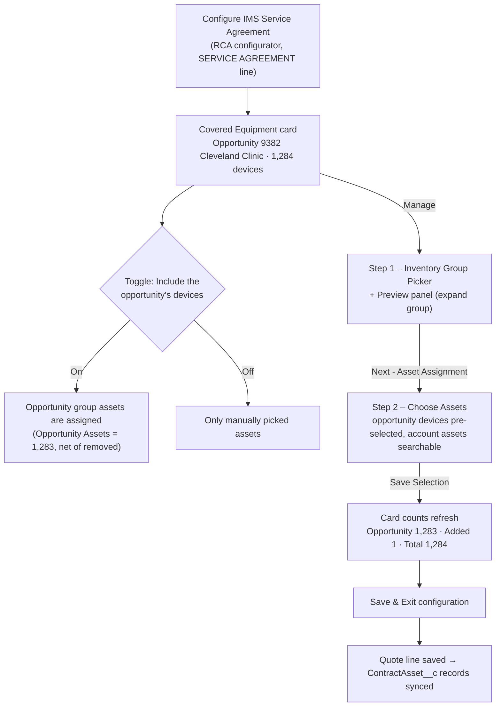
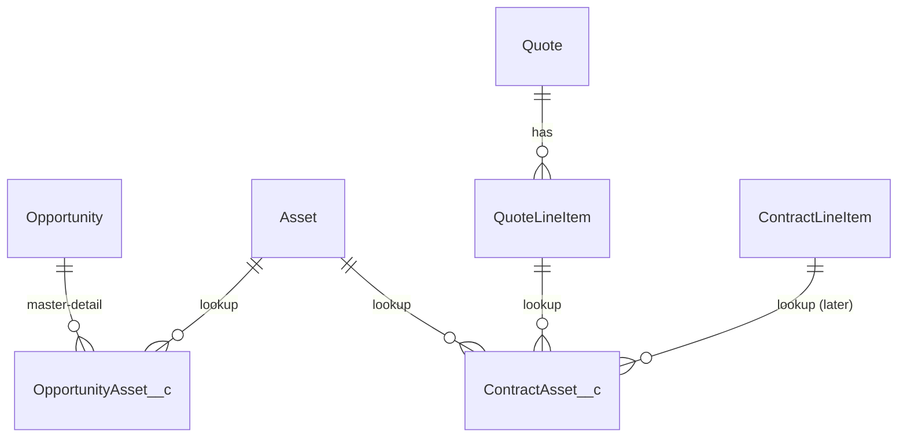
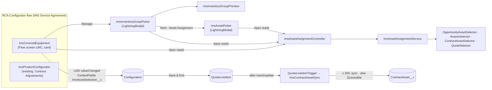

# GW-6456 — Create the IMS Asset Assignment LWCs

| | |
|---|---|
| **Ticket** | GW-6456 (Sub-task of GW-4778, 1.5.1 Product Configuration: Add IMS Asset to Service Product) |
| **Reporter / Assignee** | Chad Huffman / Vinay Soni |
| **Status / Sprint** | New / Sprint 11 |
| **Ticket estimate** | Not specified |
| **Attachments to review** | *IMS Configuration Screen Flow.pptx* (field list per modal), Lucid chart (focus on the **Assign Asset** path), 5 screenshots |
| **This document** | Technical solution + estimate. **No org changes were made.** |

---

## 1. Scope

The IMS Product Configuration has four areas:

| Area | Status |
|---|---|
| Coverage Type & Entitlements | Built in other tickets |
| **Device & Device Inventory Assignment (Asset Assignment)** | **This ticket** |
| Contract Adjustments (Pricing Programs, Inc/Exc, Model Qty, On Location) | Built (`imsProductConfigurator`, GW-4777 / GW-5676 / GW-6468) |
| Revenue Center Categories | Separate (see GW-4864) |

**Out of scope:** the Inventory Tool upload/cleansing that creates the `OpportunityAsset` records (another ticket), and populating *Service Contract Line* on the junction (done at contract creation).

### The four LWC pieces in the ticket description

| # | Ticket description | Component in this design |
|---|---|---|
| 1 | Configurator modal: summary of the devices assigned to the service | `imsCoveredEquipment` (the **Covered Equipment** card on the configurator screen) |
| 2 | Picker for an inventory group created by the inventory upload tool | `imsInventoryGroupPicker` (modal, step 1) |
| 3 | Preview panel that expands a group into its individual assets | `imsInventoryGroupPreview` (child of #2) |
| 4 | Individual asset selector with several search mechanisms | `imsAssetPicker` (modal, step 2: **Choose Assets**) |

---

## 2. User flow (from the mock-ups)



**Covered Equipment card (mock-up):**
- Header: *Covered Equipment*, *Opportunity {Name} · {n} devices on the list*, **Manage** button.
- Toggle **Include the opportunity's devices**: *"The opportunity's devices are assigned. Use Manage to remove some or add other assets."*
- Three tiles: **Opportunity Assets** (net of any removed) · **Added Assets** (picked with Manage) · **Total Assets** (covered by this service).

**Choose Assets modal (mock-up):**
- Subtitle: *SERVICE AGREEMENT · when "Include the opportunity's devices" is on, devices on Opportunity {x} start selected. Untick any you don't want and search to add others.*
- Search all columns, plus criteria fields: **Product Line, Sub Product Line, Device Type, Manufacturer, Model** (the item-number segments).
- Columns: ☐ · **Source** (Opportunity / Account badge) · Serial Number · Asset Name · PFCL · Product Line · Manufacturer · Model · Account. Each column can be sorted and filtered.
- *{n} selected*, **Show selected only**, **Clear selection**.
- Footer: *Showing 11 of 2,310 assets for the quote's account and 2 related accounts – opportunity devices first* and *1,283 of 1,284 opportunity devices + 1 added = 1,284 covered*.
- **Cancel** / **Save Selection**.

---

## 3. Data model



### 3.1 `OpportunityAsset__c` (new): Inventory Tool group table

| Field | API name | Type | Notes |
|---|---|---|---|
| Name | `Name` | Auto Number `ET-{000}` | as per the ticket (`ET-001`) |
| Opportunity | `Opportunity__c` | **Master-Detail(Opportunity)** | Sharing inherits from the Opportunity (ticket requirement) |
| Asset | `Asset__c` | Lookup(Asset) | Required. Delete constraint: *clear* |
| *(proposed)* Inventory Group | `InventoryGroup__c` | Text(80) | See **Q1**. Needed if one opportunity can hold more than one uploaded group |
| *(proposed)* Unique Key | `UniqueKey__c` | Text(40), Unique, External Id | `OpportunityId + AssetId`. Stops the upload tool from creating duplicates |

> Written by the Inventory Tool (other ticket). This ticket only **reads** it. Create the object in this ticket if the upload ticket hasn't yet, and agree the API names with that team.

### 3.2 `ContractAsset__c` (new): junction Quote Line ↔ Asset

| Field | API name | Type | Notes |
|---|---|---|---|
| Name | `Name` | Auto Number `CA-{000000000}` | as per the ticket (`CA-000000001`) |
| Quote Line | `QuoteLineItem__c` | Lookup(QuoteLineItem) | Required. Delete constraint: *cascade* is not allowed on lookup, so clean up in the sync service |
| Service Contract Line | `ContractLineItem__c` | Lookup(ContractLineItem) | Populated later at contract creation |
| Asset | `Asset__c` | Lookup(Asset) | Required |
| Customer Inventory Audit Info | `CustomerInventoryAuditInfo__c` | Long Text Area(32768) | "Information to make the Inventory activity visible". Content TBD (**Q4**) |
| *(proposed)* Quote | `Quote__c` | Lookup(Quote) | Simplifies queries and reports |
| *(proposed)* Source | `Source__c` | Picklist: `Opportunity`, `Account` | Whether the asset came from the inventory group or was added manually. Drives the card counts |
| *(proposed)* Unique Key | `UniqueKey__c` | Text, Unique | `QuoteLineId + AssetId`. Stops duplicate assignment |

**Security:**
- OWD **Private / Private** (internal / external).
- **ServiceSales** permission set: Create / Read / Edit / Delete on `ContractAsset__c` (and Read on `OpportunityAsset__c`, Asset, Opportunity).
- **ServiceSalesReviewers** permission set: Read only.
- Neither permission set is in the repo today. Retrieve both first (**Q6**).

### 3.3 `QuoteLineItem` (change)

| Field | API name | Type | Purpose |
|---|---|---|---|
| IMS Asset Selection | `ImsAssetSelection__c` | Long Text Area(131072) | The configurator keeps the selection here as JSON via a **ContextFields** update, same pattern as `ModelQtyCoverage__c` |

Needs a **Context Attribute + mapping** in the RCA context definition (like `ModelQtyCoverage__c` and `SelectedAssets__c`). The LWC finds the attribute Id with `EsServiceProductConfigController.getAttributeIds`.

> ⚠️ **Do not reuse `SelectedAssets__c`.** `EsServiceQuoteLineTrigger` → `EsServiceLineExpansion` splits every line with that field filled into **one quote line per asset**. An IMS selection of 1,284 devices would create 1,284 lines.

**JSON shape (compact, stores the differences rather than every Id):**
```json
{
  "opportunityId": "006...",
  "includeOpportunityAssets": true,
  "groups": ["Cleveland Clinic Main Campus"],
  "removedAssetIds": ["02i..."],
  "addedAssetIds": ["02i..."],
  "counts": { "opportunity": 1283, "added": 1, "total": 1284 }
}
```
Storing only removed/added Ids keeps the field small (1,284 Ids as a full list would be about 26 KB), and the group stays the source of truth.

---

## 4. Architecture



### Why the configuration is used rather than writing `ContractAsset__c` from the LWC
- Lines in an open configuration can be unsaved (`ref_…` Ids), so there is nothing to look up yet.
- **Cancel** in the configurator must throw away changes. Direct DML would not.
- It is the pattern already used by `imsProductConfigurator` and the ES Service launcher, so reps get the same behaviour.

---

## 5. Component design

### 5.1 `imsCoveredEquipment` (Flow screen card)
- **Target:** `lightning__FlowScreen`. Properties copied from `imsProductConfigurator`: `transactionId`, `rootTransactionLineId`, `currentTransactionLineId`, `currentProductId`, `currentProductName`, `allowedProducts`.
- **Placement:** in the IMS configurator flow, **above** the Contract Adjustments card (as in the mock-up). Visible only for the IMS Service Agreement product.
- **Load:**
  1. LMS subscribe (`lightning__productConfigurator_notification`) to follow the line on screen. Same `key` / `lineId` logic as `imsProductConfigurator`.
  2. `getAttributeIds(['ImsAssetSelection__c'])`.
  3. `getAssignmentContext(quoteId, lineId)` → opportunity name and Id, group count, opportunity asset count, saved selection (from the line or from `ContractAsset__c` for saved lines), and the session value if already changed.
- **Toggle** flips `includeOpportunityAssets`, recalculates the tiles and publishes.
- **Manage** opens `imsInventoryGroupPicker`.
- **Commit:** `publish(... { action: 'valueChanged', data: [{ key, field: 'ContextFields', attributeId, fieldName: 'ImsAssetSelection__c', value }] })`, then a toast (*"Covered equipment updated. Saved when the configuration is saved."*).
- **Reconfigure** (ticket requirement): reopening the configuration loads the saved JSON, so toggle, groups, removed and added are restored. Line switching keeps a session per line (`sessionByLine`, as in `imsProductConfigurator`).

### 5.2 `imsInventoryGroupPicker` + `imsInventoryGroupPreview` (Step 1 modal)
- Lists the inventory groups on the quote's opportunity, from `OpportunityAsset__c` grouped by `InventoryGroup__c` (or one row per opportunity if there is no group field, see Q1). Each row shows the group name, device count, upload date and a checkbox.
- **Preview panel:** expands a group into its assets (Serial, Asset Name, PFCL, Product Line, Manufacturer, Model, Account) to help the rep identify the group. Paged at 50 rows and loaded lazily with `getGroupAssets(opportunityId, group, offset)`.
- **Next - Asset Assignment** passes the chosen groups to `imsAssetPicker`. **Cancel** closes without changes.

### 5.3 `imsAssetPicker` (Step 2 modal, "Choose Assets")
**Reuse:** `esServiceAssetPicker` already does about 70 % of this: loading all assets once, search across all columns, the five criteria fields, column filters, sorting, paging at 100 and debouncing at 250 ms. Recommended approach: **move the shared table, search and filter logic into `c/assetPickerUtils` (JS module)**, and build `imsAssetPicker` on it with the IMS-specific changes:

| Feature | Detail |
|---|---|
| Data | `getEligibleAssets(quoteId, groups)` returns the **opportunity group assets** (Source = Opportunity) **plus** assets on the quote's account and its parent accounts via `AccountAccountRelationship__c` (Source = Account), with duplicates removed. Opportunity devices come first |
| Pre-selection | When the toggle is on, every group asset starts selected minus `removedAssetIds`, plus `addedAssetIds` |
| Fuzzy search | (1) any column, (2) item-number segments: Product Line, Sub Product Line, Device Type, Manufacturer, Model (`*Calculated__c` asset fields), (3) a filter on each column. Contains-match, case-insensitive, every word typed must match (same as the ES picker) |
| Controls | Select all (filtered rows), *Show selected only*, *Clear selection*, selected counter |
| Footer | *Showing x of y assets for the quote's account and n related accounts – opportunity devices first* and *a of b opportunity devices + c added = d covered* |
| Save Selection | Works out `removedAssetIds` (unticked group assets) and `addedAssetIds` (ticked account assets), then returns them to the card, which publishes |
| Volume | 10,000-row ceiling (`MAX_ASSETS`, same as the ES/IMS services). Shows a warning when truncated |

### 5.4 Apex

**`ImsAssetAssignmentController`** (`with sharing`, `@AuraEnabled`, `toAuraException` + `Logger` pattern, scenario `IMS Asset Assignment`, tag `ImsAssets`):

| Method | Purpose |
|---|---|
| `getAssignmentContext(Id quoteId, String lineId)` | Quote → Opportunity, group summary, saved selection (JSON from line, or rebuilt from `ContractAsset__c`), counts |
| `getInventoryGroups(Id opportunityId)` (cacheable) | Groups with counts (aggregate SOQL on `OpportunityAsset__c`) |
| `getGroupAssets(Id opportunityId, String groupName, Integer offset)` | Preview page |
| `getEligibleAssets(Id quoteId, List<String> groups)` | Picker data (group assets + account/related-account assets). Returns `AssetRow` with `source` |

**`ImsContractAssetSync`** (service, called from `QuoteLineItemTrigger` after insert/update):
1. Pick out the lines whose `ImsAssetSelection__c` changed. Recursion guard per line Id (same as `ImsProductConfiguratorService.processedLineIdSet`).
2. Work out the target asset set per line: (group assets if toggle on − removed) ∪ added.
3. Compare with the existing `ContractAsset__c` for the line: insert the missing, delete the no-longer-selected, leave unchanged rows alone.
4. **Volume:** if the change is 200 rows or fewer, do it in the trigger. Otherwise **Queueable**, chained in chunks of 5,000 to stay under the 10k DML-row limit. Savepoint, rollback and `Logger.error` on failure. A failure must never block the quote save, matching the existing IMS sync.
5. Line deleted → delete its `ContractAsset__c` (before delete).

**New selectors:** `OpportunityAssetSelector`, `ContractAssetSelector` (same base as `AssetsSelector`), all `WITH USER_MODE`.

---

## 6. Test plan

### Apex
| # | Scenario | Expected |
|---|---|---|
| 1 | Toggle on, 1 group, no changes → save | One `ContractAsset__c` per group asset, Source = Opportunity |
| 2 | Toggle on, 1 asset removed, 1 account asset added | n−1 Opportunity + 1 Account rows |
| 3 | Toggle off, 3 added | 3 rows only |
| 4 | Reconfigure: remove an added asset | That row deleted, others untouched |
| 5 | 1,300 assets (Queueable path) | All rows created, chained jobs, no limit errors |
| 6 | Unsaved `ref_` line → saved | Sync runs on insert |
| 7 | Quote line deleted | Junction rows deleted |
| 8 | Duplicate asset in the group and on the account | One row (unique key) |
| 9 | Reviewer user (read only) | Cannot create/edit/delete `ContractAsset__c` |
| 10 | ES Service quote line untouched | `EsServiceLineExpansion` not triggered by IMS selections |
| 11 | Bad JSON in `ImsAssetSelection__c` | Logged, save not blocked |

### Jest
Card counts and toggle, LMS publish payload, line switching, group picker and preview paging, picker search (all-column, segment, column filter), pre-selection rules, show-selected-only, clear selection, Save Selection diff.

### UAT
1. Opportunity with an inventory group (data loaded via the upload tool or a script) → quote → IMS Service Agreement → Covered Equipment shows the counts.
2. Toggle off/on → tiles update.
3. Manage → choose group → preview → Next → untick 1, add 1 account asset → Save Selection → 1,283 / 1 / 1,284.
4. Save & Exit → check the `ContractAsset__c` records. Reopen → selection restored.
5. Cancel the configuration after changes → nothing saved.
6. Reviewer user → read only.

---

## 7. Risks, gaps & open questions

### Risks
| # | Risk | Mitigation |
|---|---|---|
| R1 | Reusing `SelectedAssets__c` would set off the ES line expansion (one line per asset) | Dedicated `ImsAssetSelection__c` field (§3.3) |
| R2 | Volume: thousands of assets per quote → DML, heap and browser limits | Store differences in JSON, sync in a chained Queueable, 10k picker ceiling, paged preview |
| R3 | `OpportunityAsset__c` is created by another ticket, so API names may not match | Agree the names up front. Whoever deploys first owns the object |
| R4 | The RCA context definition needs a new attribute and mapping. This step is often missed in deployments | Add it to the deployment checklist. Retrieve the context definition into the repo |
| R5 | Sync runs after save asynchronously, so `ContractAsset__c` is briefly behind the line | The card reads the JSON first, so the user never sees the lag |

### Open questions (for Chad Huffman)
| # | Question |
|---|---|
| Q1 | The ticket calls `OpportunityAsset` a **Group Header** table, but its fields (Opportunity + Asset) make it one row per device. Can an opportunity have **more than one** inventory group? If yes, add `InventoryGroup__c` (or a separate header object with `OpportunityAsset` as the detail). The group picker and preview depend on this |
| Q2 | What makes an asset **eligible**? Quote account plus parent accounts (as in the ES picker)? Asset Status filter (Active only)? Only repairable product lines? |
| Q3 | If a group asset is also on another active IMS contract or quote, should we warn or block it? |
| Q4 | Content and source of *Customer Inventory Audit Info*: who writes it, what format, and is it per asset or per upload? |
| Q5 | Should the assets also be written to `QuoteLineItem` ("the LWC will write the assets to the quote line objects"), or is the junction `ContractAsset__c` enough? This design uses the JSON on the line plus the junction |
| Q6 | API names of the **ServiceSales** / **ServiceSalesReviewers** permission sets (not in the repo) |
| Q7 | Does the Covered Equipment card show on the root SERVICE AGREEMENT line only, or also on child lines? |
| Q8 | Do the PPTX field lists differ from the mock-ups in this doc? (Read the PPTX in detail before the build.) |

---

## 8. Estimation

| # | Task | Area | Estimate |
|---|---|---|---|
| 1 | Review PPTX and Lucid (Assign Asset path), clarify Q1–Q8 | Dev + SA | 0.5 d |
| 2 | Objects: `OpportunityAsset__c`, `ContractAsset__c` (fields, auto-numbers, OWD, layouts, list views), `QuoteLineItem.ImsAssetSelection__c` | Admin/Dev | 1.0 d |
| 3 | Permission sets (ServiceSales CRUD, Reviewers Read) + FLS | Admin/Dev | 0.5 d |
| 4 | RCA context definition attribute + mapping for `ImsAssetSelection__c`. Configurator flow: add `imsCoveredEquipment` with visibility | Dev | 0.5 d |
| 5 | Apex: selectors + `ImsAssetAssignmentController` / service (context, groups, preview, eligible assets) | Apex | 2.0 d |
| 6 | Apex: `ImsContractAssetSync` (diff, trigger hook, Queueable chunking, delete handling, recursion guard) | Apex | 1.5 d |
| 7 | Apex tests (incl. bulk/Queueable, sharing, ES non-regression) | Apex | 1.5 d |
| 8 | Extract shared picker logic into `assetPickerUtils` from `esServiceAssetPicker` (no behaviour change) | LWC | 0.75 d |
| 9 | `imsCoveredEquipment` card (LMS, toggle, tiles, load/commit, reconfigure, per-line session) | LWC | 1.5 d |
| 10 | `imsInventoryGroupPicker` + `imsInventoryGroupPreview` | LWC | 1.5 d |
| 11 | `imsAssetPicker` (Source column, pre-selection, segment search, show selected only, footer counts, diff on save) | LWC | 2.0 d |
| 12 | Jest tests (4 components + utils) | LWC | 1.5 d |
| 13 | Test data script (opportunity group of ~1,300 assets), `package.xml`, deploy to dev/QA, PR review fixes | Dev | 0.75 d |
| 14 | Dev testing in the configurator, UAT support, defect fixes | Dev + QA | 2.0 d |
| | **Total** | | **≈ 17.5 dev days (~3.5 weeks for one developer)** |

**Ways to bring it down:**
- If Q1 = one group per opportunity, the group picker reduces to a toggle plus preview: **−1.0 d**.
- Skipping the `assetPickerUtils` extraction (copying the ES picker instead) saves **0.75 d**, but leaves two copies of the same code to maintain. Not recommended; `CONTRACT_ADJUSTMENTS_PRICING_PROGRAMS_DESIGN.md` already flags this problem with the `modelQtyCoverage` copies.
- Two developers (Apex on 2/3/5–7, LWC on 8–12) in parallel: **~2 weeks** elapsed.

---

## 9. Deployment checklist

- [ ] `OpportunityAsset__c` (if not already deployed by the upload ticket) and `ContractAsset__c`: objects, fields, layouts, OWD Private/Private
- [ ] `QuoteLineItem.ImsAssetSelection__c`
- [ ] RCA context definition: attribute + mapping for `ImsAssetSelection__c`
- [ ] Apex: `ImsAssetAssignmentController`, `ImsAssetAssignmentService`, `ImsContractAssetSync`, `OpportunityAssetSelector`, `ContractAssetSelector`, trigger handler hook + tests
- [ ] LWC: `imsCoveredEquipment`, `imsInventoryGroupPicker`, `imsInventoryGroupPreview`, `imsAssetPicker`, `assetPickerUtils` (+ updated `esServiceAssetPicker`)
- [ ] IMS configurator flow: card placed above Contract Adjustments, visibility rule
- [ ] Permission sets: ServiceSales (CRUD), ServiceSalesReviewers (Read)
- [ ] `manifest/package.xml` updated
- [ ] Run the specified tests, including `EsServiceAssetSelectionControllerTest` (regression after the utils extraction)
