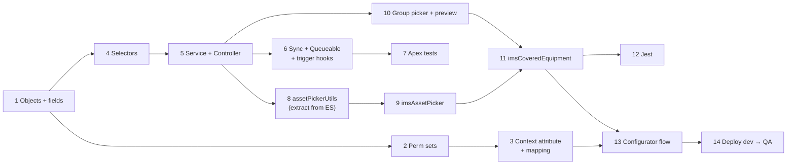

# GW-6456 — IMS Asset Assignment: Implementation Guide

> Companion to [GW-6456_IMS_ASSET_ASSIGNMENT_DESIGN.md](GW-6456_IMS_ASSET_ASSIGNMENT_DESIGN.md), which covers the *what* and *why*. This document is the *how*: build order, metadata, code, tests and deployment steps.
> **Nothing here has been deployed. No org changes were made.**

---

## Implementation status (2026-11-25): built in the repo, **object + fields deployed to cbmdev; Apex / LWC / flow not deployed**

### Deployment log
| Date | Org | What | Deploy ID | Result |
|---|---|---|---|---|
| 2026-11-25 | cbmdev (`vinay_soni@steris.com.cbmdev`) | `CustomObject:OpportunityAsset__c`; `CustomField`: `OpportunityAsset__c.Opportunity__c`, `.Asset__c`, `.InventoryGroup__c`, `.UniqueKey__c`, `QuoteLineItem.ImsAssetSelection__c` | `0AfOu00000FfuIXKAZ` (validated first: `0AfOu00000FfuGvKAJ`) | ✅ Succeeded, 6/6 created |

No field permissions were deployed: the new fields are not visible to anyone until a permission set grants them (see "Still to do" #2).

### Decision: `ContractAsset__c` stays as it is
`ContractAsset__c` already exists in cbmdev (GW-2519 / GW-2273, 14 records) with **`ContractLineItem__c` as a required Master-Detail**, plus `Asset__c`, `StartDate__c`, `EndDate__c`, `Entitlement__c`. A row cannot exist without a contract line, so the quote-save sync in §4.5–§4.6 (`ImsContractAssetSync`, the trigger hooks, `QuoteLineItem__c` / `Source__c` / `UniqueKey__c` / `CustomerInventoryAuditInfo__c`) was **not built**. Instead:
- The selection lives only in `QuoteLineItem.ImsAssetSelection__c` (JSON, §3), saved with the configuration.
- `ImsAssetAssignmentService.buildContractAssets(Map<QuoteLineItemId, ContractLineItemId>)` returns the `ContractAsset__c` rows (contract line, asset, start/end date from the contract line) for the contract-creation step to insert. It skips assets already linked, so it can be called again. It is not wired to anything yet: the contract-creation process must call it.
- A line whose card was never changed (blank JSON) gets the card's default: every inventory group on the quote's opportunity. Unreadable JSON covers nothing (logged).

### What was built
| Area | Files |
|---|---|
| Metadata | `objects/OpportunityAsset__c` (object + `Opportunity__c` MD, `Asset__c`, `InventoryGroup__c`, `UniqueKey__c`), `objects/QuoteLineItem/fields/ImsAssetSelection__c` |
| Apex | `OpportunityAssetSelector`, `ImsAssetAssignmentService`, `ImsAssetAssignmentController`, `ImsAssetAssignmentServiceTest`; `EsServiceAssetSelectionController` refactor (`loadAccountAssets`, `loadRowsByIds`, `AssetRow.source`; `getAssets` / `getAssetsByIds` behave as before) |
| LWC | `assetPickerUtils` (new, shared), `esServiceAssetPicker` (uses the shared helpers, same behaviour), `imsCoveredEquipment`, `imsInventoryGroupPicker`, `imsInventoryGroupPreview`, `imsAssetPicker`, Jest tests for all five new modules |
| Flow | `flows/Custom_Product_Configurator_IMS_Service_Product.flow-meta.xml`: retrieved from cbmdev (active v8) and `c:imsCoveredEquipment` added above `c:imsProductConfigurator`, same inputs + `currentTransactionLineId`, `allowedProducts = FIXED FEE SERVICE AGREEMENT,SERVICE AGREEMENT` |
| Tooling | `jest-mocks/lightning/modal.js` + `jest.config.js` mapper (sfdx-lwc-jest has no `lightning/modal` stub), `manifest/gw-6456-package.xml` |

`QuoteLineItemSelector` was **not** changed: the repo copy differs from cbmdev, so the new code uses the existing builder API instead.

### Verified / not verified
- ✅ Jest: 27 tests pass (`npx sfdx-lwc-jest -- assetPickerUtils imsAssetPicker imsCoveredEquipment imsInventoryGroup`). ESLint clean on the new components.
- ❌ Apex has **not been compiled or run** (only the object + fields are in cbmdev). Run a check-only validation first:
  `sf project deploy validate -x manifest/gw-6456-package.xml -o <alias> -l RunSpecifiedTests -t ImsAssetAssignmentServiceTest EsServiceAssetSelectionControllerTest`
- ❌ The ES picker refactor has no Jest tests; check the ES configurator manually after deploying.

### Still to do before / after deploying
1. RCA context definition: add the `ImsAssetSelection__c` attribute + Quote mapping (§2.4). Without it the card shows *"Missing context attribute Id"* and cannot save.
2. Permission sets (§2.5): Read on `OpportunityAsset__c` + its fields and Edit on `QuoteLineItem.ImsAssetSelection__c` for Service Sales users. The permission sets are not in the repo; retrieve them first.
3. Agree `OpportunityAsset__c` API names with the Inventory Tool upload ticket.
4. Contract creation: call `buildContractAssets` and insert the result (chunk above 10,000 rows).
5. Deploying the flow creates a new version; activate it in dev first.

---

## 0. Assumptions used until the open questions are answered

The design doc's open questions (§7) are still open. This guide builds on the defaults below. Each one is isolated so it can change without a rewrite.

| Open question | Default used here | Where to change it |
|---|---|---|
| Q1: more than one inventory group per opportunity? | **Yes.** `OpportunityAsset__c.InventoryGroup__c` (Text). A blank group is shown as *"Default Group"* | `ImsAssetAssignmentService.DEFAULT_GROUP`, group picker |
| Q2: eligible assets | Quote account + its parent accounts via `AccountAccountRelationship__c` (same rule as the ES picker), any status, plus every asset in the opportunity groups | `EsServiceAssetSelectionController.loadAccountAssets` |
| Q3: asset already on another contract | Not checked | — |
| Q4: Customer Inventory Audit Info | Written by the sync: `Source, Group, assigned by <user> on <datetime>` | `ImsContractAssetSync.auditInfo()` |
| Q5: write to quote line too? | JSON on the line (`ImsAssetSelection__c`) + `ContractAsset__c` junction | — |
| Q6: permission set names | `ServiceSales`, `ServiceSalesReviewers` (placeholders) | §2.5 |
| Q7: which line shows the card | Root line only (`allowedProducts = IMS Service Agreement`) | Flow component property |

---

## 1. Build order



| Step | Owner | Est. |
|---|---|---|
| 1–3 Metadata | Admin/Dev | 2.0 d |
| 4–7 Apex | Apex dev | 5.0 d |
| 8–12 LWC | LWC dev | 7.25 d |
| 13–14 Flow, deploy, UAT | Dev + QA | 3.25 d |

---

## 2. Metadata

### 2.1 `OpportunityAsset__c`

`force-app/main/default/objects/OpportunityAsset__c/`

`OpportunityAsset__c.object-meta.xml`
```xml
<?xml version="1.0" encoding="UTF-8"?>
<CustomObject xmlns="http://soap.sforce.com/2006/04/metadata">
    <label>Opportunity Asset</label>
    <pluralLabel>Opportunity Assets</pluralLabel>
    <description>GW-6456 - Inventory Tool group table: one row per device uploaded against an Opportunity.</description>
    <nameField>
        <label>Opportunity Asset Number</label>
        <type>AutoNumber</type>
        <displayFormat>ET-{000000}</displayFormat>
        <startingNumber>1</startingNumber>
    </nameField>
    <deploymentStatus>Deployed</deploymentStatus>
    <sharingModel>ControlledByParent</sharingModel>
    <externalSharingModel>ControlledByParent</externalSharingModel>
    <enableReports>true</enableReports>
    <enableSearch>false</enableSearch>
    <enableHistory>false</enableHistory>
</CustomObject>
```

| File (`fields/`) | Type | Key settings |
|---|---|---|
| `Opportunity__c.field-meta.xml` | MasterDetail → Opportunity | `relationshipName=OpportunityAssets`, `reparentableMasterDetail=false`, `writeRequiresMasterRead=false` |
| `Asset__c.field-meta.xml` | Lookup → Asset | `required=true`, `deleteConstraint=Restrict`, `relationshipName=OpportunityAssets` |
| `InventoryGroup__c.field-meta.xml` | Text(80) | Inventory Tool group name |
| `UniqueKey__c.field-meta.xml` | Text(40) | `unique=true`, `externalId=true`, `caseSensitive=false`. Value is `OppId + AssetId`, set by the upload tool |

```xml
<!-- fields/Opportunity__c.field-meta.xml -->
<CustomField xmlns="http://soap.sforce.com/2006/04/metadata">
    <fullName>Opportunity__c</fullName>
    <label>Opportunity</label>
    <type>MasterDetail</type>
    <referenceTo>Opportunity</referenceTo>
    <relationshipLabel>Opportunity Assets</relationshipLabel>
    <relationshipName>OpportunityAssets</relationshipName>
    <relationshipOrder>0</relationshipOrder>
    <reparentableMasterDetail>false</reparentableMasterDetail>
    <writeRequiresMasterRead>false</writeRequiresMasterRead>
</CustomField>
```

> Coordinate with the Inventory Tool upload ticket. Whichever ticket deploys first owns this object, and the API names above must match.

### 2.2 `ContractAsset__c`

`ContractAsset__c.object-meta.xml`: `nameField` AutoNumber `CA-{000000000}`, `sharingModel=Private`, `externalSharingModel=Private`, `enableReports=true`.

| Field | Type | Key settings |
|---|---|---|
| `QuoteLineItem__c` | Lookup → QuoteLineItem | `required=false` (lookups to QLI cannot be required + Restrict). `deleteConstraint=SetNull`. Cleanup is done in Apex (§4.5) |
| `Quote__c` | Lookup → Quote | `deleteConstraint=SetNull` |
| `ContractLineItem__c` | Lookup → ContractLineItem | Label *Service Contract Line*. Filled later at contract creation |
| `Asset__c` | Lookup → Asset | `required=true`, `deleteConstraint=Restrict` |
| `Source__c` | Picklist (restricted) | `Opportunity`, `Account` |
| `CustomerInventoryAuditInfo__c` | LongTextArea(32768), 5 lines | Label *Customer Inventory Audit Info* |
| `UniqueKey__c` | Text(40) | `unique=true`, `externalId=true`. Value is `QuoteLineItemId + AssetId` |

Layout `ContractAsset__c-Contract Asset Layout`: Name, Quote, Quote Line, Asset, Source, Service Contract Line, Customer Inventory Audit Info. List view *All*.

Related lists: add **Contract Assets** to the Quote Line Item and Asset layouts. Add **Opportunity Assets** to the Opportunity layout used by Service Sales.

### 2.3 `QuoteLineItem.ImsAssetSelection__c`

```xml
<CustomField xmlns="http://soap.sforce.com/2006/04/metadata">
    <fullName>ImsAssetSelection__c</fullName>
    <label>IMS Asset Selection</label>
    <description>GW-6456 - Covered Equipment selection written by imsCoveredEquipment (JSON). Synced to ContractAsset__c on save.</description>
    <type>LongTextArea</type>
    <length>131072</length>
    <visibleLines>3</visibleLines>
</CustomField>
```
**Do not** add it to page layouts. It is a system field.

### 2.4 RCA context definition (manual step in Setup, then retrieve)

1. Setup → **Context Service → Context Definitions** → open the definition used by the IMS quote (the same one that holds `ModelQtyCoverage__c`).
2. On the `SalesTransactionItem` node, add the attribute **`ImsAssetSelection__c`** (Data type: Text). The *Title* must equal the field API name, because `getAttributeIds` looks it up by Title.
3. **Map** it to `QuoteLineItem.ImsAssetSelection__c` in the Quote mapping (input and output, both directions).
4. Activate the definition version.
5. Retrieve it into the repo: `sf project retrieve start -m "ContextDefinition:<Name>"`.

### 2.5 Permission sets

| Permission set | `ContractAsset__c` | `OpportunityAsset__c` | FLS | Apex classes |
|---|---|---|---|---|
| `ServiceSales` | C R E D | R | all new fields: Edit (`ImsAssetSelection__c` Edit) | `ImsAssetAssignmentController` |
| `ServiceSalesReviewers` | R | R | all new fields: Read | `ImsAssetAssignmentController` |

Retrieve both first (`sf project retrieve start -m "PermissionSet:ServiceSales,PermissionSet:ServiceSalesReviewers"`) and add the entries. Don't write the files from scratch, or the existing permissions will be wiped.

---

## 3. Selection JSON contract

Stored in `QuoteLineItem.ImsAssetSelection__c`. Apex and the LWC share this shape, so the property names are fixed.

```json
{
  "version": 1,
  "opportunityId": "006...",
  "includeOpportunityAssets": true,
  "groups": ["Cleveland Clinic Main Campus"],
  "removedAssetIds": ["02i..."],
  "addedAssetIds": ["02i..."],
  "counts": { "opportunity": 1283, "added": 1, "total": 1284 }
}
```

**Covered set** = (`includeOpportunityAssets` ? assets of `groups` : ∅) − `removedAssetIds` ∪ `addedAssetIds`.
`counts` is for display only. The sync always recomputes from the Ids.

---

## 4. Apex

### 4.1 Selectors

`classes/OpportunityAssetSelector.cls`
```apex
/**
 * @description GW-6456 - Selector for OpportunityAsset__c (Inventory Tool group rows).
 */
public with sharing class OpportunityAssetSelector extends SoqlQueryBuilder {

	public OpportunityAssetSelector() {
		super('OpportunityAsset__c');
	}

	/**
	 * @description Inventory groups on an opportunity with device counts.
	 */
	public static List<AggregateResult> selectGroupCounts(Id opportunityId) {
		return [
			SELECT InventoryGroup__c groupName, COUNT(Id) deviceCount, MAX(CreatedDate) uploadedOn
			FROM OpportunityAsset__c
			WHERE Opportunity__c = :opportunityId
			WITH USER_MODE
			GROUP BY InventoryGroup__c
			ORDER BY InventoryGroup__c
		];
	}

	/**
	 * @description Asset Ids in the given groups (null in groups = the blank/default group).
	 */
	public static Set<Id> selectAssetIdsByGroups(Id opportunityId, Set<String> groups) {
		Set<Id> assetIds = new Set<Id>();
		for (OpportunityAsset__c row : [
			SELECT Asset__c FROM OpportunityAsset__c
			WHERE Opportunity__c = :opportunityId AND InventoryGroup__c IN :groups AND Asset__c != null
			WITH USER_MODE
		]) {
			assetIds.add(row.Asset__c);
		}
		return assetIds;
	}

	/**
	 * @description One page of a group's devices for the preview panel.
	 */
	public static List<OpportunityAsset__c> selectGroupPage(Id opportunityId, String groupName, Integer pageSize, Integer offset) {
		return [
			SELECT Id, Asset__c, Asset__r.SerialNumber, Asset__r.Name, Asset__r.AssetAccountName_f__c,
				Asset__r.ProductLineCalculated__c, Asset__r.ManufacturerCalculated__c, Asset__r.ModelCalculated__c,
				Asset__r.PFCL__c
			FROM OpportunityAsset__c
			WHERE Opportunity__c = :opportunityId AND InventoryGroup__c = :groupName
			WITH USER_MODE
			ORDER BY Asset__r.SerialNumber NULLS LAST
			LIMIT :pageSize OFFSET :offset
		];
	}
}
```
> `OFFSET` is capped at 2,000. Past that the preview shows *"Showing the first 2,000. Use Choose Assets to search the rest"*. This is enough to identify a group.

`classes/ContractAssetSelector.cls`
```apex
public with sharing class ContractAssetSelector extends SoqlQueryBuilder {
	public ContractAssetSelector() {
		super('ContractAsset__c');
	}

	/** @description Existing junction rows by quote line (system mode: the sync must see every row). */
	public static Map<Id, Map<Id, ContractAsset__c>> selectByLineIds(Set<Id> lineIds) {
		Map<Id, Map<Id, ContractAsset__c>> result = new Map<Id, Map<Id, ContractAsset__c>>();
		for (ContractAsset__c row : [
			SELECT Id, QuoteLineItem__c, Asset__c, Source__c
			FROM ContractAsset__c
			WHERE QuoteLineItem__c IN :lineIds
			WITH SYSTEM_MODE
		]) {
			if (!result.containsKey(row.QuoteLineItem__c)) {
				result.put(row.QuoteLineItem__c, new Map<Id, ContractAsset__c>());
			}
			result.get(row.QuoteLineItem__c).put(row.Asset__c, row);
		}
		return result;
	}
}
```

`QuoteLineItemSelector` gets a new method:
```apex
	/** @description GW-6456 - Lines with their IMS asset selection and quote/opportunity. */
	public static List<QuoteLineItem> selectImsSelectionByIds(Set<Id> lineIds) {
		return [
			SELECT Id, QuoteId, Quote.OpportunityId, Quote.AccountId, ImsAssetSelection__c
			FROM QuoteLineItem WHERE Id IN :lineIds WITH SYSTEM_MODE
		];
	}
```

### 4.2 Small refactor in `EsServiceAssetSelectionController`

Extract the body of `getAssets` into a non-Aura method so IMS can reuse it. `getAssets` behaves exactly as before.

```apex
	@AuraEnabled public String source; // GW-6456 - added to AssetRow: 'Opportunity' | 'Account' (null for ES)

	@AuraEnabled
	public static AssetList getAssets(Id quoteId) {
		try {
			return loadAccountAssets(quoteId);
		} catch (Exception e) {
			throw toAuraException('getAssets: unable to load assets for the quote', quoteId, e,
								  'Unable to load the assets for this quote.');
		} finally {
			Logger.saveLog();
		}
	}

	/** @description Assets on the quote's account and its parent accounts (moved from getAssets, unchanged). */
	public static AssetList loadAccountAssets(Id quoteId) { /* existing body of getAssets' try block */ }

	/** @description Rows for given asset Ids (any account), for IMS opportunity-group assets. */
	public static List<AssetRow> loadRowsByIds(Set<Id> assetIds) { /* same field list + toRow */ }
```
Run `EsServiceAssetSelectionControllerTest` afterwards to check for regressions.

### 4.3 `ImsAssetAssignmentService`

```apex
/**
 * @author <dev>
 * @date 2026/11/xx
 * @group IMS Asset Assignment
 * @description GW-6456 - Covered Equipment for the IMS Service Agreement in the RCA configurator: inventory
 *              groups on the quote's opportunity, eligible assets for the picker, and the selection JSON
 *              (QuoteLineItem.ImsAssetSelection__c) shared with imsCoveredEquipment.
 */
public with sharing class ImsAssetAssignmentService {

	public static final String SELECTION_FIELD = 'ImsAssetSelection__c';
	public static final String SOURCE_OPPORTUNITY = 'Opportunity';
	public static final String SOURCE_ACCOUNT = 'Account';
	public static final String DEFAULT_GROUP = 'Default Group';
	@TestVisible private static final Integer PREVIEW_PAGE_SIZE = 50;
	@TestVisible private static final Integer MAX_ASSETS = 10000;

	public class ImsAssetAssignmentException extends Exception {}

	/** @description The JSON stored on the line (see implementation guide §3). */
	public class Selection {
		public Integer version = 1;
		public Id opportunityId;
		public Boolean includeOpportunityAssets = true;
		public List<String> groups = new List<String>();
		public List<Id> removedAssetIds = new List<Id>();
		public List<Id> addedAssetIds = new List<Id>();
		public Map<String, Integer> counts;
	}

	public class InventoryGroup {
		@AuraEnabled public String name;
		@AuraEnabled public Integer deviceCount;
		@AuraEnabled public Datetime uploadedOn;
	}

	public class AssignmentContext {
		@AuraEnabled public Id quoteId;
		@AuraEnabled public Id opportunityId;
		@AuraEnabled public String opportunityName;
		@AuraEnabled public List<InventoryGroup> groups = new List<InventoryGroup>();
		@AuraEnabled public Integer opportunityDeviceCount = 0;
		@AuraEnabled public String savedSelection; // JSON, null when nothing saved
	}

	public class EligibleAssets {
		@AuraEnabled public List<EsServiceAssetSelectionController.AssetRow> rows =
			new List<EsServiceAssetSelectionController.AssetRow>();
		@AuraEnabled public Integer relatedAccountCount = 0;
		@AuraEnabled public Boolean truncated = false;
	}

	public static Selection parse(String raw) {
		if (String.isBlank(raw)) {
			return null;
		}
		try {
			Selection s = (Selection) JSON.deserialize(raw, Selection.class);
			if (s.groups == null) s.groups = new List<String>();
			if (s.removedAssetIds == null) s.removedAssetIds = new List<Id>();
			if (s.addedAssetIds == null) s.addedAssetIds = new List<Id>();
			if (s.includeOpportunityAssets == null) s.includeOpportunityAssets = true;
			return s;
		} catch (Exception e) { // JSONException or a malformed Id (StringException)
			Logger.warn('ImsAssetAssignmentService.parse: unreadable ' + SELECTION_FIELD, e).addTag('ImsAssets');
			return null;
		}
	}

	public static AssignmentContext getContext(Id quoteId, Id lineId) {
		AssignmentContext ctx = new AssignmentContext();
		ctx.quoteId = quoteId;
		Quote q = (Quote) new QuoteSelector()
			.selectFields(new List<String>{ 'Id', 'OpportunityId', 'Opportunity.Name' })
			.whereEquals('Id', quoteId)
			.first();
		if (q == null) {
			throw new ImsAssetAssignmentException('Quote not found.');
		}
		ctx.opportunityId = q.OpportunityId;
		ctx.opportunityName = q.Opportunity?.Name;
		if (q.OpportunityId != null) {
			for (AggregateResult ar : OpportunityAssetSelector.selectGroupCounts(q.OpportunityId)) {
				InventoryGroup g = new InventoryGroup();
				String raw = (String) ar.get('groupName');
				g.name = String.isBlank(raw) ? DEFAULT_GROUP : raw;
				g.deviceCount = (Integer) ar.get('deviceCount');
				g.uploadedOn = (Datetime) ar.get('uploadedOn');
				ctx.groups.add(g);
				ctx.opportunityDeviceCount += g.deviceCount;
			}
		}
		if (lineId != null) {
			List<QuoteLineItem> lines = QuoteLineItemSelector.selectImsSelectionByIds(new Set<Id>{ lineId });
			ctx.savedSelection = lines.isEmpty() ? null : lines[0].ImsAssetSelection__c;
		}
		return ctx;
	}

	public static List<EsServiceAssetSelectionController.AssetRow> getGroupPage(Id opportunityId, String groupName, Integer offset) {
		String dbGroup = groupName == DEFAULT_GROUP ? null : groupName;
		List<Id> assetIds = new List<Id>();
		for (OpportunityAsset__c row : OpportunityAssetSelector.selectGroupPage(
			opportunityId, dbGroup, PREVIEW_PAGE_SIZE, Math.min(offset == null ? 0 : offset, 2000))) {
			assetIds.add(row.Asset__c);
		}
		return EsServiceAssetSelectionController.loadRowsByIds(new Set<Id>(assetIds));
	}

	/**
	 * @description Picker data: the chosen groups' devices (Source = Opportunity, first) plus the account and
	 *              related-account assets (Source = Account), without duplicates.
	 */
	public static EligibleAssets getEligibleAssets(Id quoteId, Id opportunityId, List<String> groups) {
		EligibleAssets result = new EligibleAssets();
		Set<Id> groupAssetIds = opportunityId == null || groups == null || groups.isEmpty()
			? new Set<Id>()
			: OpportunityAssetSelector.selectAssetIdsByGroups(opportunityId, toDbGroups(groups));

		Set<Id> seen = new Set<Id>();
		for (EsServiceAssetSelectionController.AssetRow r : EsServiceAssetSelectionController.loadRowsByIds(groupAssetIds)) {
			r.source = SOURCE_OPPORTUNITY;
			result.rows.add(r);
			seen.add(r.id);
		}
		EsServiceAssetSelectionController.AssetList accountAssets =
			EsServiceAssetSelectionController.loadAccountAssets(quoteId);
		result.relatedAccountCount = accountAssets.relatedAccountCount;
		for (EsServiceAssetSelectionController.AssetRow r : accountAssets.rows) {
			if (seen.add(r.id)) {
				r.source = SOURCE_ACCOUNT;
				result.rows.add(r);
			}
		}
		if (result.rows.size() > MAX_ASSETS) {
			while (result.rows.size() > MAX_ASSETS) {
				result.rows.remove(result.rows.size() - 1);
			}
			result.truncated = true;
		}
		result.truncated = result.truncated || accountAssets.truncated;
		return result;
	}

	/** @description The covered asset set of a selection, with each asset's source. */
	public static Map<Id, String> coveredAssets(Selection s) {
		Map<Id, String> covered = new Map<Id, String>();
		if (s == null) {
			return covered;
		}
		if (s.includeOpportunityAssets && s.opportunityId != null && !s.groups.isEmpty()) {
			for (Id assetId : OpportunityAssetSelector.selectAssetIdsByGroups(s.opportunityId, toDbGroups(s.groups))) {
				covered.put(assetId, SOURCE_OPPORTUNITY);
			}
		}
		for (Id removed : s.removedAssetIds) {
			covered.remove(removed);
		}
		for (Id added : s.addedAssetIds) {
			if (!covered.containsKey(added)) {
				covered.put(added, SOURCE_ACCOUNT);
			}
		}
		return covered;
	}

	private static Set<String> toDbGroups(List<String> groups) {
		Set<String> result = new Set<String>();
		for (String g : groups) {
			result.add(g == DEFAULT_GROUP ? null : g);
		}
		return result;
	}
}
```

### 4.4 `ImsAssetAssignmentController`

```apex
/**
 * @description GW-6456 - Controller for imsCoveredEquipment, imsInventoryGroupPicker and imsAssetPicker. Reads only;
 *              the selection is written into the configuration by imsCoveredEquipment (ContextFields update) and
 *              ImsContractAssetSync creates the ContractAsset__c records when the quote line is saved.
 */
public with sharing class ImsAssetAssignmentController {

	private static final String CLASS_NAME = 'ImsAssetAssignmentController';
	private static final String SCENARIO = 'IMS Asset Assignment';
	private static final String LOGGER_TAG = 'ImsAssets';

	@AuraEnabled
	public static ImsAssetAssignmentService.AssignmentContext getAssignmentContext(Id quoteId, String lineId) {
		try {
			return ImsAssetAssignmentService.getContext(quoteId, toQuoteLineId(lineId));
		} catch (Exception e) {
			throw toAuraException('getAssignmentContext', quoteId, e, 'Unable to load the covered equipment.');
		} finally {
			Logger.saveLog();
		}
	}

	@AuraEnabled
	public static List<EsServiceAssetSelectionController.AssetRow> getGroupAssets(Id opportunityId, String groupName, Integer offset) {
		try {
			return ImsAssetAssignmentService.getGroupPage(opportunityId, groupName, offset);
		} catch (Exception e) {
			throw toAuraException('getGroupAssets: ' + groupName, opportunityId, e, 'Unable to load the group devices.');
		} finally {
			Logger.saveLog();
		}
	}

	@AuraEnabled
	public static ImsAssetAssignmentService.EligibleAssets getEligibleAssets(Id quoteId, Id opportunityId, List<String> groups) {
		try {
			return ImsAssetAssignmentService.getEligibleAssets(quoteId, opportunityId, groups);
		} catch (Exception e) {
			throw toAuraException('getEligibleAssets', quoteId, e, 'Unable to load the assets for this quote.');
		} finally {
			Logger.saveLog();
		}
	}

	// toQuoteLineId(String) and toAuraException(...) — copy from ImsProductConfiguratorController (same behaviour:
	// "ref_" / blank Ids return null; Logger.error + AuraHandledException with the user message).
}
```

### 4.5 `ImsContractAssetSync` + `ImsContractAssetSyncJob`

```apex
/**
 * @description GW-6456 - Keeps ContractAsset__c in line with QuoteLineItem.ImsAssetSelection__c. Diff-based and
 *              idempotent: inserts missing assets, deletes unselected ones, leaves the rest. Small changes run in
 *              the trigger; large ones go to ImsContractAssetSyncJob (chained in chunks). Failures are rolled
 *              back and logged and never block the quote save.
 */
public with sharing class ImsContractAssetSync {

	@TestVisible private static final Integer SYNC_LIMIT = 200;   // rows changed in the trigger itself
	public static final Integer CHUNK_SIZE = 5000;                // rows per Queueable execution (used by the job)
	@TestVisible private static final Set<Id> processedLineIdSet = new Set<Id>();
	private static final String LOGGER_TAG = 'ImsAssets';

	public class Plan {
		public List<ContractAsset__c> toInsert = new List<ContractAsset__c>();
		public List<ContractAsset__c> toDelete = new List<ContractAsset__c>();
		public Integer size() { return toInsert.size() + toDelete.size(); }
	}

	/** @description After insert / after update of QuoteLineItem. */
	public static void onLinesSaved(List<QuoteLineItem> newLines, Map<Id, QuoteLineItem> oldMap) {
		Set<Id> changed = new Set<Id>();
		for (QuoteLineItem line : newLines) {
			String newValue = line.ImsAssetSelection__c;
			String oldValue = oldMap == null ? null : oldMap.get(line.Id).ImsAssetSelection__c;
			Boolean isChange = oldMap == null ? String.isNotBlank(newValue) : newValue != oldValue;
			if (isChange && processedLineIdSet.add(line.Id)) {
				changed.add(line.Id);
			}
		}
		if (changed.isEmpty()) {
			return;
		}
		Logger.setScenario('IMS Asset Assignment');
		try {
			Plan plan = buildPlan(changed);
			if (plan.size() <= SYNC_LIMIT) {
				apply(plan, CHUNK_SIZE);
			} else if (Limits.getQueueableJobs() < Limits.getLimitQueueableJobs()) {
				System.enqueueJob(new ImsContractAssetSyncJob(changed, 0));
			} else {
				Logger.error('ImsContractAssetSync: no Queueable capacity; lines not synced ' + changed).addTag(LOGGER_TAG);
			}
		} catch (Exception e) {
			Logger.error('ImsContractAssetSync.onLinesSaved failed', e).addTag(LOGGER_TAG);
		} finally {
			Logger.saveLog();
		}
	}

	/** @description Before delete of QuoteLineItem: remove its junction rows (lookup has no cascade). */
	public static void onLinesDeleted(Map<Id, QuoteLineItem> oldMap) {
		List<ContractAsset__c> rows = new List<ContractAsset__c>();
		for (Map<Id, ContractAsset__c> byAsset : ContractAssetSelector.selectByLineIds(oldMap.keySet()).values()) {
			rows.addAll(byAsset.values());
		}
		if (!rows.isEmpty()) {
			Database.delete(rows, AccessLevel.SYSTEM_MODE);
		}
	}

	public static Plan buildPlan(Set<Id> lineIds) {
		Plan plan = new Plan();
		Map<Id, Map<Id, ContractAsset__c>> existing = ContractAssetSelector.selectByLineIds(lineIds);
		for (QuoteLineItem line : QuoteLineItemSelector.selectImsSelectionByIds(lineIds)) {
			ImsAssetAssignmentService.Selection s = ImsAssetAssignmentService.parse(line.ImsAssetSelection__c);
			Map<Id, String> target = ImsAssetAssignmentService.coveredAssets(s);
			Map<Id, ContractAsset__c> current = existing.containsKey(line.Id)
				? existing.get(line.Id) : new Map<Id, ContractAsset__c>();
			for (Id assetId : target.keySet()) {
				if (!current.containsKey(assetId)) {
					plan.toInsert.add(new ContractAsset__c(
						QuoteLineItem__c = line.Id,
						Quote__c = line.QuoteId,
						Asset__c = assetId,
						Source__c = target.get(assetId),
						UniqueKey__c = String.valueOf(line.Id).left(15) + String.valueOf(assetId).left(15),
						CustomerInventoryAuditInfo__c = auditInfo(target.get(assetId), s)
					));
				}
			}
			for (Id assetId : current.keySet()) {
				if (!target.containsKey(assetId)) {
					plan.toDelete.add(current.get(assetId));
				}
			}
		}
		return plan;
	}

	/** @description Applies up to maxRows operations (deletes first). Returns true when everything was applied. */
	public static Boolean apply(Plan plan, Integer maxRows) {
		List<ContractAsset__c> deletes = slice(plan.toDelete, maxRows);
		List<ContractAsset__c> inserts = slice(plan.toInsert, maxRows - deletes.size());
		Savepoint sp = Database.setSavepoint();
		try {
			if (!deletes.isEmpty()) Database.delete(deletes, AccessLevel.USER_MODE);
			if (!inserts.isEmpty()) Database.insert(inserts, AccessLevel.USER_MODE);
		} catch (Exception e) {
			Database.rollback(sp);
			throw e;
		}
		return deletes.size() + inserts.size() == plan.size();
	}

	@TestVisible
	private static String auditInfo(String source, ImsAssetAssignmentService.Selection s) {
		return 'Source: ' + source
			+ (source == ImsAssetAssignmentService.SOURCE_OPPORTUNITY && s != null ? '; Groups: ' + String.join(s.groups, ', ') : '')
			+ '; Assigned by ' + UserInfo.getName() + ' on ' + Datetime.now().format();
	}

	private static List<ContractAsset__c> slice(List<ContractAsset__c> source, Integer n) {
		List<ContractAsset__c> out = new List<ContractAsset__c>();
		for (Integer i = 0; i < source.size() && i < n; i++) out.add(source[i]);
		return out;
	}
}
```

```apex
/**
 * @description GW-6456 - Large Covered Equipment syncs. Each run rebuilds the plan (the diff is idempotent),
 *              applies one chunk and chains itself until nothing is left. Max 20 links (≈ 100k rows).
 */
public with sharing class ImsContractAssetSyncJob implements Queueable {
	private static final Integer MAX_DEPTH = 20;
	private final Set<Id> lineIds;
	private final Integer depth;

	public ImsContractAssetSyncJob(Set<Id> lineIds, Integer depth) {
		this.lineIds = lineIds;
		this.depth = depth;
	}

	public void execute(QueueableContext ctx) {
		Logger.setScenario('IMS Asset Assignment');
		try {
			ImsContractAssetSync.Plan plan = ImsContractAssetSync.buildPlan(lineIds);
			Boolean done = ImsContractAssetSync.apply(plan, ImsContractAssetSync.CHUNK_SIZE);
			if (!done && depth < MAX_DEPTH && !Test.isRunningTest()) {
				System.enqueueJob(new ImsContractAssetSyncJob(lineIds, depth + 1));
			} else if (!done) {
				Logger.error('ImsContractAssetSyncJob: stopped at depth ' + depth + ' for ' + lineIds).addTag('ImsAssets');
			}
		} catch (Exception e) {
			Logger.error('ImsContractAssetSyncJob failed for ' + lineIds, e).addTag('ImsAssets');
		} finally {
			Logger.saveLog();
		}
	}
}
```

### 4.6 Trigger wiring

`triggers/QuoteLineItemTrigger.trigger`: add the **`before delete`** event.

`classes/QuoteLineItemTriggerHandler.cls`:
```apex
	public override void afterInsert() {
		// ...existing calls...
		// GW-6456 - IMS Asset Assignment: ContractAsset__c from the line's Covered Equipment JSON
		ImsContractAssetSync.onLinesSaved((List<QuoteLineItem>) Trigger.new, null);
	}

	public override void afterUpdate() {
		// ...existing calls...
		ImsContractAssetSync.onLinesSaved((List<QuoteLineItem>) Trigger.new, (Map<Id, QuoteLineItem>) Trigger.oldMap);
	}

	public override void beforeDelete() {
		// GW-6456 - remove the deleted lines' ContractAsset__c (lookup has no cascade)
		ImsContractAssetSync.onLinesDeleted((Map<Id, QuoteLineItem>) Trigger.oldMap);
	}
```
> `EsServiceQuoteLineTrigger` only reacts to `SelectedAssets__c`, so IMS lines do not set off the ES line expansion. Test #10 checks this.

---

## 5. LWC

### 5.1 File layout

```
lwc/
├── assetPickerUtils/            # NEW – shared by esServiceAssetPicker and imsAssetPicker
│   ├── assetPickerUtils.js
│   └── assetPickerUtils.js-meta.xml   (isExposed=false)
├── esServiceAssetPicker/        # CHANGE – imports from assetPickerUtils, no behaviour change
├── imsCoveredEquipment/         # NEW – Flow screen card
├── imsInventoryGroupPicker/     # NEW – LightningModal, step 1
├── imsInventoryGroupPreview/    # NEW – child of the group picker
└── imsAssetPicker/              # NEW – LightningModal, step 2 "Choose Assets"
```

### 5.2 `assetPickerUtils.js` (moved out of `esServiceAssetPicker`)

```js
export const PAGE_SIZE = 100;
export const SEARCH_DEBOUNCE_MS = 250;

// Item-number segments used as search criteria
export const CRITERIA = [
    { field: 'productLine', label: 'Product Line' },
    { field: 'subProductLine', label: 'Sub Product Line' },
    { field: 'productType', label: 'Device Type' },
    { field: 'manufacturer', label: 'Manufacturer' },
    { field: 'model', label: 'Model' }
];

export const tokenize = (text) => String(text || '').toLowerCase().split(/\s+/).filter(Boolean);
export const emptyMap = (list) => Object.fromEntries(list.map((c) => [c.field, '']));

// Every word typed must appear (contains, ignore case)
export const matchesAll = (haystack, words) => words.every((w) => haystack.includes(w));

// Lower-cased text of the given fields, built once per row
export const buildSearchText = (row, columns) =>
    columns.map((c) => row[c.field] ?? '').join(' ').toLowerCase();

/**
 * Filters rows by: search bar (all columns) + criteria fields + column filters.
 * @returns rows that match all three
 */
export function filterRows(rows, { search, criteria, columnFilters }) {
    const searchWords = tokenize(search);
    const criteriaWords = Object.entries(criteria).map(([f, v]) => [f, tokenize(v)]).filter(([, w]) => w.length);
    const colWords = Object.entries(columnFilters).map(([f, v]) => [f, tokenize(v)]).filter(([, w]) => w.length);
    return rows.filter((r) =>
        matchesAll(r._search, searchWords) &&
        criteriaWords.every(([f, w]) => matchesAll(String(r[f] ?? '').toLowerCase(), w)) &&
        colWords.every(([f, w]) => matchesAll(String(r[f] ?? '').toLowerCase(), w))
    );
}

export function compareBy(field, direction) {
    const dir = direction === 'desc' ? -1 : 1;
    return (a, b) => {
        const x = a[field] ?? '';
        const y = b[field] ?? '';
        if (x === y) return 0;
        if (x === '') return 1; // blanks last
        if (y === '') return -1;
        return String(x).localeCompare(String(y), undefined, { numeric: true, sensitivity: 'base' }) * dir;
    };
}
```
After the extraction, `esServiceAssetPicker.js` imports these instead of defining them. Its Jest tests (if any) and a manual check of the ES configurator must still pass.

### 5.3 `imsCoveredEquipment` (Flow screen card)

**`imsCoveredEquipment.js-meta.xml`**
```xml
<LightningComponentBundle xmlns="http://soap.sforce.com/2006/04/metadata">
    <apiVersion>66.0</apiVersion>
    <isExposed>true</isExposed>
    <masterLabel>IMS Covered Equipment</masterLabel>
    <description>GW-6456 - Covered Equipment (Device and Device Inventory Assignment) for the IMS Service Agreement configurator.</description>
    <targets><target>lightning__FlowScreen</target></targets>
    <targetConfigs>
        <targetConfig targets="lightning__FlowScreen">
            <property name="rootTransactionLineId" type="String" label="Root Transaction Line Id"/>
            <property name="transactionId" type="String" label="Transaction (Quote) Id"/>
            <property name="currentTransactionLineId" type="String" label="Current Transaction Line Id"/>
            <property name="currentProductName" type="String" label="Current Product Name"/>
            <property name="allowedProducts" type="String" label="Allowed Products"/>
        </targetConfig>
    </targetConfigs>
</LightningComponentBundle>
```

**`imsCoveredEquipment.js`** (key parts)
```js
import { LightningElement, api, wire } from 'lwc';
import { ShowToastEvent } from 'lightning/platformShowToastEvent';
import { publish, subscribe, unsubscribe, MessageContext, APPLICATION_SCOPE } from 'lightning/messageService';
import CONFIGURATOR_CHANNEL from '@salesforce/messageChannel/lightning__productConfigurator_notification';
import getAttributeIds from '@salesforce/apex/EsServiceProductConfigController.getAttributeIds';
import getAssignmentContext from '@salesforce/apex/ImsAssetAssignmentController.getAssignmentContext';
import ImsInventoryGroupPicker from 'c/imsInventoryGroupPicker';
import ImsAssetPicker from 'c/imsAssetPicker';

const SELECTION_FIELD = 'ImsAssetSelection__c';
const isSavedLineId = (id) => typeof id === 'string' && id.startsWith('0QL');

export default class ImsCoveredEquipment extends LightningElement {
    @api rootTransactionLineId;
    @api transactionId;
    @api currentProductName;
    @api allowedProducts;
    @api
    get currentTransactionLineId() { return this._currentLineId; }
    set currentTransactionLineId(v) { this._currentLineId = v; this.load(); }

    _currentLineId;
    currentKey;
    subscription;
    attributeId;
    context;              // AssignmentContext from Apex
    sessionByLine = {};   // selections committed this session, by line id
    isLoading = false;
    errorMessage;

    @wire(MessageContext) messageContext;

    connectedCallback() {
        this.subscription = subscribe(this.messageContext, CONFIGURATOR_CHANNEL,
            (m) => this.handleMessage(m), { scope: APPLICATION_SCOPE });
        getAttributeIds({ fieldNames: [SELECTION_FIELD] })
            .then((ids) => { this.attributeId = ids?.[SELECTION_FIELD]; })
            .catch(() => {});
        this.load();
    }
    disconnectedCallback() { unsubscribe(this.subscription); this.subscription = null; }

    handleMessage(message) {
        if (message?.action === 'navigate' && Array.isArray(message.key) && message.key.length) {
            this.currentKey = [...message.key];
            this.load();
        }
    }

    // same key/lineId rules as imsProductConfigurator
    get key() {
        if (this.currentKey?.length) return this.currentKey;
        const root = this.rootTransactionLineId, cur = this._currentLineId;
        if (root && cur && cur !== root) return [root, cur];
        return (cur || root) ? [cur || root] : [];
    }
    get lineId() { const k = this.key; return k.length ? k[k.length - 1] : null; }

    get isVisible() {
        const allowed = (this.allowedProducts || '').split(',').map((s) => s.trim().toLowerCase()).filter(Boolean);
        return !allowed.length || allowed.includes((this.currentProductName || '').trim().toLowerCase());
    }

    async load() {
        if (!this.transactionId || this.isLoading) return;
        this.isLoading = true;
        try {
            this.context = await getAssignmentContext({
                quoteId: this.transactionId,
                lineId: isSavedLineId(this.lineId) ? this.lineId : null
            });
        } catch (e) {
            this.errorMessage = e?.body?.message || 'Unable to load the covered equipment.';
        } finally {
            this.isLoading = false;
        }
    }

    // Session value first, then saved JSON, then the default (all groups, toggle on)
    get selection() {
        const session = this.sessionByLine[this.lineId];
        if (session) return session;
        if (this.context?.savedSelection) {
            try { return JSON.parse(this.context.savedSelection); } catch (e) { /* fall through */ }
        }
        return {
            version: 1,
            opportunityId: this.context?.opportunityId || null,
            includeOpportunityAssets: true,
            groups: (this.context?.groups || []).map((g) => g.name),
            removedAssetIds: [],
            addedAssetIds: []
        };
    }

    get groupDeviceCount() {
        const chosen = new Set(this.selection.groups);
        return (this.context?.groups || []).filter((g) => chosen.has(g.name))
            .reduce((sum, g) => sum + g.deviceCount, 0);
    }
    get opportunityAssets() {
        return this.selection.includeOpportunityAssets
            ? Math.max(this.groupDeviceCount - this.selection.removedAssetIds.length, 0) : 0;
    }
    get addedAssets() { return this.selection.addedAssetIds.length; }
    get totalAssets() { return this.opportunityAssets + this.addedAssets; }

    handleToggle(event) {
        this.commit({ ...this.selection, includeOpportunityAssets: event.target.checked });
    }

    async handleManage() {
        // Step 1: group picker (returns null on Cancel)
        const step1 = await ImsInventoryGroupPicker.open({
            size: 'large',
            opportunityId: this.context?.opportunityId,
            opportunityName: this.context?.opportunityName,
            groups: this.context?.groups || [],
            selectedGroups: this.selection.groups,
            includeOpportunityAssets: this.selection.includeOpportunityAssets
        });
        if (!step1) return;
        // Step 2: Choose Assets (opened after step 1 closes: modals are not nested)
        const step2 = await ImsAssetPicker.open({
            size: 'full',
            quoteId: this.transactionId,
            opportunityId: this.context?.opportunityId,
            opportunityName: this.context?.opportunityName,
            groups: step1.groups,
            includeOpportunityAssets: step1.includeOpportunityAssets,
            removedAssetIds: this.selection.removedAssetIds,
            addedAssetIds: this.selection.addedAssetIds
        });
        if (!step2) return;
        this.commit({
            ...this.selection,
            groups: step1.groups,
            includeOpportunityAssets: step1.includeOpportunityAssets,
            removedAssetIds: step2.removedAssetIds,
            addedAssetIds: step2.addedAssetIds
        });
    }

    // Writes the selection into the configuration (ContextFields update on the line on screen)
    commit(selection) {
        if (!this.lineId || !this.attributeId) {
            this.errorMessage = !this.lineId
                ? 'The quote line is not known yet. Close this window and try again.'
                : `Missing context attribute Id for ${SELECTION_FIELD}. Check the context definition.`;
            return;
        }
        const value = { ...selection, opportunityId: this.context?.opportunityId || null };
        this.sessionByLine = { ...this.sessionByLine, [this.lineId]: value };
        value.counts = { opportunity: this.opportunityAssets, added: this.addedAssets, total: this.totalAssets };
        publish(this.messageContext, CONFIGURATOR_CHANNEL, {
            action: 'valueChanged',
            data: [{ key: [...this.key], field: 'ContextFields', attributeId: this.attributeId,
                     fieldName: SELECTION_FIELD, value: JSON.stringify(value) }]
        });
        this.dispatchEvent(new ShowToastEvent({
            title: 'Covered equipment updated',
            message: 'The devices are stored when the configuration is saved.',
            variant: 'success'
        }));
    }
}
```

**`imsCoveredEquipment.html`** (structure, following the mock-up)
```html
<template lwc:if={isVisible}>
  <article class="slds-card ims-card">
    <div class="slds-card__header slds-grid">
      <lightning-icon icon-name="standard:asset_object" size="small"></lightning-icon>
      <div class="slds-media__body slds-p-left_small">
        <h2 class="slds-text-heading_small">Covered Equipment</h2>
        <p class="slds-text-body_small">Opportunity {context.opportunityName} · {groupDeviceCount} devices on the list</p>
      </div>
      <lightning-button label="Manage" onclick={handleManage} disabled={isLoading}></lightning-button>
    </div>
    <div class="slds-card__body slds-card__body_inner">
      <template lwc:if={errorMessage}><div class="slds-text-color_error">{errorMessage}</div></template>
      <lightning-input type="toggle" label="Include the opportunity's devices"
          message-toggle-active="" message-toggle-inactive=""
          checked={selection.includeOpportunityAssets} onchange={handleToggle}></lightning-input>
      <p class="slds-text-body_small">The opportunity's devices are assigned. Use Manage to remove some or add other assets.</p>
      <div class="slds-grid slds-gutters slds-m-top_small">
        <div class="slds-col tile"><span>Opportunity Assets</span><strong>{opportunityAssets}</strong><small>net of any removed</small></div>
        <div class="slds-col tile"><span>Added Assets</span><strong>{addedAssets}</strong><small>picked with Manage</small></div>
        <div class="slds-col tile"><span>Total Assets</span><strong>{totalAssets}</strong><small>covered by this service</small></div>
      </div>
    </div>
  </article>
</template>
```
Format counts with `Intl.NumberFormat` getters (e.g. `1,283`). Keep the CSS tokens in line with `imsProductConfigurator.css` so the two cards look the same.

### 5.4 `imsInventoryGroupPicker` (LightningModal, step 1)

```js
import { api } from 'lwc';
import LightningModal from 'lightning/modal';

export default class ImsInventoryGroupPicker extends LightningModal {
    @api opportunityId;
    @api opportunityName;
    @api groups = [];            // [{ name, deviceCount, uploadedOn }]
    @api selectedGroups = [];
    @api includeOpportunityAssets;

    chosen = new Set();
    include = true;
    previewGroup;                // group name expanded in the preview panel

    connectedCallback() {
        this.chosen = new Set(this.selectedGroups?.length ? this.selectedGroups : this.groups.map((g) => g.name));
        this.include = this.includeOpportunityAssets !== false;
    }
    get rows() {
        return this.groups.map((g) => ({ ...g, checked: this.chosen.has(g.name), isPreview: g.name === this.previewGroup }));
    }
    get nextDisabled() { return this.include && this.chosen.size === 0; }
    get hasNoGroups() { return !this.groups.length; }

    handleCheck(e) {
        const name = e.target.dataset.name;
        const next = new Set(this.chosen);
        e.target.checked ? next.add(name) : next.delete(name);
        this.chosen = next;
    }
    handlePreview(e) { this.previewGroup = e.currentTarget.dataset.name; }
    handleInclude(e) { this.include = e.target.checked; }
    handleCancel() { this.close(null); }
    handleNext() { this.close({ groups: [...this.chosen], includeOpportunityAssets: this.include }); }
}
```
Layout: `lightning-modal-header` (*Assign Inventory Group*, Opportunity name), body as two columns: left is the group table (checkbox, Group, Devices, Uploaded, Preview button), right is `<c-ims-inventory-group-preview opportunity-id={opportunityId} group-name={previewGroup}>`. Footer: **Cancel** · **Next - Asset Assignment**. When there are no groups, show *"No inventory groups have been uploaded for this opportunity. Continue to pick assets individually."* and keep Next enabled with `include=false`.

### 5.5 `imsInventoryGroupPreview`

```js
import { LightningElement, api } from 'lwc';
import getGroupAssets from '@salesforce/apex/ImsAssetAssignmentController.getGroupAssets';

const COLUMNS = [
    { label: 'Serial Number', fieldName: 'serialNumber' },
    { label: 'Asset Name', fieldName: 'name' },
    { label: 'PFCL', fieldName: 'pfcl' },
    { label: 'Product Line', fieldName: 'productLine' },
    { label: 'Manufacturer', fieldName: 'manufacturer' },
    { label: 'Model', fieldName: 'model' },
    { label: 'Account', fieldName: 'accountName' }
];
const PAGE = 50;
const MAX_OFFSET = 2000;

export default class ImsInventoryGroupPreview extends LightningElement {
    @api opportunityId;
    @api
    get groupName() { return this._group; }
    set groupName(v) { this._group = v; this.rows = []; this.done = false; if (v) this.loadMore(); }

    _group;
    columns = COLUMNS;
    rows = [];
    loading = false;
    done = false;
    error;

    async loadMore() {
        if (this.loading || this.done || this.rows.length >= MAX_OFFSET) return;
        this.loading = true;
        try {
            const page = await getGroupAssets({ opportunityId: this.opportunityId, groupName: this._group, offset: this.rows.length });
            this.rows = [...this.rows, ...page];
            this.done = page.length < PAGE;
        } catch (e) {
            this.error = e?.body?.message;
        } finally {
            this.loading = false;
        }
    }
}
```
HTML: `lightning-datatable` with `enable-infinite-loading={notDone}` and `onloadmore={loadMore}`, `hide-checkbox-column`, max height 24rem.

### 5.6 `imsAssetPicker` (LightningModal, step 2 "Choose Assets")

Start from a copy of `esServiceAssetPicker.html` (table, search bar, criteria row, column filters, virtual paging) and change these parts:

```js
import { api } from 'lwc';
import LightningModal from 'lightning/modal';
import getEligibleAssets from '@salesforce/apex/ImsAssetAssignmentController.getEligibleAssets';
import { PAGE_SIZE, SEARCH_DEBOUNCE_MS, CRITERIA, emptyMap, buildSearchText, filterRows, compareBy }
    from 'c/assetPickerUtils';

const COLUMNS = [
    { field: 'source', label: 'Source', width: '7rem' },
    { field: 'serialNumber', label: 'Serial Number', width: '9rem' },
    { field: 'name', label: 'Asset Name', width: '13rem' },
    { field: 'pfcl', label: 'PFCL', width: '10rem' },
    { field: 'productLine', label: 'Product Line', width: '10rem' },
    { field: 'manufacturer', label: 'Manufacturer', width: '10rem' },
    { field: 'model', label: 'Model', width: '9rem' },
    { field: 'accountName', label: 'Account', width: '13rem' }
];

export default class ImsAssetPicker extends LightningModal {
    @api quoteId;
    @api opportunityId;
    @api opportunityName;
    @api groups = [];
    @api includeOpportunityAssets;
    @api removedAssetIds = [];
    @api addedAssetIds = [];

    allRows = [];
    selected = new Set();
    opportunityIds = new Set();   // assets that came from the groups
    relatedAccountCount = 0;
    truncated = false;
    search = '';
    criteria = emptyMap(CRITERIA);
    columnFilters = emptyMap(COLUMNS);
    showSelectedOnly = false;
    sortField = null;
    sortDirection = 'asc';
    visibleCount = PAGE_SIZE;

    async connectedCallback() {
        this.loading = true;
        try {
            const res = await getEligibleAssets({ quoteId: this.quoteId, opportunityId: this.opportunityId, groups: this.groups });
            this.relatedAccountCount = res.relatedAccountCount;
            this.truncated = res.truncated;
            this.allRows = res.rows.map((r) => ({ ...r, _search: buildSearchText(r, COLUMNS) }));
            this.opportunityIds = new Set(this.allRows.filter((r) => r.source === 'Opportunity').map((r) => r.id));
            // Pre-selection: group devices (if included) minus removed, plus added
            const removed = new Set(this.removedAssetIds);
            const sel = new Set(this.addedAssetIds);
            if (this.includeOpportunityAssets) {
                this.opportunityIds.forEach((id) => { if (!removed.has(id)) sel.add(id); });
            }
            this.selected = sel;
        } catch (e) {
            this.error = e?.body?.message || 'Unable to load the assets for this quote.';
        } finally {
            this.loading = false;
        }
    }

    get filteredRows() {
        let rows = filterRows(this.allRows, { search: this.search, criteria: this.criteria, columnFilters: this.columnFilters });
        if (this.showSelectedOnly) rows = rows.filter((r) => this.selected.has(r.id));
        // default order: opportunity devices first, then serial number
        rows = this.sortField
            ? [...rows].sort(compareBy(this.sortField, this.sortDirection))
            : [...rows].sort((a, b) => (a.source === b.source ? 0 : a.source === 'Opportunity' ? -1 : 1));
        return rows;
    }
    get visibleRows() {
        return this.filteredRows.slice(0, this.visibleCount).map((r) => ({
            ...r,
            checked: this.selected.has(r.id),
            sourceClass: r.source === 'Opportunity' ? 'badge badge_opportunity' : 'badge badge_account'
        }));
    }

    // Footer texts from the mock-up
    get showingText() {
        return `Showing ${this.visibleRows.length} of ${this.allRows.length} assets for the quote's account and `
            + `${this.relatedAccountCount} related accounts – opportunity devices first`;
    }
    get coveredText() {
        const oppSelected = [...this.opportunityIds].filter((id) => this.selected.has(id)).length;
        const added = [...this.selected].filter((id) => !this.opportunityIds.has(id)).length;
        return `${oppSelected} of ${this.opportunityIds.size} opportunity devices + ${added} added = ${oppSelected + added} covered`;
    }
    get selectedCount() { return this.selected.size; }

    handleRowToggle(e) {
        const id = e.target.dataset.id;
        const next = new Set(this.selected);
        e.target.checked ? next.add(id) : next.delete(id);
        this.selected = next;
    }
    handleSelectAll(e) {           // applies to the filtered rows only
        const next = new Set(this.selected);
        this.filteredRows.forEach((r) => (e.target.checked ? next.add(r.id) : next.delete(r.id)));
        this.selected = next;
    }
    handleClearSelection() { this.selected = new Set(); }
    handleCancel() { this.close(null); }

    // Save Selection: store differences against the group, not the full list
    handleSave() {
        const removedAssetIds = this.includeOpportunityAssets
            ? [...this.opportunityIds].filter((id) => !this.selected.has(id)) : [];
        const addedAssetIds = [...this.selected].filter((id) => !this.includeOpportunityAssets || !this.opportunityIds.has(id));
        this.close({ removedAssetIds, addedAssetIds });
    }
    // handleSearch / handleCriteria / handleColumnFilter / handleSort / handleScroll: same as esServiceAssetPicker
    // (debounced with SEARCH_DEBOUNCE_MS; typing in search or criteria clears column filters; scroll grows visibleCount)
}
```
**Header subtitle:** *SERVICE AGREEMENT · when "Include the opportunity's devices" is on, devices on Opportunity {opportunityName} start selected. Untick any you don't want and search to add others.*
**Truncated banner:** *"Only the first 10,000 assets are shown. Narrow the search."*
**Rows:** source badges are green for *Opportunity* and grey for *Account*. Ticked rows get a light-blue background, and opportunity rows that were unticked get a light-orange one (as in the mock-up).

---

## 6. Configurator flow

1. Retrieve the IMS configurator flow: `sf project retrieve start -m "Flow:<IMS configurator flow API name>"`.
2. On the main screen, drag **IMS Covered Equipment** (`c:imsCoveredEquipment`) **above** the *IMS Product Configurator* (Contract Adjustments) component.
3. Map the properties exactly as for `imsProductConfigurator`:
   - `transactionId` ← `configuratorContext.transactionId`
   - `rootTransactionLineId` ← `configuratorContext.transactionLineId`
   - `currentTransactionLineId` ← `configuratorContext.currentTransactionLineId`
   - `currentProductName` ← `S01_DataManager.header.name`
   - `allowedProducts` = `IMS Service Agreement`
4. **Don't** use Flow component visibility to hide it. The component must stay on the screen to receive `navigate` messages; it hides itself with `allowedProducts` (same reason as noted in `imsProductConfigurator`).
5. Save as a new version and activate it in the dev org only.

---

## 7. Tests

### 7.1 Test data: extend `ImsProductConfiguratorTestDataFactory`

```apex
	/** GW-6456 - Inventory group on the quote's opportunity with n assets on the quote's account. */
	public static List<OpportunityAsset__c> createInventoryGroup(Id opportunityId, Id accountId, String groupName, Integer n) {
		List<Asset> assets = new List<Asset>();
		for (Integer i = 0; i < n; i++) {
			assets.add(new Asset(Name = 'IMS Asset ' + groupName + i, AccountId = accountId,
								 SerialNumber = 'SN-' + groupName + '-' + i));
		}
		insert assets;
		List<OpportunityAsset__c> rows = new List<OpportunityAsset__c>();
		for (Asset a : assets) {
			rows.add(new OpportunityAsset__c(Opportunity__c = opportunityId, Asset__c = a.Id,
				InventoryGroup__c = groupName, UniqueKey__c = String.valueOf(opportunityId).left(15) + String.valueOf(a.Id).left(15)));
		}
		insert rows;
		return rows;
	}

	public static String selectionJson(Id oppId, Boolean include, List<String> groups, List<Id> removed, List<Id> added) {
		return JSON.serialize(new Map<String, Object>{
			'version' => 1, 'opportunityId' => oppId, 'includeOpportunityAssets' => include,
			'groups' => groups, 'removedAssetIds' => removed, 'addedAssetIds' => added });
	}
```

### 7.2 `ImsContractAssetSyncTest` (key methods)

| Method | Arrange | Assert |
|---|---|---|
| `insertLine_withGroup_createsJunctionRows` | group of 10, JSON include=true | 10 `ContractAsset__c`, Source = Opportunity |
| `update_removeAndAdd_appliesDiff` | 10 synced, then remove 1 + add 1 account asset | 10 rows, 1 Account, removed asset absent, untouched rows keep Ids |
| `toggleOff_keepsOnlyAdded` | include=false, 2 added | 2 rows |
| `largeSelection_goesAsync` | group of 250 (> `SYNC_LIMIT`) | 0 rows before `Test.stopTest()`, 250 after |
| `chunking_appliesInParts` | call `apply(plan, 100)` on a plan of 250 | returns false, 100 rows applied |
| `deleteLine_removesJunctionRows` | delete the QLI | 0 rows |
| `badJson_doesNotBlockSave` | `ImsAssetSelection__c = '{bad'` | update succeeds, 0 rows, no exception |
| `recursionGuard_processesLineOnce` | update the same line twice in one transaction | one sync |
| `esExpansion_notTriggered` | IMS line with selection | no extra quote lines created (`[SELECT COUNT() FROM QuoteLineItem]` unchanged) |
| `reviewer_cannotEdit` | `System.runAs` user with ServiceSalesReviewers | DML on `ContractAsset__c` throws |

### 7.3 `ImsAssetAssignmentServiceTest` / `ControllerTest`
- `getContext` returns groups with counts, `savedSelection` for a saved line, and null for a `ref_` Id.
- `getEligibleAssets` puts opportunity assets first, no duplicates when an asset is both in the group and on the account, and sets `relatedAccountCount`.
- `coveredAssets` covers the set maths for include on/off, removed and added.
- `parse` handles blank, invalid JSON and missing lists.
- `getGroupPage` handles paging and the default group (blank `InventoryGroup__c`).
- Controller: exception paths return `AuraHandledException` with the user message, and the logs are saved.

### 7.4 Jest

| Component | Tests |
|---|---|
| `assetPickerUtils` | `filterRows` multi-word, criteria, column filters; `compareBy` blanks last / numeric |
| `imsCoveredEquipment` | default selection from context; tile maths; toggle publishes `valueChanged` with the right `fieldName`/`key`; `navigate` message switches line; missing attribute Id shows error; hidden when product not allowed |
| `imsInventoryGroupPicker` | all groups pre-checked; Next disabled with none chosen while include on; returns `{groups, includeOpportunityAssets}`; Cancel returns null |
| `imsInventoryGroupPreview` | loads first page; loadMore appends; stops at < 50 |
| `imsAssetPicker` | pre-selection rules; footer texts; select all applies to filtered rows only; show selected only; Save returns correct removed/added diff for include on and off |

Mock Apex with `jest.mock('@salesforce/apex/...', () => ({ default: jest.fn() }), { virtual: true })` and LMS with `@salesforce/sfdx-lwc-jest` stubs, as in the existing component tests.

---

## 8. `manifest/package.xml` additions

```xml
<types>
    <members>OpportunityAsset__c</members>
    <members>ContractAsset__c</members>
    <name>CustomObject</name>
</types>
<types>
    <members>OpportunityAsset__c.Opportunity__c</members>
    <members>OpportunityAsset__c.Asset__c</members>
    <members>OpportunityAsset__c.InventoryGroup__c</members>
    <members>OpportunityAsset__c.UniqueKey__c</members>
    <members>ContractAsset__c.QuoteLineItem__c</members>
    <members>ContractAsset__c.Quote__c</members>
    <members>ContractAsset__c.ContractLineItem__c</members>
    <members>ContractAsset__c.Asset__c</members>
    <members>ContractAsset__c.Source__c</members>
    <members>ContractAsset__c.CustomerInventoryAuditInfo__c</members>
    <members>ContractAsset__c.UniqueKey__c</members>
    <members>QuoteLineItem.ImsAssetSelection__c</members>
    <name>CustomField</name>
</types>
<types>
    <members>ImsAssetAssignmentController</members>
    <members>ImsAssetAssignmentControllerTest</members>
    <members>ImsAssetAssignmentService</members>
    <members>ImsAssetAssignmentServiceTest</members>
    <members>ImsContractAssetSync</members>
    <members>ImsContractAssetSyncJob</members>
    <members>ImsContractAssetSyncTest</members>
    <members>OpportunityAssetSelector</members>
    <members>ContractAssetSelector</members>
    <members>QuoteLineItemSelector</members>
    <members>QuoteLineItemTriggerHandler</members>
    <members>EsServiceAssetSelectionController</members>
    <members>ImsProductConfiguratorTestDataFactory</members>
    <name>ApexClass</name>
</types>
<types>
    <members>QuoteLineItemTrigger</members>
    <name>ApexTrigger</name>
</types>
<types>
    <members>assetPickerUtils</members>
    <members>esServiceAssetPicker</members>
    <members>imsCoveredEquipment</members>
    <members>imsInventoryGroupPicker</members>
    <members>imsInventoryGroupPreview</members>
    <members>imsAssetPicker</members>
    <name>LightningComponentBundle</name>
</types>
<types>
    <members>ContractAsset__c-Contract Asset Layout</members>
    <name>Layout</name>
</types>
<types>
    <members>ServiceSales</members>
    <members>ServiceSalesReviewers</members>
    <name>PermissionSet</name>
</types>
<!-- + Flow:<IMS configurator flow> and ContextDefinition:<name> once retrieved -->
```

---

## 9. Deployment & verification (when approved, run against **dev** first)

```bash
# 1. Validate only (no changes to the org)
sf project deploy validate -x manifest/package.xml -o <dev-alias> -l RunSpecifiedTests \
  -t ImsContractAssetSyncTest ImsAssetAssignmentServiceTest ImsAssetAssignmentControllerTest \
     EsServiceAssetSelectionControllerTest ImsProductConfiguratorServiceTest QuoteLineItemSelectorTest

# 2. Jest
npm run test:unit -- assetPickerUtils imsCoveredEquipment imsInventoryGroupPicker imsInventoryGroupPreview imsAssetPicker esServiceAssetPicker

# 3. Deploy (after review), then the manual context-definition step (§2.4) and flow activation (§6)
```

**Post-deploy smoke test**
- [ ] Load a test inventory group (≈ 1,300 assets) onto an opportunity (script or Inventory Tool).
- [ ] Quote → IMS Service Agreement → Configure → card shows the opportunity name and counts.
- [ ] Toggle off/on → tiles update. The toast appears.
- [ ] Manage → groups → preview loads and pages → Next → picker shows opportunity devices first, pre-selected.
- [ ] Untick 1, search by Manufacturer + Model, add 1 → footer reads *1,283 of 1,284 opportunity devices + 1 added = 1,284 covered* → Save Selection.
- [ ] Save & Exit → after the async job, 1,284 `ContractAsset__c` rows for the line (1 Account, 1,283 Opportunity).
- [ ] Reopen → selection restored. Change → only the difference is applied (check that row Ids are unchanged).
- [ ] Cancel the configuration after changes → no change in `ContractAsset__c`.
- [ ] ES Service Agreement quote still expands lines as before (regression).
- [ ] Reviewer user: read-only on `ContractAsset__c`.
- [ ] No `ErrorLog__c` / Logger errors tagged `ImsAssets`.

---

## 10. Rollback

- Deactivate the new configurator flow version (re-activate the previous one). The card disappears and nothing else changes.
- `ContractAsset__c` / `OpportunityAsset__c` can stay. Nothing else depends on them yet.
- If the trigger hook causes problems, turn it off with `Automation_Setting_Trigger__c.disableAll__c` (org-wide, last resort) or comment out the two `ImsContractAssetSync` calls and redeploy the handler.
