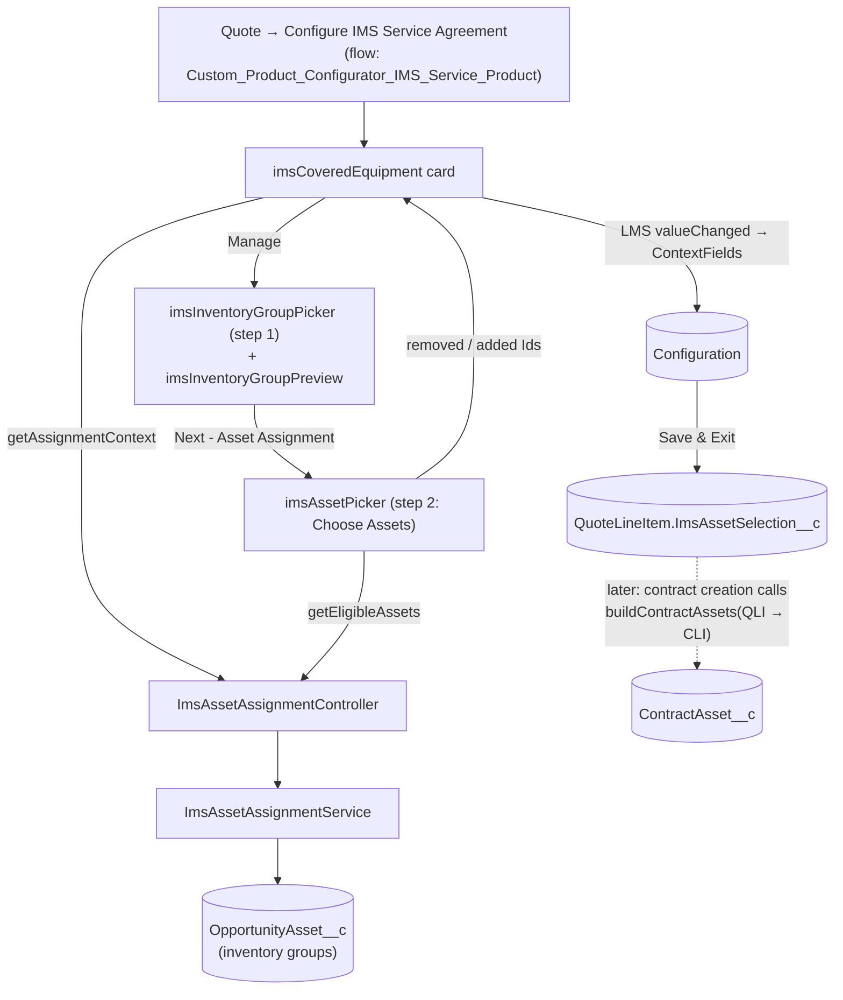

# GW-6456 — IMS Asset Assignment: Changes Made

| | |
|---|---|
| **Ticket** | GW-6456 (Sub-task of GW-4778, 1.5.1 Product Configuration: Add IMS Asset to Service Product) |
| **Date** | 2026-11-25 |
| **Status** | Built in the local repo. **Not deployed to any org.** Apex not yet compiled or run. |
| **Related docs** | [Design](GW-6456_IMS_ASSET_ASSIGNMENT_DESIGN.md) · [Implementation guide](GW-6456_IMS_ASSET_ASSIGNMENT_IMPLEMENTATION.md) |

This document lists what was built, why some parts differ from the design, how the pieces fit together, and what is still needed before go-live.

---

## 1. Summary

The IMS Service Agreement configurator gets a new **Covered Equipment** card. It lets a sales rep choose which devices the service covers:

- **Toggle "Include the opportunity's devices"**: the devices uploaded for the quote's opportunity (inventory groups) are covered.
- **Manage**:
  - Step 1 picks the inventory groups and previews their devices.
  - Step 2 ("Choose Assets") unticks devices or adds other assets from the quote's account and its related accounts.
- **Three count tiles**: Opportunity Assets, Added Assets and Total Assets.

The selection is saved as JSON on the quote line (`QuoteLineItem.ImsAssetSelection__c`) through the configurator. It is saved with **Save & Exit** and thrown away with **Cancel**.

---

## 2. Key decision: `ContractAsset__c` was not changed

Checking the cbmdev org showed that `ContractAsset__c` **already exists** (built for GW-2519 / GW-2273, 14 records) with this structure:

| Field | Type |
|---|---|
| `ContractLineItem__c` | **Master-Detail(Contract Line Item)**, so always required |
| `Asset__c` | Lookup(Asset) |
| `StartDate__c` / `EndDate__c` | Date |
| `Entitlement__c` | Lookup(Entitlement) |

The original design created `ContractAsset__c` rows when the **quote** is saved. That isn't possible here, because a row cannot exist without a contract line. The agreed approach (**"Keep MD, JSON only for now"**):

| Original design | What was built |
|---|---|
| Add `QuoteLineItem__c`, `Quote__c`, `Source__c`, `UniqueKey__c` and `CustomerInventoryAuditInfo__c` to `ContractAsset__c` | ❌ Not done. The object is untouched. |
| `ImsContractAssetSync` + Queueable job + `QuoteLineItemTrigger` hooks write rows on quote save | ❌ Not built. No trigger changes. |
| Selection stored on the quote line | ✅ `QuoteLineItem.ImsAssetSelection__c` (JSON) |
| — | ✅ New method `ImsAssetAssignmentService.buildContractAssets(...)` builds the `ContractAsset__c` rows **once a contract line exists**. The contract-creation step must call it. |

---

## 3. How it fits together



### Selection JSON (`QuoteLineItem.ImsAssetSelection__c`)

```json
{
  "version": 1,
  "opportunityId": "006...",
  "includeOpportunityAssets": true,
  "groups": ["Main Campus", "East Wing"],
  "removedAssetIds": ["02i..."],
  "addedAssetIds": ["02i..."],
  "counts": { "opportunity": 1283, "added": 1, "total": 1284 }
}
```

- **Covered assets** = (toggle on ? devices in `groups` : none) − `removedAssetIds` + `addedAssetIds`.
- Only the **differences** are stored, not every Id, so the field stays small even with thousands of devices.
- `counts` is for display only. Apex always recalculates from the Ids.
- A blank `InventoryGroup__c` is shown and stored as **"Default Group"**.

### Rules worth knowing
| Situation | Result |
|---|---|
| Rep never touches the card (JSON blank) | The card's default applies: toggle on, **every** inventory group of the quote's opportunity |
| JSON can't be read | Logged (`ImsAssets` tag) and covers **nothing**. The save is never blocked. |
| Toggle off | Only assets ticked in Choose Assets are covered (all count as "added") |
| Opportunity has no inventory | Step 1 is skipped. The rep picks assets individually. |
| Unsaved configurator line (`ref_…` Id) | Nothing is loaded from the record. The selection is kept for the session and saved with the configuration. |

### Why `SelectedAssets__c` is not used
`EsServiceQuoteLineTrigger` → `EsServiceLineExpansion` splits any line with `SelectedAssets__c` filled into **one quote line per asset**. A 1,284-device selection would create 1,284 lines, so IMS uses its own field.

---

## 4. Files changed

### 4.1 New metadata
| File | Purpose |
|---|---|
| `objects/OpportunityAsset__c/OpportunityAsset__c.object-meta.xml` | Inventory Tool table, one row per device. Name `ET-{000000}`. Sharing controlled by the Opportunity. |
| `objects/OpportunityAsset__c/fields/Opportunity__c.field-meta.xml` | Master-Detail → Opportunity |
| `objects/OpportunityAsset__c/fields/Asset__c.field-meta.xml` | Lookup → Asset (Set Null on delete) |
| `objects/OpportunityAsset__c/fields/InventoryGroup__c.field-meta.xml` | Text(80): group name from the upload |
| `objects/OpportunityAsset__c/fields/UniqueKey__c.field-meta.xml` | Text(40), unique, External Id: Opportunity Id + Asset Id, stops duplicate uploads |
| `objects/QuoteLineItem/fields/ImsAssetSelection__c.field-meta.xml` | Long Text (131,072): the selection JSON |

> `OpportunityAsset__c` is filled by the **Inventory Tool upload** (another ticket). This ticket only reads it. Agree the API names with that team before either side deploys.

### 4.2 Apex
| Class | New / Changed | What it does |
|---|---|---|
| `OpportunityAssetSelector` | New | Group counts (aggregate), asset Ids for the chosen groups (handles the blank "Default Group"), one page of a group's devices for the preview. All `WITH USER_MODE`. |
| `ImsAssetAssignmentService` | New | `parse` (JSON → `Selection`), `getContext` (quote → opportunity, groups, saved JSON), `getGroupPage` (preview, 50 rows, offset capped at 2,000), `getEligibleAssets` (group devices first as *Opportunity*, then account + related-account assets as *Account*, no duplicates, 10,000-row cap), `coveredAssets` (set calculation), `defaultSelection`, `buildContractAssets`. |
| `ImsAssetAssignmentController` | New | `@AuraEnabled`: `getAssignmentContext`, `getGroupAssets`, `getEligibleAssets`. Same error/log pattern as `ImsProductConfiguratorController` (scenario *IMS Asset Assignment*, tag `ImsAssets`). |
| `ImsAssetAssignmentServiceTest` | New | 11 tests: parse, context, preview paging + Default Group, eligible assets order/dedup, covered-set calculation, `buildContractAssets` (normal, already linked, blank JSON = default, bad JSON = nothing, empty input), Id checks, error path. |
| `EsServiceAssetSelectionController` | **Changed** | Refactor only, so IMS can reuse it: the body of `getAssets` moved into the public `loadAccountAssets(quoteId)`, new `loadRowsByIds(Set<Id>)`, shared field list, and `AssetRow.source` added (null for ES). `getAssets` and `getAssetsByIds` return the same data as before. |

#### `buildContractAssets` (for the contract-creation step)
```apex
// Quote Line Item Id -> Contract Line Item Id created from it
Map<Id, Id> contractLineByQuoteLine = new Map<Id, Id>{ qliId => cliId };
List<ContractAsset__c> rows = ImsAssetAssignmentService.buildContractAssets(contractLineByQuoteLine);
insert rows; // caller's transaction; split into chunks (e.g. Queueable) above 10,000 rows
```
Each row gets `ContractLineItem__c`, `Asset__c`, and `StartDate__c` / `EndDate__c` from the contract line. Assets already linked to that contract line are skipped.

### 4.3 LWC
| Component | New / Changed | What it does |
|---|---|---|
| `imsCoveredEquipment` | New (Flow screen) | The card: subtitle *Opportunity {name} · {n} devices on the list*, toggle, three tiles, **Manage**, "Saved with the configuration" badge. Follows the line on screen through configurator `navigate` messages and keeps a separate selection per line, the same way as `imsProductConfigurator`. Publishes `valueChanged` / `ContextFields` / `ImsAssetSelection__c`. Hidden for products not in `allowedProducts`. |
| `imsInventoryGroupPicker` | New (modal, step 1) | Group table (checkbox, name, devices, upload date, Preview), include toggle, *Next - Asset Assignment* / *Cancel*. All groups ticked by default. Next is disabled when the toggle is on and no group is ticked. |
| `imsInventoryGroupPreview` | New (child of step 1) | `lightning-datatable` of one group's devices, 50 rows per scroll, up to 2,000. |
| `imsAssetPicker` | New (modal, step 2) | "Choose Assets": **Source** badge (green Opportunity / grey Account), search across all columns, five criteria fields (Product Line, Sub Product Line, Device Type, Manufacturer, Model), column filters and sorting, select all (filtered rows only), *Show selected only*, *Clear selection*. Unticked opportunity devices are highlighted orange. Footer: *Showing x of y … – opportunity devices first* and *a of b opportunity devices + c added = d covered*. **Save Selection** returns the removed/added Ids. |
| `assetPickerUtils` | New (JS module) | Shared helpers moved out of the ES picker: `tokenize`, `emptyMap`, `addSearchText`, `filterBySearch`, `filterByColumns`, `compareValues`, `formatDate`, `formatCount`, `PAGE_SIZE`, `SEARCH_DEBOUNCE_MS`. |
| `esServiceAssetPicker` | **Changed** | Now imports the shared helpers instead of its own copies. No change in behaviour. |

### 4.4 Flow
`flows/Custom_Product_Configurator_IMS_Service_Product.flow-meta.xml`: **retrieved from cbmdev** (active version 8, it was not in the repo) and changed:

- `c:imsCoveredEquipment` (field name `IMSCoveredEquipment`) is added **directly above** `c:imsProductConfigurator` (Contract Adjustments).
- Inputs:

| Input | Value |
|---|---|
| `transactionId` | `configuratorContext.transactionId` |
| `rootTransactionLineId` | `configuratorContext.transactionLineId` |
| `currentTransactionLineId` | `configuratorContext.currentTransactionLineId` |
| `currentProductId` | `S01_DataManager.header.id` |
| `currentProductName` | `S01_DataManager.header.name` |
| `allowedProducts` | `FIXED FEE SERVICE AGREEMENT,SERVICE AGREEMENT` (same as the Contract Adjustments card) |

- Description updated to include GW-6456.

Screen order after the change: `transactionHeader` → `breadcrumbs` → `productHeader` → `attributes` → **`imsCoveredEquipment`** → `imsProductConfigurator` → `optionGroups` | side: `pricingSummary`.

### 4.5 Tests and tooling
| File | Purpose |
|---|---|
| `lwc/*/__tests__/*.test.js` (5 files) | Jest for `assetPickerUtils`, `imsCoveredEquipment`, `imsInventoryGroupPicker`, `imsInventoryGroupPreview`, `imsAssetPicker` (27 tests) |
| `jest-mocks/lightning/modal.js` | Mock for `lightning/modal`. sfdx-lwc-jest has no stub for it. Kept outside `force-app` so it is never deployed. |
| `jest.config.js` | **Changed**: maps `lightning/modal` to the mock |
| `manifest/gw-6456-package.xml` | Manifest for this ticket only (the main `package.xml` with wildcards is unchanged) |
| `package-lock.json` | Created by `npm install` to run Jest. Delete it if it shouldn't be committed. |

### 4.6 Not changed (on purpose)
- `ContractAsset__c` (see §2).
- `QuoteLineItemTrigger` / `QuoteLineItemTriggerHandler`: no quote-save sync.
- `QuoteLineItemSelector`: the repo copy is different from cbmdev, so the new code uses its existing builder API rather than adding a method.
- Permission sets: not in the repo (see §6).

---

## 5. Verification

| Check | Result |
|---|---|
| Jest: `npx sfdx-lwc-jest -- assetPickerUtils imsAssetPicker imsCoveredEquipment imsInventoryGroup` | ✅ 27 / 27 passed |
| ESLint on the new components | ✅ Clean |
| Flow XML well-formed | ✅ |
| Apex compiled / tests run | ❌ **Not yet.** Nothing has been sent to an org. |
| ES picker after refactor | ⚠️ No Jest tests exist for it; check manually in the ES configurator after deploy |

Check-only validation (no deployment) when ready:
```bash
sf project deploy validate -x manifest/gw-6456-package.xml -o <dev-alias> \
  -l RunSpecifiedTests -t ImsAssetAssignmentServiceTest EsServiceAssetSelectionControllerTest
```

---

## 6. Still to do

| # | Item | Why |
|---|---|---|
| 1 | Validate the Apex in dev (command above) and fix any compile/test issues | Apex hasn't been compiled or run |
| 2 | **RCA context definition** (Setup): add attribute `ImsAssetSelection__c` (Title = API name) on `SalesTransactionItem`, map it to `QuoteLineItem.ImsAssetSelection__c` both ways, activate, then retrieve into the repo | Without it the card shows *"Missing context attribute Id for ImsAssetSelection__c"* and can't save |
| 3 | **Permission sets** (ServiceSales / ServiceSalesReviewers): Read on `OpportunityAsset__c` + its fields, Edit on `QuoteLineItem.ImsAssetSelection__c`, access to `ImsAssetAssignmentController`. Retrieve them first; don't overwrite. | New fields have no field-level security after deploy; queries run in USER_MODE |
| 4 | Agree `OpportunityAsset__c` API names with the Inventory Tool upload ticket | Both tickets depend on the same object |
| 5 | Contract creation: call `buildContractAssets` and insert the rows | Nothing writes `ContractAsset__c` yet |
| 6 | Deploy the flow to dev, then activate the new version | Deploying a flow creates a new version |
| 7 | Manual check: ES Service configurator "Choose Assets" still works | Shared-helper refactor |
| 8 | Answer the open questions in the design doc (Q1–Q8), especially Q2 (which assets are eligible) and Q3 (asset already on another contract) | Current defaults: quote account + parent accounts, any status, no cross-contract check |

### Smoke test (after deploying to dev)
1. Load a test inventory group (`OpportunityAsset__c` rows) on an opportunity.
2. Quote → IMS Service Agreement → Configure. The card shows the opportunity name and counts.
3. Toggle off and on. The tiles change and the "Saved with the configuration" badge appears.
4. Manage → tick groups → Preview → Next. In Choose Assets, the opportunity devices come first and are ticked.
5. Untick 1 device, search and add 1 account asset → Save Selection. Tiles show *n−1 / 1 / n*.
6. Save & Exit, then reopen. The selection is restored.
7. Change something, then Cancel the configuration. `ImsAssetSelection__c` is unchanged.

---

## 7. Rollback
- Deactivate the new flow version and reactivate version 8. The card disappears.
- `OpportunityAsset__c` and `ImsAssetSelection__c` can stay. Nothing else depends on them.
- `EsServiceAssetSelectionController` / `esServiceAssetPicker`: redeploy the previous versions if the ES picker misbehaves (in git: `git show HEAD:<path>`).
