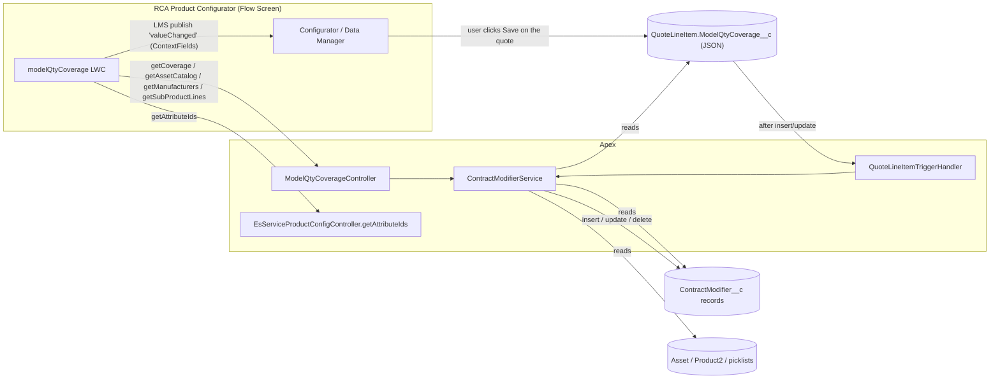
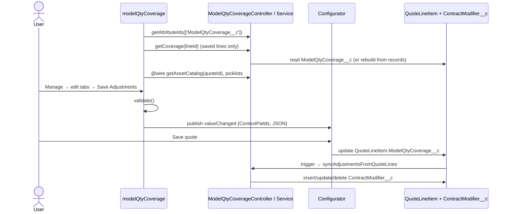

# ModelQtyCoverage: Code Explanation

How the **Contract Adjustments** LWC (`modelQtyCoverage`) and its Apex classes work, file by file and method by method.

> Tickets: GW-4777 / GW-5676 · Business area: IMS Service Agreement, RCA product configurator
> Written from the code in this repo as of 2026-11-04. Line numbers are approximate and will drift as the code changes.

---

## Contents

1. [What it is (business view)](#1-what-it-is-business-view)
2. [Files at a glance](#2-files-at-a-glance)
3. [Architecture and data flow](#3-architecture-and-data-flow)
4. [The JSON contract (`ModelQtyCoverage__c`)](#4-the-json-contract-modelqtycoverage__c)
5. [LWC: `modelQtyCoverage`](#5-lwc-modelqtycoverage)
6. [Apex: `ModelQtyCoverageController`](#6-apex-modelqtycoveragecontroller)
7. [Apex: `ContractModifierService`](#7-apex-contractmodifierservice)
8. [Apex: `EsServiceProductConfigController.getAttributeIds`](#8-apex-esserviceproductconfigcontrollergetattributeids)
9. [Trigger wiring: `QuoteLineItemTriggerHandler`](#9-trigger-wiring-quotelineitemtriggerhandler)
10. [Data model: `ContractModifier__c`](#10-data-model-contractmodifier__c)
11. [Tests and test data](#11-tests-and-test-data)
12. [Known gaps and things to watch](#12-known-gaps-and-things-to-watch)
13. [How to extend](#13-how-to-extend)

---

## 1. What it is (business view)

STERIS sells **IMS Service Agreements**: contracts to service and repair a customer's medical equipment and surgical instruments. A sales user builds the agreement as a Quote in the **Revenue Cloud (RCA) product configurator**.

Every service line on that quote needs **contract adjustments**: rules that decide later, when a repair comes in, whether that repair is **covered by the contract or charged**. This component is the card inside the configurator where users enter those rules.

The card has four kinds of adjustment:

| Tab | What the user sets | Business meaning |
|---|---|---|
| **Inclusions / Exclusions** | Equipment rules built from up to 5 fields (Product Line, Sub Product Line, Device Type, Manufacturer, Model), each with optional exclusions | "Cover all Flexible Endoscopy from Olympus, **except** model GIF-H190" |
| **Model Quantity** | Equipment plus a **Max Covered Devices** number | "Cover at most 12 Olympus colonoscopes" |
| **Pricing Programs** | Pricing programs, each with child **CT codes** | Pricing agreements set up outside the quote that apply to this line (**mock data for now**) |
| **On Location - Mobile Van** | Instrument service categories | Categories covered by on-site mobile van service (**UI only, not saved yet**) |

A blank field means **"Any"**. For example, an inclusion with only Manufacturer = Olympus covers every Olympus device.

---

## 2. Files at a glance

### LWC: `force-app/main/default/lwc/modelQtyCoverage/`

| File | Lines | Purpose |
|---|---|---|
| `modelQtyCoverage.js` | ~1030 | All logic: loading, the modal, the four tabs, validation, save |
| `modelQtyCoverage.html` | ~440 | Summary card and modal with left nav and one block per tab |
| `modelQtyCoverage.css` | ~580 | Card, modal, tables, CT-code pill and hover card, Mobile Van tiles |
| `modelQtyCoverage.js-meta.xml` | 17 | Exposed as a **Flow Screen** component, label "Contract Adjustments" |
| `pricingProgramsMockData.js` | ~115 | Dummy pricing programs and CT codes (until Apex exists) |

### Apex: `force-app/main/default/classes/`

| Class | Role |
|---|---|
| `ModelQtyCoverageController` | `@AuraEnabled` entry points for the LWC. Read-only, a thin wrapper around the service |
| `ContractModifierService` | The real logic: reads the JSON, builds the pickers' data, **syncs `ContractModifier__c` records** on save |
| `ContractModifierSelector` | Query builder plus constants (`TYPE_MODEL_QTY`, `TYPE_INC_EXC`, `INCLUSION`, `EXCLUSION`, record type Ids) |
| `EsServiceProductConfigController` | Shared. The LWC uses only `getAttributeIds` (context attribute Id lookup) |
| `QuoteLineItemTriggerHandler` | Calls the sync after insert and after update of Quote Line Items |
| `ModelQtyCoverageControllerTest` | Unit tests for the controller |
| `ContractModifierServiceTest` | Unit tests for the sync and the read methods |
| `ModelQtyCoverageTestDataFactory` | Test data: quote, line, asset, coverage JSON, permissions |

> **Sibling:** `ImsProductConfiguratorController` (used by the `imsProductConfigurator` LWC) is almost a line-for-line copy of `ModelQtyCoverageController` and calls the same service methods. A fix in one controller usually needs making in the other as well.

---

## 3. Architecture and data flow



### The two-phase save (important)

The LWC **never writes records itself**. Saving happens in two steps:

1. **In the modal: "Save Adjustments".** The LWC sends the adjustments as a JSON string to the configurator over **Lightning Message Service** (`valueChanged`, field `ContextFields`, attribute `ModelQtyCoverage__c`). It keeps a copy in `sessionByLine`, and the card shows a *"Saved with the configuration"* badge. **Nothing is in the database yet.**
2. **In the configurator: the user saves the quote.** RCA writes the JSON to `QuoteLineItem.ModelQtyCoverage__c`. The Quote Line Item trigger runs `ContractModifierService.syncAdjustmentsFromQuoteLines`, which **creates, updates or deletes the line's `ContractModifier__c` records** so they match the JSON.

If the user closes the configurator without saving the quote, the adjustments are lost.

### Runtime sequence



---

## 4. The JSON contract (`ModelQtyCoverage__c`)

The LWC and Apex share one JSON shape. The property names are the same as the Apex class fields (`ContractModifierService.Criteria`, etc.).

```json
{
  "inclusions": [
    {
      "productLine": "FLEXIBLE ENDOSCOPY",
      "subProductLine": null,
      "productType": null,
      "manufacturer": "Olympus",
      "model": null,
      "exclusions": [
        { "productLine": null, "subProductLine": null, "productType": null,
          "manufacturer": null, "model": "GIF-H190" }
      ]
    }
  ],
  "models": [
    { "productLine": "FLEXIBLE ENDOSCOPY", "subProductLine": null, "productType": null,
      "manufacturer": "Olympus", "model": "CF-HQ190L", "qty": 12 }
  ],
  "pricingPrograms": [
    { "program": "PP-ENDO-01", "description": "Flexible endoscope repair, contract rate",
      "ctCodes": [ { "code": "4410", "name": "Flexible Gastroscope" } ] }
  ],
  "pricingProgram": null
}
```

| Key | Written by LWC | Read by Apex | Turned into records |
|---|---|---|---|
| `inclusions[]` (+ `exclusions[]`) | Yes | Yes | **INC/EXC** `ContractModifier__c` |
| `models[]` | Yes | Yes | **MODEL QTY** `ContractModifier__c` |
| `pricingPrograms[]` | Yes | **No** (not in the Apex class, so dropped on read) | No |
| `pricingProgram` (single, legacy) | Passes through | Yes (field exists) | No |
| Mobile Van categories | **No** | No | No |

Field rules (enforced on both sides):
- **Criteria fields:** `null` means Any. Product Line, Sub Product Line and Product Type must be **active picklist values** of `ContractModifier__c`. Model is at most 100 characters and Manufacturer at most 255.
- **`qty`:** a whole number from **1 to 99999** (`ModelQty__c` is Number(5,0)).
- A rule needs **at least one** non-blank field.

---

## 5. LWC: `modelQtyCoverage`

### 5.1 Where it runs (`js-meta.xml`)

- Target: `lightning__FlowScreen`, placed in the configurator's flow.
- Input properties, mapped from the configurator context:

| `@api` property | Source | Used for |
|---|---|---|
| `rootTransactionLineId` | `configuratorContext.transactionLineId` | Root line of the configuration (bundle parent) |
| `transactionId` | `configuratorContext.transactionId` | The **Quote Id**: asset catalog and manufacturer lookups |
| `currentTransactionLineId` | `configuratorContext.currentTransactionLineId` | The line on screen. Its **setter** calls `loadLine()` |
| `currentProductId` | Data Manager Product Id | Not used in logic (kept so the flow mapping matches) |

### 5.2 Imports and constants

| Import | What for |
|---|---|
| `lightning/messageService` + `lightning__productConfigurator_notification` | Listen for configurator `navigate` messages, and send `valueChanged` |
| `getObjectInfo`, `getPicklistValues` | Picklist values for `ContractModifier__c.ProductLine__c / SubProductLine__c / ProductType__c`, and for `ContractAdjustment__c.InstrumentServices__c` (Mobile Van categories) |
| `getAttributeIds` (EsServiceProductConfigController) | Id of the `ModelQtyCoverage__c` context attribute, needed for the save message |
| `getCoverage`, `getAssetCatalog`, `getManufacturers`, `getSubProductLines` | ModelQtyCoverageController |
| `PRICING_PROGRAMS`, `PRICING_PROGRAM_SAMPLE_ROWS` | Mock data file |

Key constants:

| Constant | Value | Meaning |
|---|---|---|
| `COVERAGE_FIELD` | `ModelQtyCoverage__c` | The context field and QLI field holding the JSON |
| `FIELDS` | `productLine, subProductLine, productType, manufacturer, model` | The 5 criteria fields, **in order** (order matters for Model Qty cascading) |
| `PICKLIST_FIELDS` | the first four | Inc/Exc fields shown as pickers. Model is free text |
| `MODEL_MAX_LENGTH` / `QTY_MAX` | 100 / 99999 | Field limits, matching the Apex side |
| `SECTION_*` | `incExc`, `modelQty`, `pricingPrograms`, `onLocationMobileVan` | Tab keys |
| `MIN_PROGRAM_SEARCH_LENGTH` | 3 | Pricing program search starts at 3 characters |
| `EMPTY_ADJUSTMENTS` | all empty | Used when there is no line |

### 5.3 Module-level helper functions

| Helper | What it does |
|---|---|
| `isSavedLineId(id)` | True only for a real QLI Id (`0QL`, 15 or 18 characters). New configurator lines have temporary `ref_…` Ids |
| `clean` / `blankToNull` / `lower` | Trim, turn blanks into null, and lower-case for comparisons |
| `reduceError(e)` | Pulls a readable message out of an Apex or JS error |
| `pickCriteria(src)` | Copies just the 5 fields, blanks as `null`. This is the stored criteria shape |
| `hasAnyValue(c)` | At least one of the 5 fields is set |
| `criteriaKey(c)` | `"a|b|c|d|e"` lower-cased, used to detect duplicates |
| `manufacturerKey(row)` | `"productLine|subProductLine"`, the cache key for manufacturers |
| `pickCtCodes(src)` | Returns a program's CT codes as `[{code, name}]`. Still reads the **old single `ctCode` string** as one code |
| `pickProgram(src)` | Stored pricing program shape: `{program, description, ctCodes}` |
| `ctCodeView(codes, key)` | Builds what the template shows for the CT-code pill (`hasCtCodes`, `ctPillLabel` such as "3 CT Codes · 4410, 4412, 4415", `ctCodeList` for the hover table) |

### 5.4 Component state

| Field | Holds |
|---|---|
| `_currentLineId`, `currentKey` | Which line is on screen (`currentKey` is the path from `navigate` messages) |
| `attributeId` | Context attribute Id for `ModelQtyCoverage__c` |
| `savedByLine` | `{lineId: adjustments}` as **loaded from the database** |
| `sessionByLine` | `{lineId: adjustments}` **saved in the modal but not yet in the database** |
| `loadingLines` | `{lineId: true}` while `getCoverage` is running |
| `isModalOpen`, `activeSection`, `modalError` | Modal state |
| `incRules`, `modelRows`, `pricingRows` | **Working copies** edited in the modal |
| `pricingPrograms` | The list of known programs (mock for now) |
| `programSearchTerm`, `selectedProgramNames` | "Add pricing program" search |
| `mobileVanFilter`, `mobileVanSelected` | Mobile Van filter and checked categories (picklist **API values**) |
| `mobileVanCategories`, `mobileVanCategoriesLoaded`, `mobileVanError` | `InstrumentServices__c` picklist values (`{label, value}`), whether they have loaded, and any load error |
| `productLineValues`, `subProductLineValues`, `productTypeValues` | Picklist values from the wires |
| `subProductLinesByLine` | Cache: Product Line → its valid Sub Product Lines |
| `manufacturersByLine` | Cache: "PL|SPL" → manufacturers on the account's assets |
| `assetGroups` | The account's assets grouped by the 5 fields, with counts |
| `_seq` | Counter for unique row keys (`inc1`, `exc2`, `mq3`, `pp4`) |

### 5.5 Lifecycle and loading

**Wires (run automatically):**
- `objectInfo` → `ContractModifier__c` object info (gives the default record type for the picklist wires).
- `wiredProductLines`, `wiredSubProductLineValues`, `wiredProductTypes` → picklist values.
- `wiredAssetCatalog` → `getAssetCatalog({ quoteId: transactionId })` → `assetGroups`.
- `contractAdjustmentInfo` → `ContractAdjustment__c` object info. `wiredInstrumentServices` uses its **`defaultRecordTypeId`** (the running user's default record type) to get the `InstrumentServices__c` picklist values → `mobileVanCategories`.

**`connectedCallback()`**
1. Subscribes to the configurator message channel (application scope).
2. `loadAttributeId()` looks up the context attribute Id. A failure here doesn't stop the component; Save shows an error later if it's still missing.
3. `loadLine(lineId)`.

**`handleMessage(message)`**: on `action === 'navigate'`, stores `message.key` (the line path) and loads that line. This is how the card follows the user between bundle lines.

**`key` / `lineId` getters**: the path to the line on screen. It is the `navigate` key if one was received, otherwise `[root, current]` or `[current]`. `lineId` is the last element.

**`loadLine(lineId)`**
- Skips the call if the line is already loaded or loading.
- **Unsaved line (`ref_…`)** → `fromJson(null)`: empty adjustments (Pricing Programs get the sample rows).
- **Saved line** → `getCoverage({lineId})` → `fromJson(raw)` → `savedByLine[lineId]`.

**`fromJson(raw)`**: parses the JSON safely and cleans each part:
- `inclusions` → criteria plus their exclusions' criteria
- `models` → criteria plus `qty` (as a Number)
- `pricingPrograms` → each goes through `programDetails()`. **If the key is missing, it falls back to `PRICING_PROGRAM_SAMPLE_ROWS`.**

### 5.6 Summary card

- **`committed`**: what the line has now. Values saved this session (`sessionByLine`) come first, then the database values (`savedByLine`).
- **`summaryTypes`**: one row per tab with a count and a one-line preview:
  - Inc/Exc: `Include Manufacturer: Olympus · Exclude Model: GIF-H190`
  - Model Qty: `CF-HQ190L · 12 max`
  - Pricing: `PP-ENDO-01 (3 CT codes)`
  - Mobile Van: always `0` / "None configured" (TODO)
- **`describe(criteria)`**: "Any equipment", "Field: Value" when one field is set, or the values joined with " / ".
- **`displayValue(field, value)`**: shows the picklist **label** in place of the API value.
- **`isPendingSave`**: shows the "Saved with the configuration" badge.
- **`editDisabled`**: disables Manage while the line is loading or unknown.

### 5.7 Modal shell

- **`openModal(section)`** builds fresh working copies from `committed`:
  - `incRules` via `newRule()`, `modelRows` via `newModelRow()` (always **at least one** empty row), and `pricingRows` via `newPricingRow()`
  - resets the program search and the Mobile Van filter
  - preloads manufacturers and sub product lines for the existing rules
  - opens on the tab that was clicked
- **`handleCancelModal` / Escape** → closes the modal and **throws away** unsaved edits (the working copies are rebuilt next time it opens).
- **`navItems`**: the left nav with live counts. Only non-blank rows are counted; the Mobile Van count is `mobileVanSelected.length`.
- **`footerSummary`**: for example "5 adjustments across 4 types · changes are saved with the configuration".

### 5.8 Tab 1: Inclusions / Exclusions

**Data:** `incRules = [{key, 5 fields, expanded, exclusions:[{key, 5 fields}]}]`

| Method | Behaviour |
|---|---|
| `newCriteriaRow(prefix, src)` / `newRule(src, excl)` | Build a row with a unique key |
| `incExcRows` (getter) | View model: `Include1` label, expand/collapse icon, "2 exclusions" text, cells for each field, aria labels |
| `criteriaCells(row, …)` | One cell per field. Product Line, Sub Product Line and Device Type are **picklists**; Manufacturer is a picklist **from the account's assets**; Model is **free text** (max 100) |
| `withCurrent(options, value)` | Adds "Any" at the top. **Keeps the current value even if it is no longer offered**, so the user sees what is saved |
| `subProductLineOptionsFor(pl)` | Only Sub Product Lines that belong to the Product Line (from `getSubProductLines`). Shows all of them until that list has loaded |
| `manufacturerOptionsFor(row)` / `ensureManufacturers(row)` | Manufacturers of the account's assets in that PL/SPL, loaded once per key and cached |
| `handleIncFieldChange` | Updates the field. If **Product Line** changed, loads its Sub Product Lines and **clears a Sub Product Line that doesn't belong**. If PL or SPL changed, reloads manufacturers and **clears a Manufacturer that has no assets there** |
| `handleAddInclusion` / `handleRemoveInclusion` | Add or remove an inclusion |
| `handleToggleRule` | Expand or collapse. Opening a rule with no exclusions **starts one empty exclusion** |
| `handleAddExclusion` / `handleRemoveExclusion` | Add or remove exclusions under an inclusion |

### 5.9 Tab 2: Model Quantity

**Data:** `modelRows = [{key, 5 fields, qty}]`. All five fields are pickers built from the **account's own assets** (`assetGroups`).

| Method | Behaviour |
|---|---|
| `matchingGroups(row, upTo)` | Asset groups that fit every field set **to the left of** `upTo` |
| `modelQtyOptionsFor(row, field)` | **Cascading** options: only values found on assets that fit the fields to the left, de-duplicated and sorted |
| `modelQtyRows` (getter) | View model, including **Matching Assets** (the sum of `assetCount` for the groups that fit the whole row) |
| `handleModelFieldChange` | Sets the field, then **resets to Any** any field to its right whose value no longer fits |
| `handleQtyChange` | Parses Max Covered Devices as a whole number |
| `handleAddModelRow` / `handleRemoveModelRow` | The last row can't be deleted |

### 5.10 Tab 3: Pricing Programs (mock data)

**Data:** `pricingRows = [{key, program, description, ctCodes:[{code,name}]}]`

| Method | Behaviour |
|---|---|
| `programDetails(src)` | **Looks the program up in the program list by name** and uses that description and those CT codes. Rows saved earlier with missing or old-format CT codes still show the current ones. Saved values are used only for an unknown program |
| `newPricingRow(src)` | A table row built from `programDetails` |
| `pricingProgramRows` (getter) | View model, including the CT-code pill (`ctCodeView`) |
| `programSearchTooShort` | 1–2 characters typed, so the template shows "Type at least 3 characters to search." |
| `programSearchResults` | At 3 or more characters: known programs **not already in the table** whose program name, category, **CT code or CT name** contains the text (case-insensitive) |
| `handlePricingProgramSearch` | Stores the search text |
| `handleProgramSelect` | Checkbox ticked or cleared → `selectedProgramNames` |
| `addProgramsLabel` / `addProgramsDisabled` | Button reads "Add (2)", and is disabled when nothing is ticked |
| `handleAddSelectedPrograms` | Adds the ticked programs as rows, then clears the search and ticks |
| `handleRemovePricingProgram` | Removes a row |

**CT-code UI:** the CT Code column shows a pill (`3 CT Codes · 4410, 4412, 4415`, cut off with "…" by CSS). **Hovering or keyboard-focusing** the pill shows a small table of Code and Name (`.ca-ct-pop`, shown through `:hover` / `:focus-within`, with no JS).

**Mock data (`pricingProgramsMockData.js`):**
- `PRICING_PROGRAMS`: 10 programs, each with `program`, `description`, `category` and `ctCodes[]`.
- `PRICING_PROGRAM_SAMPLE_ROWS`: 2 rows shown when a line has no `pricingPrograms`.
- Both are kept as JSON strings and parsed safely (`[]` on error), so they can later be swapped for an Apex call that returns the same shape.

### 5.11 Tab 4: On Location - Mobile Van (UI only)

**Data:** `mobileVanCategories` (the active values of the restricted picklist **`ContractAdjustment__c.InstrumentServices__c`**, loaded through `uiObjectInfoApi` for the user's **default record type**; 14 values in `steris-cbmdev`), `mobileVanSelected[]` (API values), `mobileVanFilter`.

| Method | Behaviour |
|---|---|
| `wiredInstrumentServices` | Stores the picklist values. On error, sets `mobileVanError`, which shows **inside this tab only** so the other tabs keep working |
| `visibleMobileVanCategories` | Categories whose **label** matches the filter |
| `mobileVanTiles` | One tile per category: shows the label, the checkbox carries the value |
| `mobileVanEmptyMessage` | "Loading categories...", the load error, "No instrument service categories are available.", or "No categories match …" |
| `mobileVanCountLabel` | "3 of 14 selected" (counts only the tiles shown) |
| `handleMobileVanToggle` | Ticks or clears one category |
| `handleMobileVanSelectAll` / `handleMobileVanClear` | Act on the **tiles shown** |

The selections are **not** in `workingValue`, **not** saved, and **not** reset when the modal reopens. See [§12](#12-known-gaps-and-things-to-watch).

### 5.12 Save: `handleCommit()`

```
workingValue  ──► validate() ──► publish valueChanged ──► sessionByLine[lineId] ──► close + toast
```

1. **Guards:** there must be a `lineId` and an `attributeId`, or the modal shows an error and stays open.
2. **`workingValue`** builds the JSON from the working copies:
   - **inclusions:** drops fully blank ones and blank exclusions
   - **models:** drops rows with no fields and no qty
   - **pricingPrograms:** rows that have a program
   - **pricingProgram:** passed through unchanged
3. **`validate(value)`** returns the **first** problem and switches to that tab:
   - Inclusion with no fields: "Include N needs at least one field."
   - Duplicate inclusion, or a duplicate exclusion within one inclusion
   - Model row with no fields: "needs at least one field other than Any."
   - Qty not a whole number from 1 to 99999
   - Duplicate Model rows
   - Duplicate pricing program
4. **Publish** on the configurator channel:
   ```js
   { action: 'valueChanged', data: [{ key: [...this.key], field: 'ContextFields',
     attributeId, fieldName: 'ModelQtyCoverage__c', value: JSON.stringify(value) }] }
   ```
5. Stores the value in `sessionByLine`, closes the modal, and shows the toast *"The adjustments are stored when the configuration is saved."*

**`commitDisabled`**: Save is disabled while `workingValue` equals `toValue(committed)`, compared as JSON strings, meaning nothing has changed.

---

## 6. Apex: `ModelQtyCoverageController`

`public with sharing`. **Read-only.** Every method wraps a `ContractModifierService` call. On failure it logs through **Nebula Logger** (scenario "Contract Adjustments", tag `ContractAdjustments`) and throws an `AuraHandledException` with a friendly message.

| Method | Cacheable | Input | Returns | Notes |
|---|---|---|---|---|
| `getCoverage(String lineId)` | No | QLI Id | JSON string of `ContractAdjustments` | Blank, `ref_` or bad Ids return empty adjustments without querying. Not cacheable, so it always gets fresh data |
| `getSubProductLines(String productLine)` | Yes | Product Line | `List<String>` | Valid Sub Product Lines from active products |
| `getManufacturers(Id quoteId, String pl, String spl)` | Yes | Quote Id, optional PL and SPL | `List<String>` | Manufacturers on the account's assets |
| `getAssetCatalog(Id quoteId)` | Yes | Quote Id | `List<AssetGroup>` | The account's assets grouped by the 5 fields, with counts |
| `toQuoteLineId(String)` (private) | | | `Id` or null | Accepts only `0QL…` Ids that parse |
| `toAuraException(...)` (`@TestVisible`) | | | `AuraHandledException` | Logs the error and builds the message for the user |

---

## 7. Apex: `ContractModifierService`

`public with sharing`. This is where the business logic lives. It does two jobs:
- **Read side:** serves the LWC (`getContractAdjustments`, `getSubProductLines`, `getManufacturers`, `getAssetCatalog`).
- **Write side:** keeps the `ContractModifier__c` records in sync with the JSON (`syncAdjustmentsFromQuoteLines`).

### 7.1 Inner classes (the JSON shape)

```apex
virtual class Criteria          { productLine, subProductLine, productType, manufacturer, model }
class ModelQtyEntry extends Criteria  { Decimal qty }
class InclusionRule extends Criteria  { List<Criteria> exclusions }
class ContractAdjustments       { List<InclusionRule> inclusions; List<ModelQtyEntry> models; String pricingProgram }
class AssetGroup  (@AuraEnabled) { 5 fields + Integer assetCount }
private class PendingInclusion  { ContractModifier__c inclusion; List<ContractModifier__c> exclusionList }
```

### 7.2 Read-side methods

**`parseCoverage(String raw)`**
- Blank → `null`. Unreadable JSON → logs a warning and returns `null`.
- Fills in missing lists so callers never see nulls. JSON from before the Contract Adjustments layout (`models` with only model and qty) still reads.
- Uses `JSON.deserialize` (not strict), so **unknown keys such as `pricingPrograms` are silently dropped**.

**`getContractAdjustments(Id qliId)`**: used by `getCoverage`.
1. Reads `QuoteLineItem.ModelQtyCoverage__c`. If it parses, returns that.
2. **If it's blank, rebuilds the adjustments from the existing `ContractModifier__c` records**: MODEL QTY records become `models`, INC records become `inclusions`, and EXC records are attached to their parent inclusion through `ParentContractModifier__c`.

**`getSubProductLines(String productLine)`**
- Queries active `Product2` with that `ProductLine__c` and a non-null `SubProductLine__c`.
- Returns distinct values, case-insensitive, sorted (the first spelling wins).

**`getManufacturers(Id quoteId, String pl, String spl)`**
- `quoteAccountIds()` gives the quote's account **plus its parent accounts** (through `AccountAccountRelationship__c`).
- Reads up to **10,000 assets** on those accounts (`ManufacturerCalculated__c`, `ProductLineCalculated__c`, `SubProductLineCalculated__c`).
- Keeps assets whose PL and SPL match (case-insensitive; a blank filter matches all), and returns distinct manufacturer names, sorted.

**`getAssetCatalog(Id quoteId)`**
- Same account set and asset query, with the 5 `…Calculated__c` fields.
- PL, SPL and Product Type are converted to **active `ContractModifier__c` picklist values** (`toPicklistValue`). An asset value that isn't a valid picklist value becomes blank, so whatever the user picks can always be saved.
- Groups by the 5 values (case-insensitive key), counts the assets in each group, and returns them sorted.

### 7.3 Write side: `syncAdjustmentsFromQuoteLines(newList, oldMap)`

Called from the QLI trigger **after insert** (with `oldMap = null`) and **after update**.

```
for each line:
   needsSync?  (JSON changed, or the term changed on a line that has JSON; on insert, JSON not blank)
   already processed in this transaction?  → skip (recursion guard: processedLineIdSet)
savepoint
  load the existing MODEL QTY and INC/EXC records for those lines (selectAdjustments)
  for each line:
     parseCoverage(JSON)   (unreadable JSON → leave this line's records alone)
     planModelQtyChanges(...)
     planIncExcChanges(...)
  delete  → update → insert inclusions + model rows → insert exclusions (they need the inclusion Id)
catch: rollback + log (NOT rethrown: a failed sync must never block the quote save)
```

All DML is done **`as user`**, so the user's own object and field permissions apply.

**`planModelQtyChanges`**: matches rows to existing records **by their 5 criteria** (case-insensitive key):
- Existing records that are blank or duplicates are deleted.
- Each JSON row is checked with `normalize()` and `isValidQty()`. Invalid rows and duplicate rows are **skipped and logged**.
- No matching record → **insert** (`Type__c = 'MODEL QTY'`, Model Qty record type, `ModelQty__c = qty`).
- A record matches but its criteria spelling, qty or term changed → **update**.
- Records with no matching row any more → **delete**.

**`planIncExcChanges`**: Inc/Exc rules are **not matched one by one**, because an exclusion belongs to one inclusion. Instead:
- `validInclusions()` normalizes the rules and drops invalid or duplicate inclusions (along with their exclusions) and invalid or duplicate exclusions, logging each one.
- `incExcSignature(desired)` is compared with `incExcSignature(existing records)`. The signature is an ordered text of `INC:key` and `EXC:key` entries; an orphan exclusion makes it differ.
  - **Same** → only the **term** (Start/End Date) is updated where it changed.
  - **Different** → **all** of the line's INC/EXC records are deleted and recreated. Inclusions are inserted first; exclusions get `ParentContractModifier__c = inclusion.Id` in a second insert.

### 7.4 Shared helpers

| Helper | Purpose |
|---|---|
| `needsSync(line, oldLine)` | Insert: JSON not blank. Update: JSON changed, or Start/End Date changed **and** JSON not blank (a date-only change never wipes records) |
| `normalize(criteria)` | Trims and blanks-to-null. Returns null unless at least one value is set, PL/SPL/Type are active picklist values, Manufacturer ≤ 255 and Model ≤ 100 |
| `isValidQty(qty)` | Whole number, 1–99999 |
| `criteriaKey` / `joinKey` | `"pl|spl|type|mfr|model"` |
| `newRecord(line, type, rtId, criteria)` | New `ContractModifier__c` with record type, `Type__c`, `Quote__c`, `QuoteLineItem__c`, the criteria and the term |
| `applyCriteria` / `readCriteria` / `copyCriteria` | Copy the criteria between record, class and class |
| `isCriteriaChanged` | **Exact** comparison, so a change of letter case is saved |
| `applyTerm` / `isTermChanged` | `StartDate__c` / `EndDate__c` from the line's `StartDate` / `EndDate` |
| `picklistValues(property)` | Active picklist values by describe, lower-case → API value, cached for the transaction |
| `quoteAccountIds(quoteId)` | Quote account plus parent accounts. Kept as a `List<Id>` on purpose: binding a `List<Object>` to an Id column fails in SOQL |
| `selectAdjustments(lineIds)` | The lines' MODEL QTY and INC/EXC records, oldest first |
| `selectAccountAssets(fields, accountIds)` | Assets on those accounts, ordered by serial number (nulls last) then name, limit 10,000 |

---

## 8. Apex: `EsServiceProductConfigController.getAttributeIds`

The LWC calls only this one method of the class (the rest serves the ES Service Asset & PM Visits modal).

- `getAttributeIds(List<String> fieldNames)` (cacheable) queries `ContextAttribute` where `Title IN :fieldNames` and returns `{Title → Id}`.
- If there are duplicate titles, it logs a warning and keeps the first.
- On any error it **does not throw**: it logs a warning and returns an empty map. The LWC then shows *"Missing context attribute Id for ModelQtyCoverage__c. Check the context definition."* when the user tries to save.

**Why it's needed:** the configurator's `valueChanged` message must name the **context attribute Id** of the field being updated. If the context definition doesn't map `ModelQtyCoverage__c`, the adjustments can't be saved.

---

## 9. Trigger wiring: `QuoteLineItemTriggerHandler`

```apex
afterInsert():  QuoteLineItemService.handleAfterInsert(...);
                ContractModifierService.syncAdjustmentsFromQuoteLines(Trigger.new, null);

afterUpdate():  QuoteLineItemService.handleAfterUpdate(...);
                ContractModifierService.syncAdjustmentsFromQuoteLines(Trigger.new, Trigger.oldMap);
```

Delete and undelete do **not** call the sync. What happens to Contract Modifiers when a line is deleted depends on the lookup or master-detail setup in the org, and is covered by `ContractModifierServiceTest.testDeleteAndUndeleteLine`.

---

## 10. Data model: `ContractModifier__c`

Fields as the code uses them. The object metadata isn't in this repo; confirm in the org.

| Field | Set from | Notes |
|---|---|---|
| `RecordTypeId` | `MODEL_QTY_RECORD_TYPE_ID` / `INC_EXC_RECORD_TYPE_ID` | From `ContractModifierSelector` |
| `Type__c` | `'MODEL QTY'` or `'INC/EXC'` | |
| `InclusionExclusionType__c` | `'INC'` or `'EXC'` | INC/EXC records only |
| `ParentContractModifier__c` | The inclusion's Id | Exclusions only |
| `ProductLine__c`, `SubProductLine__c`, `ProductType__c` | Criteria | **Restricted picklists** |
| `Manufacture__c` | `manufacturer` | Note the API name spelling: **Manufacture**, not Manufacturer |
| `Model__c` | `model` | Max 100 characters |
| `ModelQty__c` | `qty` | Number(5,0). MODEL QTY records only |
| `Quote__c`, `QuoteLineItem__c` | The line | |
| `StartDate__c`, `EndDate__c` | Line `StartDate` / `EndDate` | Kept in step when the term changes |

The **Asset** fields read are `ProductLineCalculated__c`, `SubProductLineCalculated__c`, `ProductTypeCalculated__c`, `ManufacturerCalculated__c` and `ModelCalculated__c` (formula or calculated fields).

---

## 11. Tests and test data

### `ModelQtyCoverageControllerTest`
| Test | Covers |
|---|---|
| `testGetCoverage` | Saved JSON is returned; `ref_` and blank Ids return empty adjustments |
| `testGetFilterOptions` | `getSubProductLines`, `getManufacturers`, `getAssetCatalog` |
| `testMethodsThrowForUserWithoutAccess` | A Minimum Access user gets `AuraHandledException`s |
| `testToAuraException` | The message is set for the user |

### `ContractModifierServiceTest`
| Test | Covers |
|---|---|
| `testSyncCreatesModelQtyAndIncExcRecords` | Insert path for both types, and the exclusion → parent link |
| `testSyncFollowsLineTerm` | A Start/End Date change updates the records |
| `testSyncOnInsert` | The after-insert path |
| `testSyncUpdatesDeletesAndClears` | Update, delete, and blank JSON removing everything |
| `testSyncSkipsInvalidInput` | Invalid picklist values, bad qty and duplicates are skipped |
| `testGetContractAdjustments` | Reading the JSON, and rebuilding from records when the JSON is blank |
| `testDeleteAndUndeleteLine` | Line delete and undelete behaviour |
| `testParseLegacyCoverage` | The old JSON shape still parses |
| `testGetSubProductLinesAndAssetCatalog` | The master data and asset grouping |

### `ModelQtyCoverageTestDataFactory`
- `grantAccess()`: gives the running user CRUD on `ContractModifier__c` and its fields (needed because the DML runs `as user`).
- `createQuoteWithLine()`: account, opportunity, quote, one line, and a repair asset.
- `coverageJson(...)`, `inclusion(...)`, `criteria(...)`: build JSON in the LWC's shape.
- `validProductLine()`: an active `ProductLine__c` value (the field is a restricted picklist).
- `createNoAccessUser()`: a Minimum Access user for the negative tests.
- Constants: `PRODUCT_LINE`, `SUB_PRODUCT_LINE`, `MANUFACTURER`, `TERM_START`, `TERM_END`.

The LWC has no Jest tests (`__tests__`) in the repo.

---

## 12. Known gaps and things to watch

| # | Gap | Effect | Fix direction |
|---|---|---|---|
| 1 | **`pricingPrograms` isn't in Apex `ContractAdjustments`** | The LWC writes it to the JSON, but `getCoverage` deserializes into the Apex class and drops it. A saved line therefore reloads **without** its pricing programs and shows the **sample rows** instead | Add `List<PricingProgram> pricingPrograms` (with `ctCodes`) to `ContractAdjustments`, or return the raw JSON |
| 2 | Pricing programs and CT codes are **mock data** | Search and the CT codes don't come from the org | An Apex method returning `[{program, description, category, ctCodes:[{code,name}]}]` to replace `PRICING_PROGRAMS` |
| 3 | Pricing programs create **no records** | Nothing downstream uses them yet | A new `Type__c` plus sync logic (see `CONTRACT_ADJUSTMENTS_PRICING_PROGRAMS_DESIGN.md`) |
| 4 | **Mobile Van is UI only** | Selections are not in `workingValue`, so they aren't saved and don't enable the Save button. They **carry over** between modal openings (only the filter is reset), and the summary count is always 0 | Add `mobileVanCategories[]` to the JSON, reset it in `openModal`, add it to the counts, and sync it (one adjustment per category, as the tab text says) |
| 5 | Two-phase save | The adjustments are only stored when the **quote** is saved, so closing the configurator loses them | By design. The toast and the badge tell the user |
| 6 | Sync failures are silent to the user | The sync rolls back and logs, but the quote save still succeeds | Check Nebula Logger (tag `ContractAdjustments`) when records are missing |
| 7 | Up to 10,000 assets per account set | Very large accounts get a partial picker and partial counts | An aggregate query if this becomes a problem |
| 8 | Duplicate controller | `ImsProductConfiguratorController` mirrors this controller | Keep them in step, or merge them |

---

## 13. How to extend

### Add a new adjustment tab
1. **JS:** a `SECTION_X` constant, an `isXSection` getter, and an entry in `navItems` and `summaryTypes`.
2. **JS:** working state, reset or built in `openModal()`.
3. **JS:** include it in `workingValue`, `toValue` and `fromJson`, and add rules to `validate()` if needed.
4. **HTML:** a `<template lwc:if={isXSection}>` block inside `.ca-content`, using `ca-section-head`, `ca-section-title` and `ca-section-sub`.
5. **Apex:** add the property to `ContractAdjustments` (otherwise it is **dropped on read**, see gap 1), and add a `plan…Changes` method plus a `Type__c` value if it should create records.
6. **Tests:** a service test for the sync, and a controller test for the read.

### Replace the pricing program mock with real data
1. A cacheable Apex method on `ModelQtyCoverageController` that returns the program list with `ctCodes`.
2. Wire it into `pricingPrograms` in place of `PRICING_PROGRAMS`. `programDetails`, the search and `ctCodeView` already handle that shape.
3. Remove the `PRICING_PROGRAM_SAMPLE_ROWS` fallback from `fromJson()`.
