# STERIS Healthcare (CBM Dev): Object Relationships & Business Analysis

> **Scope:** the Salesforce DX project `force-app/main/default` (API v68.0). It contains about 1,060 Apex classes, 53 triggers, around 100 LWCs, Aura and Visualforce. There are no object or field metadata files in the repo (`objects/` is empty).
> **Method:** every relationship below was **inferred from Apex and LWC code**: SOQL `__r` traversals, sub-queries, DML field assignments and selector classes. Check field API names against the org (`sf sobject describe`) before relying on them for builds.
> **Generated:** 2026-11-02

---

## Table of Contents
1. [System Landscape](#1-system-landscape)
2. [Domain Map](#2-domain-map)
3. [Customer Master (Account / Address / Hierarchy)](#3-customer-master)
4. [Sales, Product & Pricing](#4-sales-product--pricing)
5. [Product Browser: Components, Connections & Data Flow](#5-product-browser)
6. [Quote, Contract Modifiers & Approvals](#6-quote-contract-modifiers--approvals)
7. [Order-to-Fulfilment (CBM Case Management)](#7-order-to-fulfilment-cbm)
8. [Repair Center (Depot Repair)](#8-repair-center-depot-repair)
9. [Field Service (ES / IMS)](#9-field-service-es--ims)
10. [CSC Visits, Team Members & Access (TAS / TAE)](#10-csc-visits-team-members--access)
11. [Integration Inventory](#11-integration-inventory)
12. [Master Relationship Reference Table](#12-master-relationship-reference-table)
13. [Business Analysis](#13-business-analysis)
14. [Technical Findings & Risks](#14-technical-findings--risks)
15. [Glossary](#15-glossary)

---

## 1. System Landscape

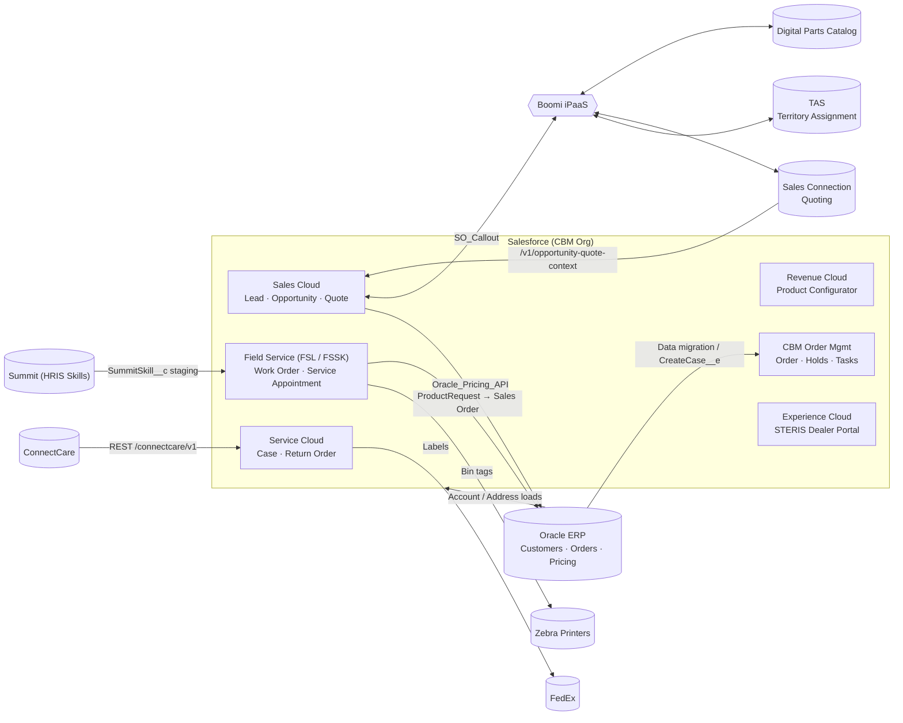

---

## 2. Domain Map

| Domain | Core objects | Key UI / Apex entry points |
|---|---|---|
| **Customer Master** | Account, Address, Location, AccountAccountRelationship__c, Department__c, AccountDepartment__c, Price_List__c, Contact | `AccountTriggerHandler`, `AccountHierarchyResolutionService`, `AccountAccountRelationshipService` |
| **Sales** | Lead, LeadProduct__c, Lead_SLA__c, Opportunity, OpportunityLineItem, OpportunityContactRole, OpportunityTeamMember, Sample__c, Project__c | `OpportunityTriggerHandller`, `EPPProductController`, `LostBusinessProductController` |
| **Product & Pricing** | Product2, Pricebook2, PricebookEntry, PFCL__c, ServiceBOM__c, PFCLServiceBOM__c, PSAM__c, Price_List__c | `OraclePricingIntegrationService`, `OraclePricingGateway` |
| **Quote & Contract** | Quote, QuoteLineItem, ContractModifier__c, DealApprovalApprover__c | `GenerateQuoteController`, `ContractModifierService`, `OppDealApprovalService` |
| **Order Mgmt (CBM)** | Order, OrderItem, OrderAndOrderLineHold__c, HoldMatrix__c, OrderLineContact__c, Case, Task | `CreateCaseEventTrigger`, `CreateCaseHandler`, `HoldTriggerHelper`, `CreateTaskHelper` |
| **Repair Center** | Case, ReturnOrder, ReturnOrderLineItem, WorkOrder, WorkOrderLineItem, Location (Repair Center/Rack), RepairCenterRoutingRule__c, WarrantyRepairEvaluation__c, NonconformanceReport__c, WOAssignmentHistory__c, ServiceTeam__c | `CreateReturnOrderController`, `ReceivingFinishService`, `WorkOrdersService` |
| **Field Service** | ServiceAppointment, ServiceResource, ProductItem, ProductRequest, Asset, CustomerPreference__c, SummitSkill__c | `WoDebrief*Controller`, `ServiceAppointmentRealignmentService` |
| **Access & Visits** | TeamMember__c, TemporaryAccessException__c, TAEProcessingWorkItem__c, TAE_AssignedRecord__c, CSC_Visit_Request__c, CSCVisitAttendee__c | `TASService`, `TemporaryAccessExceptionService`, `CscVisitConfirmationService` |

---

## 3. Customer Master

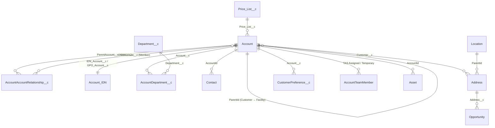

**Account model**
- **Record types:** `Customer`, `Prospect`, `HCSalesDealer`.
- **`Account.Type`:** `IDN` / `GPO` (contracting parents), `Customer`, and `Address` (ship-to or facility child).
- **External keys:**
  - `SourceSystemID__c` = `SystemID__c + 'Oracle'`
  - `OracleAddressId__c` matches `OrderLineContact__c.TASAddressId__c`
  - `OrgIDs__c` matches `User.OrgId__c`
- **Business line:** `CustomerClassCode__c` is `HC` (Healthcare) or `SC` (Life Sciences).

**Hierarchy roll-up (`AccountHierarchyResolutionService`)**

| Account level | Accounts included in the roll-up |
|---|---|
| Facility | Itself |
| Customer | Itself plus `ParentId` children that have `OracleAddressId__c` |
| IDN / GPO | Affiliated customers through `AccountAccountRelationship__c`, plus their facilities |

`AccountAccountRelationship__c` stores two labels: `RelationshipType__c` from the child's view ("Is IDN Member Of") and `InverseRelationshipType__c` from the parent's view ("Has IDN Member"). Its trigger stamps `Account.IDN_Account__c` / `GPO_Account__c` (the latest relationship wins) and syncs them onto open Opportunities.

---

## 4. Sales, Product & Pricing

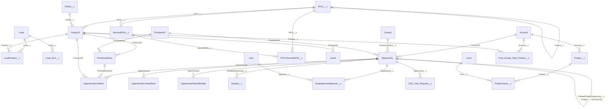

**Notes**
- **PFCL hierarchy:** `PFCL__c` is a self-referencing product-family hierarchy. Products, Service BOMs, Assets (via Product2), QuoteLineItems and WOLIs all link to it.
- **Not objects:** `Model__c`, `ProductLine__c`, `SubProductLine__c` and `ProductType__c` are **fields**, not objects. They appear on ContractModifier__c, CustomerPreference__c, routing rules and Asset formulas.
- **Free goods:** `Free_Goods_Task_Product__c.TaskId__c` is a **text** key, not a lookup to Task.
- **Opportunity record types seen:** `Healthcare_Sales`, `HCSalesConsumables`, `HCSalesLostBusinessConsumables`, `HCSalesStrategicContract`, plus EPP and Project opportunities.

---

## 5. Product Browser

There is **no single "Product Browser" component**. Product search and selection is spread across **three groups of components**: the Revenue Cloud configurator, the Opportunity product pickers, and supporting pickers. They share the same catalogue objects (Product2, PricebookEntry, PFCL__c, Asset).

### 5.1 Component and connection map

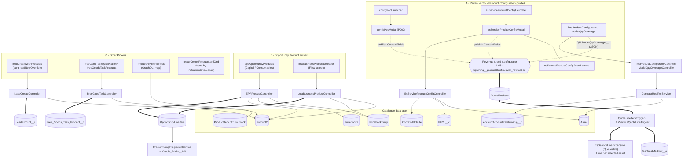

### 5.2 Group A: Revenue Cloud configurator (Quote line configuration)

These are **Flow-screen LWCs embedded in the Revenue Cloud Product Configurator**. They never save records themselves. They publish `{field:'ContextFields', attributeId, fieldName, value}` on the Lightning Message Channel `lightning__productConfigurator_notification`, and the configurator saves the QuoteLineItem.

| Component | Apex methods (`@AuraEnabled`) | Data read | Writes (via configurator) |
|---|---|---|---|
| `configPocLauncher` → `configPocModal` | none (POC, hard-coded attribute Id) | — | `Quantity`, `Asset_Name__c` |
| `esServiceProductConfigLauncher` → `esServiceProductConfigModal` → `esServiceProductConfigAssetLookup` | `EsServiceProductConfigController.getLineContext(quoteId, lineId)`, `searchAssets(accountId, text)` (LIKE on Name/Serial/PFCL, limit 20), `getAssetDetails(assetId)`, `getAttributeIds(fieldNames)` (cacheable) | Quote.AccountId, Asset, `Asset.Product2.PFCL__c`, ContextAttribute | QLI `Asset__c`, `PFCL__c`, `RequestedNumberofPMVisits__c`, demo `UnitPrice` |
| `imsProductConfigurator` / `modelQtyCoverage` | `getCoverage`, `getSubProductLines`, `getManufacturers`, `getAssetCatalog` | Assets of the quote account and its AAR parents, grouped by Product Line → Sub-line → Type → Manufacturer → Model | `QuoteLineItem.ModelQtyCoverage__c` (JSON) |

**Server-side hooks**
- **`QuoteLineItemTriggerHandler`:**
  - Calls `ContractModifierService.syncAdjustmentsFromQuoteLines`, which inserts, updates or deletes `ContractModifier__c` rows (types MODEL QTY and INC/EXC).
  - Stamps `ConstraintEngineNodeStatus__c` before insert.
- **`EsServiceQuoteLineTrigger`** runs the `EsServiceLineExpansion` queueable. It splits bundle lines that have `SelectedAssets__c` into one line per asset, with visits taken from `AssetVisits__c` (default 2).
- **Pricing hooks (`RevSignaling.SignalingApexProcessor`):**
  - `EsServiceOtCoveragePreHook` sets `OT_Coverage__c`.
  - `EsServiceDemoPricePostHook` is a demo that sets price from PM visits. The real pricing is planned as a "PFCL Pricing decision table".
- **`EsServiceAssetSelectionController`** lists assets across `AccountAccountRelationship__c` parents.

### 5.3 Group B: Opportunity product pickers (create OpportunityLineItem)

| Component | Apex | Search logic | Save logic |
|---|---|---|---|
| `eppOpportunityProducts` (record page, `productMode` = Capital / Consumables) | `EPPProductController.searchProducts`, `getOpportunityProducts`, `createOpportunityProducts` | Standard Pricebook entries where `Product2.IsActive`, `EPPEligible__c`, `IsConsumable__c` and currency match the Opportunity; LIKE on Name / ProductCode | Creates or reactivates a PBE on the Opportunity's own Pricebook2, then inserts OLIs with `EPPPrice__c`, `ElevatedEPPPricingApplicable__c`, placement/commitment dates and `ConsumptionFrequency__c`. Rejects duplicates and ineligible products. |
| `lostBusinessProductSelection` (Flow screen) | `LostBusinessProductController.getOriginatingProducts`, `searchProducts`, `getConsumptionFrequencyOptions`, `createLostBusinessProducts` | Copies OLIs from the originating Opportunity, or searches active Product2 (`Product2Selector.selectActiveBySearchKey`) | Price from the Opportunity Pricebook, falling back to Standard. Inserts OLIs with `Status__c`, `ConfidenceLevel__c`, `Contract__c`, `Product_Number_SKU__c`. Skips existing ones. |

After products are added, **Oracle pricing** (`OraclePricingIntegrationService`, invocable "Get Oracle Pricing" → `OraclePricingFlowQueueable` → `callout:Oracle_Pricing_API/getPricingDetail/`) prices the OLIs:
- The request uses `Account.OrgIDs__c`, `OracleAddressId__c` and `Price_List__r.Price_List_ID__c`.
- It sets price and `Contract__c`, deletes OLIs that Oracle did not price, and shows the `opportunityOliBanner` banner.

### 5.4 Group C: Other pickers

| Component | Purpose | Backend |
|---|---|---|
| `leadCreateWithProducts` (hosted by `aura/leadNewOverride`) | New Lead with interested products (`LeadProduct__c`: Product__c, ParentCategory__c, ProductCategory__c) | `LeadCreateController.previewLeadDuplicate`, `createLeadWithProducts` |
| `freeGoodTaskQuickAction` / `freeGoodsTaskProducts` | Attach free-goods products to a Task | `FreeGoodTaskController.searchProducts`, `createTaskProducts`, `getTaskProducts` |
| `findNearbyTrunkStock` | Find technicians' trunk stock (`ProductItem.QuantityOnHand > 0`) on a map | UI API GraphQL only (`c-mobile-map`, `c-locations-list`, `c-map-filters`) |
| `repairCenterProductCardGrid` | Presentational product card grid in instrument evaluation | none (events `cardselect` / `cardtoggle`) |

### 5.5 Product browser sequence (ES Service configuration)

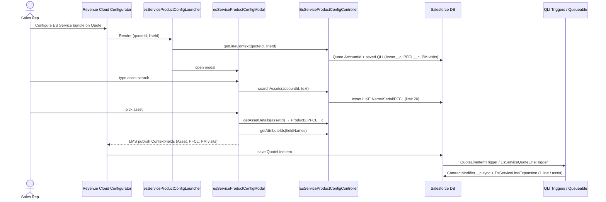

---

## 6. Quote, Contract Modifiers & Approvals

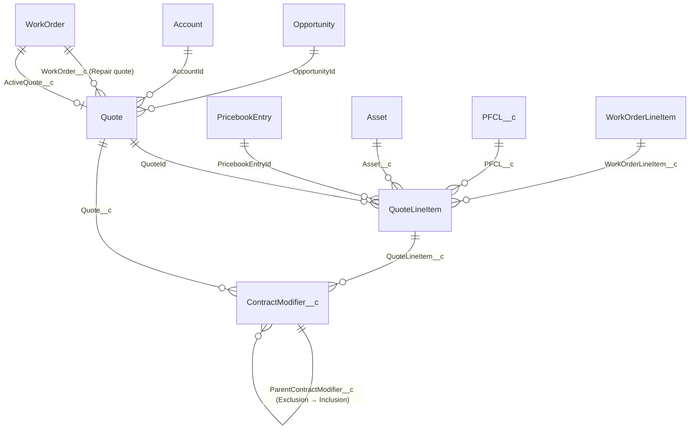

**Quote lifecycle**
- **Created in Sales Connection.** `generateQuote` / `lsGenerateQuote` → `GenerateQuoteController` handles `createQuote`, `copyQuote`, `mergeQuote`, `refreshQuotes` and `getSalesConnectionQuoteUrl`.
- **URL:** `SalesConnectionUrlService` builds `#Quote|id=` URLs from `ExternalSystemEndpoint__mdt`, encrypted with AES-256.
- **Sync back:** `RefreshQuoteSyncService` upserts Quote and QLI on `Quote.SalesConnectionQuoteID__c`.
- **Forecast eligibility (`QuoteService`):** only the **first open HC_Sales quote** (earliest LastModified) is `Forecast_Eligible__c`. It is re-evaluated on update and delete, and can be overridden manually (`updateForecastEligibleQuotes`).

**Approval models**

| Approval | Service | Model |
|---|---|---|
| Deal Desk / BU Leader / Additional | `OppDealApprovalService` (GC-3235) | Parallel. `DealApprovalApprover__c` rows; status rolls up to `DealApprovalStatus__c` (Not Submitted → Pending → Approved / Rejected) with `ApprovalCycleNumber__c` |
| EPP regional | `EppApprovalService` | Sequential, driven by `EPP_Approval_Hierarchy__mdt` |
| Pay Per Click | `PpcCommercialApprovalService` | Commercial approval panel |
| Repair quote | `RepairCenterQuotePreApprovalService` | Auto-approves within the IMS CustomerPreference limit per product line |

---

## 7. Order-to-Fulfilment (CBM)

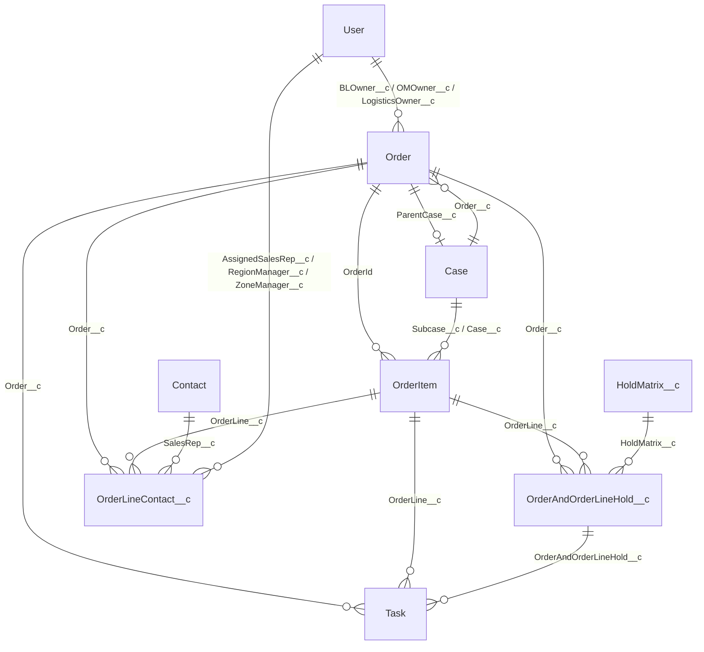

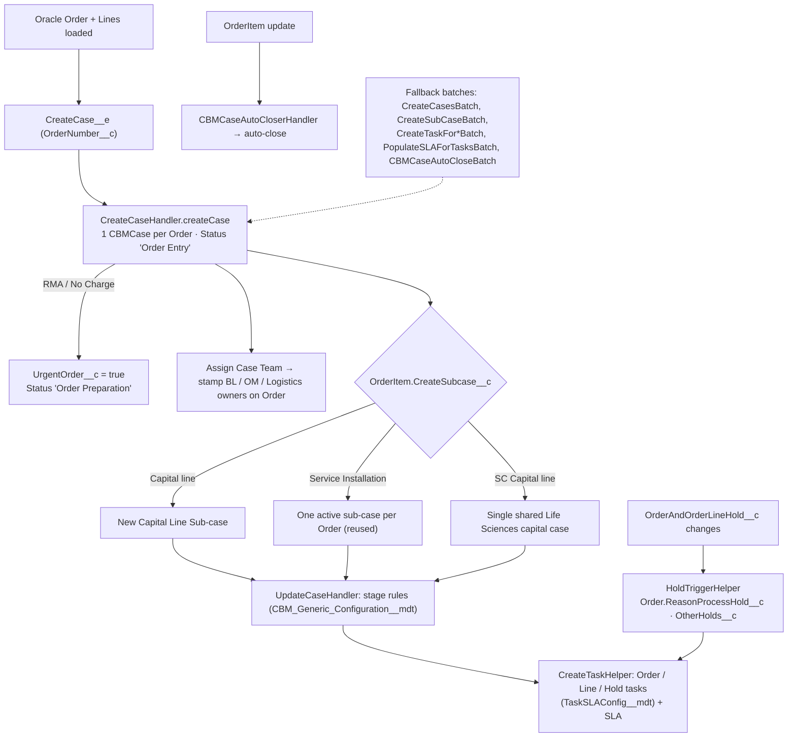

**`OrderLineContact__c` has two roles:**
- **(a) Order-line sales rep.** It rolls up rep names to `Order.SalesRepsAM__c` (Capital), `SalesRepsIPM__c` (Install) and `SalesRepsASM__c` (Service), and region names to `Region__c`.
- **(b) TAS staging row.** It holds `TASAddressId__c`, `TerritoryID__c`, `HRISSalesRepId__c` and `DeltaScenario__c`. `TASTeamAccessBatch` matches the row to `Account.OracleAddressId__c` and adds or removes "TAS Assigned" AccountTeamMembers.

---

## 8. Repair Center (Depot Repair)

> `RepairCenter__c` and `Rack__c` are **lookups to the standard `Location` object** (`LocationType` = Repair Center / Rack), not custom objects. `Vendor__c` is a lookup to Account, and `VendorWorkOrder__c` is a self-lookup on WorkOrder.

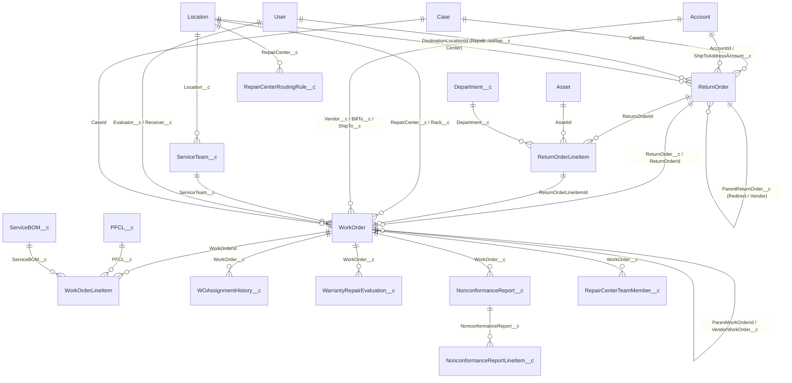

**Work order status lifecycle**

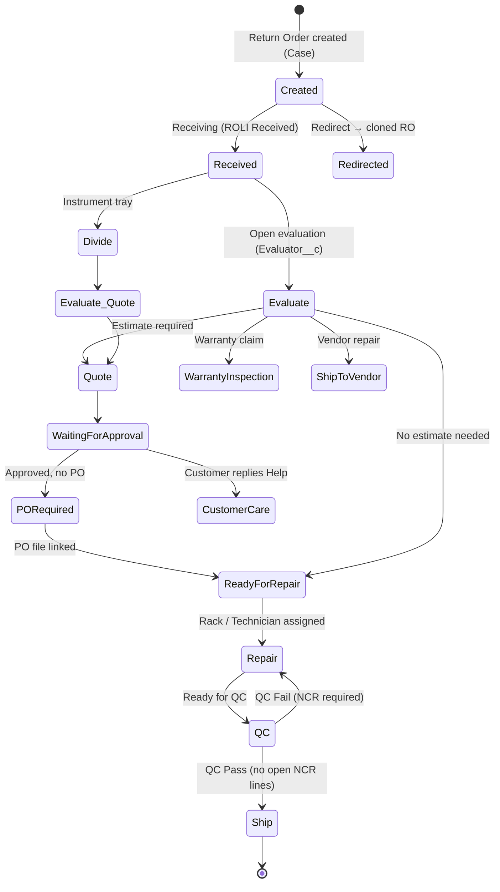

**Key rules**
- **Routing.** `RepairCenterRoutingRule__c` matches on Operating Unit, Product Line, Sub-line, Manufacturer, Device Type, Model and Ship State to pick the repair center.
- **Return Order split.** Return Orders are split by repair center, non-sterilized items, Mod Request, `MaxItemsPerReturn__c` and `ReturnOrderType__c` (Serialized / Instruments / Other).
- **Shop-floor blocks.** Rack and technician assignment are blocked in Received, Divide, Evaluate, Evaluate & Quote and Quote. Each assignment is logged in `WOAssignmentHistory__c`.
- **Ship date.** `ScheduledShipDate__c` = `TurnTime__c` + the Repair Center's `OperatingHours` holidays.
- **Customer preferences.** "Photos required" is enforced at evaluation. "Carrier Service level" sets the FedEx service level.

---

## 9. Field Service (ES / IMS)

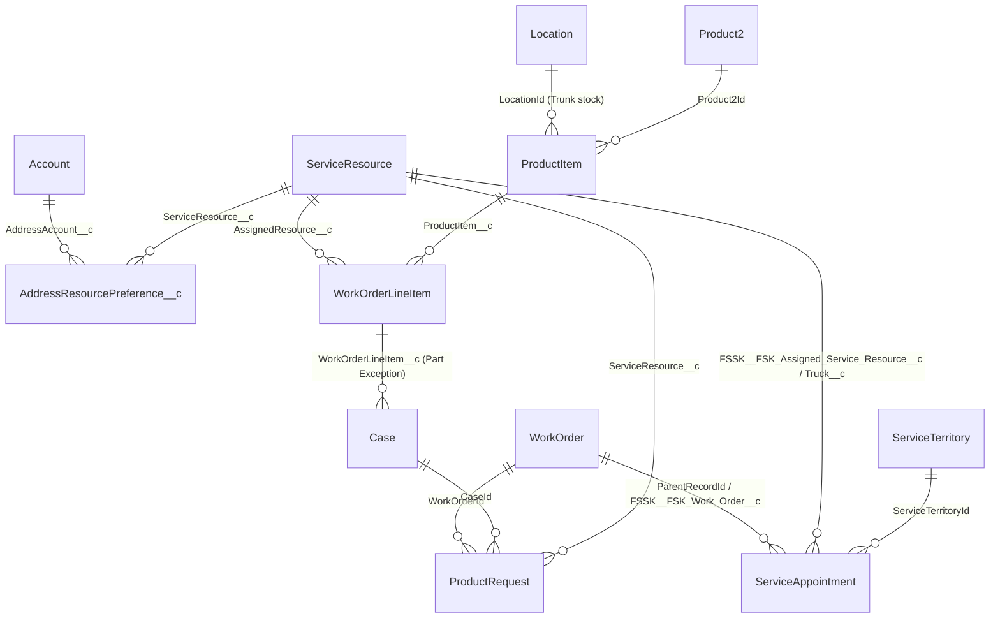

- **IMS debrief** (`WoDebriefIMSController`):
  - Creates a truck ServiceAppointment linked by a "Same Start" dependency.
  - Site visit review is blocked while any child WO is open or any line is still flagged `SendToRepairCenter__c`.
  - Flagged lines feed a site-visit Return Order.
- **ES debrief:**
  - Allowed units and billing type.
  - Trunk-stock ProductItem lookup.
  - Skill check.
  - Rate list and regional expenses.
  - Asset inspection.
  - Part exception Cases.
- **Photos.** `MobileDevicePictureLink__e` attaches photos, and microscope capture attaches images to WOLIs.
- **Realignment.** `ServiceAppointmentRealignmentBatch` flags territory and preferred-resource conflicts.
- **Skills.** `SummitSkill__c` staging records sync to WorkType, Skill and SkillRequirement.
- **Assets.** `AssetPendingInactivationTrigger` blocks inactivation while open WOs or active contract lines exist.

---

## 10. CSC Visits, Team Members & Access

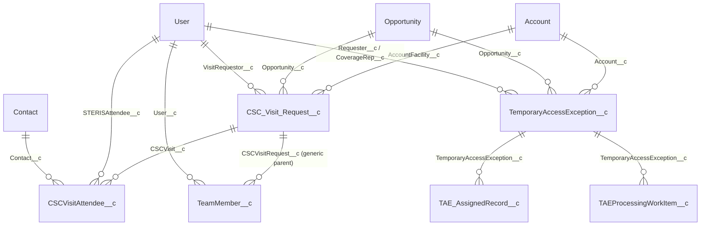

- **CSC visit statuses:** Requested → Approved → Confirmed, with side states Postponed and Cancelled.
- **CSC visit rules:**
  - Each location (ORC / IMS / OSV) has its own calendar.
  - An Approved visit holds its date for 10 days.
  - A Confirmed visit sends a confirmation email and creates an all-day Event.
  - `Opportunity.CSCVisitRequestCount__c` is recounted on insert, delete and undelete.
- **TeamMember__c** works with any parent object: the parent lookup is found by describe. Only one user is allowed per parent, and access is given through Apex sharing (row cause `TeamMember__c`).
- **TAE pipeline:**
  - Steps: Orchestrator → Creation → Grant/Revoke → HandbackDraft → Cleanup.
  - Grant happens on the start date: the CoverageRep is added as a "Temporary Assignment" team member.
  - Revoke happens on the end date.
- **Inactive sales users.** `InactiveUserTeamCleanup` writes assignment history and removes ATM/OTM records.

---

## 11. Integration Inventory

| # | Class / Entry point | Direction | Endpoint / Setting | Objects |
|---|---|---|---|---|
| 1 | `OraclePricingGateway` ← `OraclePricingService`, `OraclePricingFlowQueueable` | Out | `callout:Oracle_Pricing_API/getPricingDetail/` | OLI, QLI, WorkOrder pricing |
| 2 | `OracleUnitPricingGateway` (+Part2) | Out (Boomi) | `SF_GET_UNIT_PRICE`, `SF_GET_PROSPECT_PRICE` | QLI, `Contract__c` (prospect path mocked) |
| 3 | `GenerateQuoteRefreshGateway`, `RefreshQuoteSyncService` | Out/In | `SF_REFRESH_QUOTE` | Quote, QLI |
| 4 | `SalesConnectionUrlService` / `EncryptionService` | Out (deep link) | `ExternalSystemEndpoint__mdt` | Quote |
| 5 | `OpportunityQuoteContextService` | **In** REST | `POST /v1/opportunity-quote-context` | Opportunity, Quote |
| 6 | `ScOpportunityQuoteEventGateway` | Out | `SF_SC_OPPORTUNITY_QUOTE_EVENTS` | Opportunity / Quote forecast |
| 7 | `ProspectAccountScSyncGateway` | Out | `SF_PROSPECT_ACCOUNT_SC_SYNC` | Prospect Account |
| 8 | `TasAssignmentGateway`, `AccountCustomerTasGateway` (+ Queueables) | Out (Boomi TAS) | `SF_PROSPECT_TAS`, `SF_CUSTOMER_TAS` | Account, Lead, OrderLineContact__c, AccountTeamMember |
| 9 | `TASTeamAccessBatch` / `LSTASTeamAccessBatch` | Batch | — | OrderLineContact__c → AccountTeamMember |
| 10 | `ProductRequestsService` | Out | `ORACLE_CREATESALESORDER_DEV` | ProductRequest → Oracle Sales Order |
| 11 | `ProductRequestsDpcService` | Out | `DPC_GETPRODUCTINSTANCE_DEV` | Asset / product instance |
| 12 | `FedExService`, `VendorFedExShipmentService` | Out | `FEDEX_LABEL` | ReturnOrder, WorkOrder tracking |
| 13 | `PrinterService` | Out | `STERIS_PRINT_LABEL_ZEBRA_DEV` | WorkOrder bin tags |
| 14 | `ConnectCareRestService` | **In** REST | `/connectcare/v1/return-orders` (POST), `/assets` (GET) | Account, Asset, ReturnOrder |
| 15 | `WorkOrderLineItemFileThumbnailRest` | **In** REST | `GET /woli/v1/file-thumbnail/*` | WOLI files |
| 16 | `CreateCase__e` → `CreateCaseEventTrigger` | **In** Platform Event | — | Order → Case / Task |
| 17 | `DataMigrationTriggerOn*` (gated by label `ExecuteTrigger`) | **In** data load | — | Account, Address → Location, Order, OrderItem, Product |
| 18 | `SummitSkillProcessor` | In (staging, Batch + Schedulable) | `SummitSkill__c` | WorkType, Skill |
| 19 | `EmailInboundHandler` / `EmailInboundService` | In (Email Service) | — | WorkOrder (repair quote replies) |
| 20 | `BoomiTasClient` | Out (unused) | `callout:Boomi_TAS_Named_Credential` | — (returns a mock, no callers) |

Most outbound calls go through the **ShoutOut `SO_Callout` framework**, where each operation name above is a setting. That framework and Nebula `Logger` are **not in this repo**.

---

## 12. Master Relationship Reference Table

| Child object | Lookup field | Parent object |
|---|---|---|
| Account | ParentId | Account |
| Account | Price_List__c | Price_List__c |
| Account | IDN_Account__c, GPO_Account__c | Account |
| AccountAccountRelationship__c | ParentAccount__c, ChildAccount__c | Account |
| AccountDepartment__c | Account__c, Department__c | Account, Department__c |
| Address | ParentId / Customer__c | Location / Account |
| Contact | AccountId | Account |
| CustomerPreference__c | Account__c | Account |
| Lead_SLA__c | Lead__c | Lead |
| LeadProduct__c | Lead__c, Product__c | Lead, Product2 |
| Opportunity | AccountId, Pricebook2Id, PrimaryContact__c, Address__c, RelatedProjectOpportunity__c | Account, Pricebook2, Contact, Address, Opportunity |
| OpportunityLineItem | OpportunityId, PricebookEntryId, Product2Id | Opportunity, PricebookEntry, Product2 |
| OpportunityContactRole / OpportunityTeamMember | OpportunityId | Opportunity |
| Sample__c | RelatedOpportunity__c | Opportunity |
| DealApprovalApprover__c | Opportunity__c, Approver__c | Opportunity, User |
| Project__c | Account__c, PrimaryCase__c, ProjectTemplate__c | Account, Case, template |
| ProjectCases__c | Project__c, Case__c | Project__c, Case |
| Free_Goods_Task_Product__c | Account__c, Product__c (TaskId__c = text) | Account, Product2 |
| Product2 | PFCL__c, PSAM__c | PFCL__c, PSAM__c |
| PricebookEntry | Pricebook2Id, Product2Id | Pricebook2, Product2 |
| PFCL__c | Parent__c | PFCL__c |
| ServiceBOM__c | PFCL__c | PFCL__c |
| PFCLServiceBOM__c | PFCL__c, ServiceBOM__c | PFCL__c, ServiceBOM__c |
| Asset | AccountId, Product2Id | Account, Product2 |
| Quote | OpportunityId, AccountId, WorkOrder__c | Opportunity, Account, WorkOrder |
| QuoteLineItem | QuoteId, PricebookEntryId, Asset__c, PFCL__c, WorkOrderLineItem__c, TopLevelWorkOrder__c | Quote, PBE, Asset, PFCL__c, WOLI, WorkOrder |
| ContractModifier__c | QuoteLineItem__c, Quote__c, ParentContractModifier__c | QLI, Quote, ContractModifier__c |
| Order | ParentCase__c, BLOwner__c, OMOwner__c, LogisticsOwner__c | Case, User |
| OrderItem | OrderId, Subcase__c, Case__c | Order, Case |
| OrderAndOrderLineHold__c | Order__c, OrderLine__c, HoldMatrix__c | Order, OrderItem, HoldMatrix__c |
| OrderLineContact__c | Order__c, OrderLine__c, SalesRep__c, AssignedSalesRep__c, RegionManager__c, ZoneManager__c | Order, OrderItem, Contact, User |
| Case | Order__c, WorkOrderLineItem__c | Order, WOLI |
| Task | WhatId, Order__c, OrderLine__c, OrderAndOrderLineHold__c | Case, Order, OrderItem, Hold |
| ReturnOrder | CaseId, AccountId, ContactId, SalesRep__c, DestinationLocationId, ParentReturnOrder__c, ShipToAddressAccount__c | Case, Account, Contact, User, Location, ReturnOrder, Account |
| ReturnOrderLineItem | ReturnOrderId, AssetId, Product2Id, Department__c, Contact__c | ReturnOrder, Asset, Product2, Department__c, Contact |
| RepairCenterRoutingRule__c | RepairCenter__c | Location |
| WorkOrder | ReturnOrder__c, ReturnOrderLineItemId, ParentWorkOrderId, VendorWorkOrder__c, RepairCenter__c, Rack__c, Vendor__c, BillTo__c, ShipTo__c, ServiceTeam__c, Evaluator__c, Receiver__c, EstimateContact__c, Department__c, AssetId, CaseId, ActiveQuote__c | ReturnOrder, ROLI, WorkOrder, Location, Account, ServiceTeam__c, User, Contact, Department__c, Asset, Case, Quote |
| WorkOrderLineItem | WorkOrderId, VendorWorkOrder__c, Vendor__c, Product__c, ProductItem__c, AssignedResource__c, PFCL__c, ServiceBOM__c, TopLevelWorkOrder__c | WorkOrder, Account, Product2, ProductItem, ServiceResource, PFCL__c, ServiceBOM__c |
| WOAssignmentHistory__c | WorkOrder__c, Rack__c, Technician__c | WorkOrder, Location, User |
| WarrantyRepairEvaluation__c | WorkOrder__c, WorkOrderLineItem__c, ParentWorkOrder__c, RelatedReturnOrder__c, TechnicianPerformingWork__c | WorkOrder, WOLI, ReturnOrder, User |
| NonconformanceReport__c | WorkOrder__c, WorkOrderLineItem__c, Account__c, RepairCenter__c, Asset__c, Product__c | WorkOrder, WOLI, Account, Location, Asset, Product2 |
| NonconformanceReportLineItem__c | NonconformanceReport__c, InitiatedBy__c, QualityInspector__c | NCR, User |
| RepairCenterTeamMember__c | WorkOrder__c, WorkOrderLineItem__c, Person__c | WorkOrder, WOLI, User |
| ServiceTeam__c | Location__c | Location |
| ServiceAppointment | ParentRecordId, FSSK__FSK_Work_Order__c, FSSK__FSK_Assigned_Service_Resource__c, Truck__c | WorkOrder, ServiceResource |
| AddressResourcePreference__c | AddressAccount__c, ServiceResource__c | Account, ServiceResource |
| ProductRequest | WorkOrderId, CaseId, AssetId, ServiceResource__c | WorkOrder, Case, Asset, ServiceResource |
| ProductItem | LocationId, Product2Id | Location, Product2 |
| CSC_Visit_Request__c | AccountFacility__c, Opportunity__c, VisitRequestor__c | Account, Opportunity, User |
| CSCVisitAttendee__c | CSCVisit__c, STERISAttendee__c, Contact__c | CSC_Visit_Request__c, User, Contact |
| TeamMember__c | User__c + dynamic parent lookup | User, any |
| TemporaryAccessException__c | Account__c, Opportunity__c, Requester__c, CoverageRep__c | Account, Opportunity, User |
| TAE_AssignedRecord__c / TAEProcessingWorkItem__c | TemporaryAccessException__c, Account__c, Opportunity__c | TAE, Account, Opportunity |

---

## 13. Business Analysis

### 13.1 Business capabilities

| Capability | Business value | Primary users | Maturity (from code) |
|---|---|---|---|
| Customer master and IDN/GPO hierarchy | One view of contracting entities, facilities and ship-tos; drives pricing and territory | Sales Ops, Contracting | **High:** relationship engine and roll-ups built |
| Territory assignment (TAS) | Automatic account and lead ownership, plus coverage for reps and managers | Sales Ops | **High:** delta-based, with retry and failure notifications |
| Opportunity and forecasting | Pipeline accuracy: one forecast-eligible quote, confidence banners, closure gates | Sales Reps, Managers | **High** |
| Product selection and pricing | Faster, compliant line entry with Oracle contract pricing | Sales Reps | **Medium:** split across many pickers; real-time Oracle pricing |
| Service contract configuration (ES/IMS) | Asset-based coverage quoting (model quantity, inclusions and exclusions, PM visits) | Service Sales | **Low–Medium:** POC/demo pricing hooks remain |
| Deal and EPP approvals | Margin governance | Deal Desk, BU Leaders | **High** |
| Order-to-Case orchestration (CBM) | Every Oracle order is tracked with SLA tasks, hold visibility and auto-close | Customer Care, Order Mgmt, Logistics | **High:** event-driven with batch fallback |
| Depot repair | Inbound logistics, evaluation, quoting, shop-floor routing, QC and shipping | Repair Center techs, coordinators | **High:** largest code area (`WorkOrdersService` is over 7k lines) |
| Field service debrief | Accurate billing, parts consumption and skills compliance | Field Engineers | **Medium–High** |
| Customer Solutions Center visits | Customer experience and pipeline influence | Sales, CSC coordinators | **High** |
| Temporary access (TAE) | Controlled, time-boxed record access | Sales Ops | **High** |
| Dealer portal | Partner opportunity registration | Dealers | **Medium** |

### 13.2 Value stream: Lead to Cash to Service

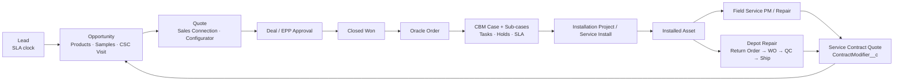

### 13.3 Key business rules (summary)

1. **Forecasting:** only one open HC_Sales quote per opportunity is forecast-eligible. An opportunity cannot close while forecast-eligible quotes are still open.
2. **Project opportunities:**
   - Proposal and Commit need at least one linked commercial opportunity.
   - The project cannot close while child opportunities are open.
   - Closed Won needs a Closed Won child.
   - Closed Lost is blocked if any child is Closed Won.
3. **EPP:**
   - An EPP opportunity cannot leave Draft while an elevated consumable has no EPP price.
   - Only EPP-eligible, active products in the right currency can be selected.
4. **Primary contact:** each opportunity has exactly one primary contact role, kept in sync with `PrimaryContact__c`.
5. **Samples:** only the opportunity owner or a team member can create them.
6. **Order holds:** active hold reason codes roll up to the Order and drive hold tasks. Inactive holds close their tasks.
7. **Repair:**
   - QC Fail requires an NCR.
   - QC Pass is blocked while any NCR line is open.
   - Shop-floor actions are locked during evaluation and quoting.
8. **Asset inactivation** is blocked while open work orders or active contract lines exist.
9. **TAS outcome** is Assigned, Assignment Missing (creates a Sales Ops task and notification) or Technical Failure (retry).
10. **Lead SLA:** a queue has 8h, Sales Development 2h, and an assigned user 24h (reminder at 48h).

### 13.4 KPIs the data model supports

| Area | KPI | Source fields |
|---|---|---|
| Sales | Win rate, forecast accuracy, quote-to-close time | Opportunity.StageName, Quote.Forecast_Eligible__c, ForecastConfidenceLevel__c |
| Lead management | SLA compliance % | Lead_SLA__c |
| Order mgmt | Order entry to invoice cycle time, hold ageing, task SLA breach | Case status, OrderAndOrderLineHold__c, Task SLA fields |
| Depot repair | Turnaround time vs `TurnTime__c`, quote approval rate, QC first-pass yield, NCR rate | WorkOrder status history, ScheduledShipDate__c / ActualShipDate__c, NonconformanceReport__c |
| Warranty | Repeat-repair rate | WarrantyRepairEvaluation__c |
| Field service | First-time fix, parts usage, realignment conflicts | ServiceAppointment, ProductItem, RealignmentConflict*__c |
| CSC | Visit-to-win influence | CSC_Visit_Request__c ↔ Opportunity |

### 13.5 Gaps and opportunities

- **Unified Product Browser.** Product search is implemented about 6 times with different filters (EPP, lost business, lead, free goods, configurator, trunk stock). A shared `productSearch` service plus one reusable LWC would keep eligibility rules consistent and cut maintenance.
- **Configurator pricing.** `EsServiceDemoPricePostHook` and `configPocModal` are POC/demo code. The PFCL pricing decision table is still to be built.
- **Ship / close step.** No Apex sets a final ship or close status for repair WOs. Confirm whether Flow or Oracle owns it.
- **Stub services.** The Product2, PFCL, ServiceBOM, Account, Department and Asset handlers are stubs. Either remove them or implement the planned logic.

---

## 14. Technical Findings & Risks

| Severity | Finding | Location |
|---|---|---|
| High | `OrderLineContactTrigger1` (marked "To be deleted") duplicates `OrderLineContactTrigger`, so the handler runs **twice** per DML | `triggers/OrderLineContactTrigger1.trigger` |
| High | `AutomationControl.isTriggerEnabled` is called, but **no `AutomationControl` class exists** in the repo; it fails to compile unless it lives elsewhere in the org | `OrderLineContactTriggerHandler`, `AccountDepartmentTriggerHandler`, service handlers |
| Medium | `AccountTriggerHandler` branches HC vs LS on `newAccounts[0].CustomerClassCode__c` only, so mixed batches are misrouted | `classes/AccountTriggerHandler.cls` |
| Medium | Field-name mismatch: the LWC uses `PFCL_Name__c` / `Requested_Number_of_PM_Visits__c` but Apex uses `PFCLName__c` / `RequestedNumberofPMVisits__c`. Check whether these are context-attribute names or a bug | `lwc/esServiceProductConfigLauncher` |
| Medium | Several triggers have no bypass guard (`OrderItemTrigger`, `CreateCaseEventTrigger`, `ContactDuplicatePrevention`), and EmailMessage has 4 triggers | `triggers/` |
| Medium | PO-link automation in `RepairCenterCdlTrigger` is commented out (GW-375) | `triggers/RepairCenterCdlTrigger.trigger` |
| Low | Unused or dead code: `BoomiTasClient` (mock, no callers), `FreeGoodsTaskProductController`, `configPocModal` (hard-coded attribute Id `11nOu00000ODPpBIAX`) | `classes/`, `lwc/` |
| Low | `imsProductConfigurator` and `modelQtyCoverage` are near-duplicates | `lwc/` |
| Info | External dependencies not in the repo: ShoutOut `SO_Callout`, Nebula `Logger`, FSSK / FSL managed packages, custom metadata types | — |

**Trigger framework.** Kevin O'Hara `TriggerHandler` with `TriggerControl` (recursion guard per object and context). Bypass comes from the hierarchy setting `Automation_Setting_Trigger__c` (`<Object>TriggerByPass__c`, `disableAll__c`). Layering is fflib-style (Selector / Service / Domain).

---

## 15. Glossary

| Term | Meaning |
|---|---|
| **CBM** | Customer / Case-Based Management: the Oracle order-tracking case model |
| **PFCL** | Product Family Classification: the hierarchical product family (`PFCL__c`) |
| **PSAM** | Product sub-group classification used to derive `ProductSubGroupDetailName__c` |
| **Service BOM** | Bill of materials for service parts per PFCL |
| **IDN / GPO** | Integrated Delivery Network / Group Purchasing Organization (contracting parents) |
| **EPP** | Equipment Placement Program (capital placed against a consumables commitment) |
| **TAS** | Territory Assignment System (via Boomi) |
| **TAE** | Temporary Access Exception |
| **CSC** | Customer Solutions Center (visit program) |
| **ES / IMS** | Equipment Service / Instrument Management Services (field service lines) |
| **NCR** | Nonconformance Report (quality) |
| **OLI / QLI / WOLI / ROLI** | Opportunity / Quote / Work Order / Return Order Line Item |
| **HC / SC (LS)** | Healthcare / Life Sciences customer class |
| **DPC** | Digital Parts Catalog |
